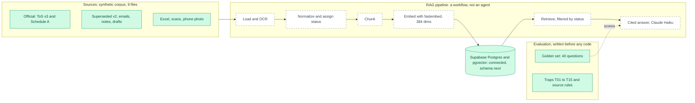

# Architecture v0.1: Foundations

**Date:** 2026-11-11 · **Status:** corpus, eval set and database connection exist; the pipeline is planned.

## What changed since the start
Nothing existed. We added the corpus, the golden set and traps, a Python 3.12 environment with dependencies, and a working Supabase connection.

## Decisions behind this version
See `decisions.md`: ADR-001 to ADR-008.

## Next version (v0.2)
Schema applied, loaders and chunking built, first documents indexed. The dashed boxes on the left of the pipeline turn solid.