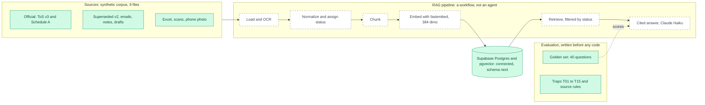

# Architecture v0.1: Foundations

**Date:** 2026-11-11 · **Status:** corpus, eval set and database connection exist; the pipeline is planned.

## What changed since the start
Nothing existed. We added the corpus, the golden set and traps, a Python 3.12 environment with dependencies, and a working Supabase connection.

## Decisions behind this version
See `decisions.md`: ADR-001 to ADR-008.

## Next version (v0.2)
Schema applied, loaders and chunking built, first documents indexed. The dashed boxes on the left of the pipeline turn solid.

---

---

## How to read this document

This page is a snapshot of the architecture at the **start of the project, on 11 Nov 2026**. It is version 0.1, so it shows the foundations only. Later versions (v0.2 and on) show what was built since. The full reasoning behind each choice is in `decisions.md`.

### What is being built

AOP (Arcaence Online Project) is a support assistant for a fictional web platform, "Arcaence Online". It will answer customer questions about the platform's terms, fees and policies. Every answer must cite the exact clause it came from. The first phase, shown here, is a **RAG service**: a program that finds the right passages in company documents and writes an answer from them only.

### How to read the diagram

- **Green boxes** exist today. **Dashed boxes** are planned.
- **Left:** the source documents. **Top:** the evaluation set. **Middle:** the pipeline that processes documents and answers questions. **Right:** the database.
- Arrows show data flowing. The dotted line labelled "scores" means the evaluation set will measure the pipeline's answers.

### The three blocks

1. **Sources.** Nine synthetic files in five formats. They are deliberately messy: a current terms document and a superseded one, an unpublished draft, emails and notes that contradict the policy, a spreadsheet, a scan, and a phone photo. The mess is the test, because real company documents look like this.
2. **Evaluation.** A golden set of 40 questions and 15 traps, written **before any code**. A trap is a question where a tempting wrong source exists, for example an old policy that gives a different refund window. Every later change is scored against this set.
3. **RAG pipeline.** Load the files (with OCR for images), normalize them and assign each a trust status, cut them into chunks, convert each chunk into numbers that capture its meaning (an embedding), and store them. To answer a question, retrieve the best chunks, **filtered by status first**, and write a cited answer with a language model (Claude Haiku).

The database is **Supabase Postgres with the pgvector extension**. At v0.1 it is connected, and its tables are still to come.

### The decisions behind it

| Decision | What we chose | Why | What it costs |
| --- | --- | --- | --- |
| Workflow, not agent (ADR-002) | The pipeline follows fixed steps in a fixed order. | Predictable, cheap and easy to test. A support answer does not need the model to choose its own path. | Less flexible. Agents are added in a later phase, where choice is needed. |
| Source authority decided by humans | Each document gets a status (approved, superseded, draft, informal) and a rank from 1 to 5, written in a manifest file. | A superseded policy can match a question as well as the current one. Similarity cannot tell old from new. | The manifest must be kept correct by hand. |
| Filter by status before searching | Only approved sources are searched, unless the question asks for history. | A wrong source never gets the chance to win on similarity. | Drafts and old versions are invisible to normal answers. |
| Evaluation first | Golden set and traps before pipeline code. | Every improvement can be measured, and we cannot fool ourselves with a good-looking demo. | A day of work before anything visible exists. |
| Exact facts in tables, not text | Prices go in a SQL table, not searched from document text. | Language models and OCR are approximate. A price must be exact. | Two retrieval paths and a router to build. |
| Stable clause IDs with a verifier | Every clause gets an ID that does not change, and every citation is checked against the list of real IDs. | Models invent plausible citations. Only a check against a real list catches this. | IDs must be assigned and kept stable at ingestion. |
| Local embeddings (fastembed, 384 numbers) | Embeddings are computed on the laptop. | Free, private, and no external service needed. | Lower quality than the largest hosted models. |
| One database for everything | Postgres holds the documents, the chunks, the vectors and the price table. | One system to run, secure and explain. | May need splitting if the data grows large. |
| Safe by construction | Public repo with synthetic data only; secrets in a git-ignored `.env`; a pinned Python environment with `uv`. | A public repo must never leak a secret, and anyone should be able to reproduce the result. | Setup steps are written down, not clicked. |
| Controls designed now, built later | Human review queue, row-level security, prompt-injection defence and least privilege are designed from the start. | They are cheap to design early and expensive to add after the agents exist. | Some design effort with no visible feature. |

### What exists and what does not

**Exists at v0.1:** the corpus, the golden set and traps, a pinned Python 3.12 environment, and a working database connection.
**Planned:** the schema, loaders, chunking, embeddings, retrieval, the answer step and the citation verifier. These appear as built in v0.2 and v0.3.

### Glossary

- **RAG:** retrieval-augmented generation. Find relevant text first, then write the answer from it only.
- **Embedding:** a list of numbers that captures the meaning of a text, so similar texts have similar numbers.
- **pgvector:** a Postgres extension that stores embeddings and finds the nearest ones.
- **OCR:** reading text out of an image.
- **Golden set:** questions with known correct answers, used to score the system.
- **Trap:** a golden-set question built so that a wrong source looks attractive.
- **ADR:** architecture decision record, a short note of what was decided, the alternatives and the trade-off.