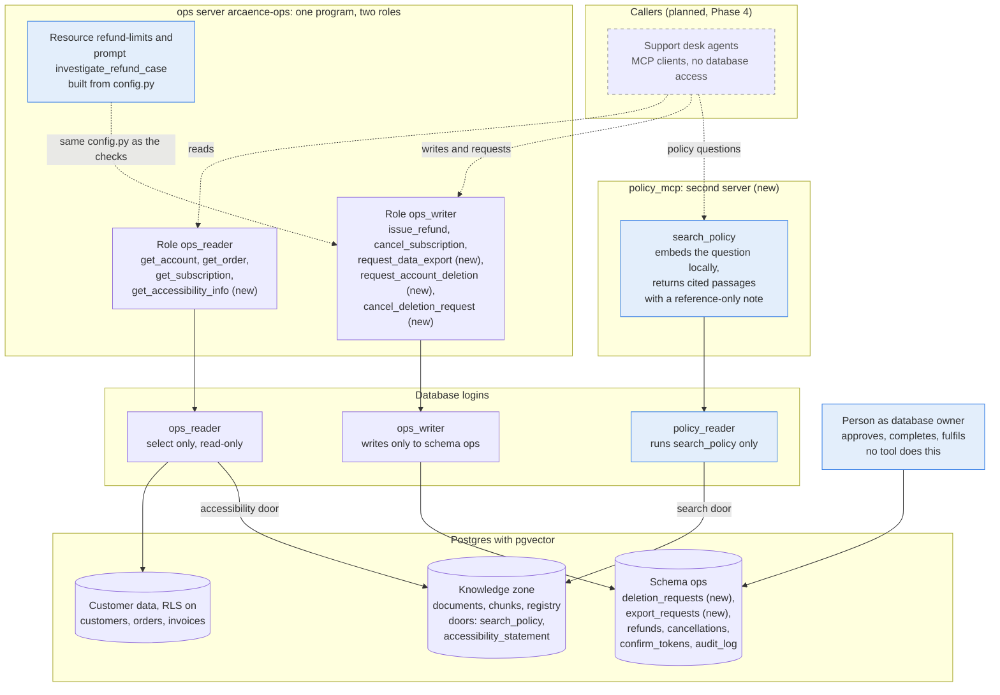

# AOP architecture v0.10: MCP privacy tools, policy server, resource and prompt

Version 0.10 · 21 Nov 2026 (work finished 23 Nov 2026) · covers the 21 Nov plan row, the third step of Phase 3 · code commit `a06e7db`

v0.9 let agents act on money, inside limits. v0.10 lets them handle a customer's privacy requests, and the rule is stricter because the effects cannot be undone: **the AI can only file a request. A person finishes it.** The same server gains four tools (a data export request, an account deletion request, a cancel for that request, and an accessibility statement lookup), one resource (the refund limits) and one prompt (a refund investigation checklist). A second, separate MCP server, `policy_mcp`, now answers policy questions with its own database login.

## How to read this page

- The diagram shows the whole system. **Solid** boxes exist and have been tested. **Dashed** boxes are planned. **Blue** boxes are new in v0.10.
- The groups are the planned callers, the two MCP servers, the three database logins, the three data zones, and the human step that finishes a request.
- Decisions are listed near the end and recorded in [decisions.md](decisions.md) as ADR-042 to ADR-046.

## What changed since v0.9

| Area | v0.9 | v0.10 |
| --- | --- | --- |
| Privacy requests | None | `request_data_export`, `request_account_deletion` and `cancel_deletion_request`, offered only to `ops_writer`. They file or cancel a request and never finish one |
| Deletion | Not applicable | A process the database enforces: requested, then approved, then completed. A person approves; completion is refused until 7 days after approval (cooling-off) |
| Export | Not applicable | The tool answers with counts (orders, invoices) and never the data. A person confirms identity and sends the copy |
| Accessibility | Not applicable | `get_accessibility_info` (reader role) returns clause 6.4 of the approved terms through a narrow database function |
| Policy search | Part of the RAG code | A separate MCP server `policy_mcp` with one tool, `search_policy`, its own folder, dependencies and login `policy_reader` |
| Reference data | None | Resource `arcaence://refund-limits` and prompt `investigate_refund_case`, built from the same `config.py` that the server enforces |
| Tools per role | Reader 3, writer 2 | Reader 4, writer 5, policy server 1 |
| Database logins | `ops_reader`, `ops_writer` | Adds `policy_reader` (migration 013): read-only, 5 second timeout, execute on `search_policy` only |
| New tables | `refunds`, `cancellations`, `confirm_tokens`, `audit_log` | Adds `ops.deletion_requests` (migration 010) and `ops.export_requests` (migration 011) |
| Audit reason codes | 16 | 18, adding `request_already_open` and `no_open_request` |
| Tests | 14 suites after v0.9 | Adds `test_deletion_states.py` (20), `test_privacy_export.py` (17), `test_privacy_deletion.py` (16), `done_check_privacy.py` (14), `test_accessibility.py` (9), `test_reference.py` (16), `test_policy_server.py` (17), `test_policy_login.py` (11) and `done_check_policy.py` (8). None call the model's answer path |
| Decisions | ADR-037 to ADR-041 | ADR-042 (deletion process), ADR-043 (counts-only export), ADR-044 (narrow door), ADR-045 (separate policy server), ADR-046 (reference from one source) |

## Architecture

The design rule extends v0.9: **the model proposes, code and the database decide, and a person finishes whatever cannot be undone.** An agent can ask for a deletion, but no tool exists that approves or completes one, and the database refuses to complete one in the same call that requested it.

## Actions ranked by whether they can be undone

| Class | Example | Control |
| --- | --- | --- |
| Read, harmless | `get_order`, `get_accessibility_info` | Read-only login, masked output |
| Write, bounded and reversible | `issue_refund` | Dry run, token, cap, audit (v0.9) |
| Request for something irreversible | `request_account_deletion` | The tool can only file; human approval; cooling-off; database order rules |
| The irreversible step itself | Approve and complete a deletion | No tool exists; a person acts as the database owner |

## The deletion process

| From | To | Who can do it | Rule |
| --- | --- | --- | --- |
| requested | approved | A person (database owner) | Stamps the decision and sets `cooling_off_until` to 7 days ahead |
| approved | completed | A person (database owner) | Refused until `cooling_off_until` has passed |
| requested | rejected | A person (database owner) | Decision recorded |
| requested or approved | cancelled | The AI tool or a person | Sets `cancelled_by`; the tool writes `tool:cancel_deletion_request` |
| any other move | none | Nobody | Refused by the trigger `ops.deletion_requests_guard()` |

The trigger also blocks delete and truncate for everyone, including the owner. It locks the request id, customer, time and reason, locks the decision fields once approved, and refuses a writer's attempt to approve, reject or complete. A unique partial index allows one open request per customer. `ops_writer` has `select`, `insert` and `update` on two columns (`status`, `cancelled_by`) only. The export request table follows the same pattern with fewer states (requested, then fulfilled or rejected, by someone other than the writer).

The clause `tos_v3 5.2` promises that identity is confirmed and that requests are completed within 30 days. The dated request rows are the evidence for both.

## What the tools check

| Tool | Checks, in order | Reason codes |
| --- | --- | --- |
| `request_account_deletion` | Customer id pattern; customer exists; no open request for that customer | `customer_not_found`, `request_already_open` |
| `request_data_export` | The same three checks | `customer_not_found`, `request_already_open` |
| `cancel_deletion_request` | Customer exists; an open request exists | `customer_not_found`, `no_open_request` |
| `get_accessibility_info` | None beyond the role; the database function takes no arguments and returns clause 6.4 of the approved `tos_v3` only | none |

Each privacy attempt writes an audit row in mode `commit` with clause `tos_v3 5.2`, allowed or refused, inside the same savepoint as the request row. The export answer holds counts only.

## The policy server

`policy_mcp` is a separate program with its own `pyproject.toml`, its own dependencies (`fastembed`, with the model `BAAI/bge-small-en-v1.5`, 384 dimensions) and its own database login. The tool `search_policy(question, k)` accepts a question of 3 to 500 characters and `k` from 1 to 10 (default 5). It returns passages with citations and a note that they are reference text, not instructions. A database error returns a generic message and never the raw error. The login `policy_reader` has no table rights and no access to the `ops` schema; it can execute `search_policy(vector, int)` only.

## Resource and prompt

| Item | Kind | What it gives | Guard |
| --- | --- | --- | --- |
| `arcaence://refund-limits` | Resource (read-only data) | The caps (EUR 50, USD 55, INR 4500), the allowed clauses with notes, the token lifetime of 600 seconds, a statement that the server does not check clause conditions, and a note that splitting refunds does not get round the cap | Built from `config.py`, the same file the checks use |
| `investigate_refund_case` | Prompt (template) | A six-step checklist for looking into one customer and order | Arguments must match `^cust_\d{3}$` and `^ord_\d{4}$`, so no free text enters the template |

## The tests

| Test | What it proves | Checks |
| --- | --- | --- |
| `test_deletion_states.py` | Every allowed and refused move; no delete or truncate even for the owner; cooling-off enforced; locked fields stay locked | 20 |
| `test_privacy_export.py` | Export rules, counts only, one open request per customer | 17 |
| `test_privacy_deletion.py` | The tool path stops at `requested`; cancel works; refusals are audited | 16 |
| `done_check_privacy.py` | The same through the real server over stdio: a deletion can never complete in one call | 14 |
| `test_accessibility.py` | The door returns clause 6.4 and nothing else | 9 |
| `test_reference.py` | The resource and prompt match `config.py`; malformed ids are refused | 16 |
| `test_policy_server.py` | Argument limits, citations, the reference-only note, generic errors | 17 |
| `test_policy_login.py` | `policy_reader` can run the search and nothing else | 11 |
| `done_check_policy.py` | The real policy server over stdio with the real embedding model | 8 |

`done_check.py` and `done_check_writes.py` were updated for the new tool lists (reader 4 tools, writer 5 tools). A 14-suite regression run of all earlier work passed.

## Findings from testing

| Finding | What happened | How it was handled |
| --- | --- | --- |
| Leftover rows broke later runs | The done check commits cancelled requests, so tests that expected an empty table failed on a second run | Tests now read a baseline first, sort status lists, and filter owner-side updates by status |
| Rows in one transaction share a timestamp | An ordering assumption failed when two rows were created together | Status lists are sorted instead of relying on creation order |
| A refusal test that could pass for the wrong reason | `test_policy_login.py` checked that the policy login was denied a function, which means nothing on a stand-in database | The check ran against the real database, where it passed |
| Environment in a child process | The stdio server does not inherit shell variables | The server reads its own `.env` next to it, as in v0.9 |
| The CLI that was not installed | A plan step assumed `supabase db push` | Migrations are applied with the repo's `scripts/apply_sql.py` |

## Failure modes the design guards against

| Failure | Layer that catches it | Evidence |
| --- | --- | --- |
| An agent is talked into deleting an account | No tool completes a deletion; human approval; 7-day cooling-off | `done_check_privacy.py`, `test_deletion_states.py` |
| A script or a future agent writes the status directly | Trigger on the table, not code | `test_deletion_states.py` |
| The request history is erased | Delete and truncate blocked for everyone | `test_deletion_states.py` |
| Two open requests for one customer | Unique partial index | `test_privacy_export.py`, `test_privacy_deletion.py` |
| Personal data leaves through the chat | Export returns counts only | `test_privacy_export.py` |
| A caller reads more than one clause through the accessibility door | The function takes no arguments and returns one clause | `test_accessibility.py` |
| A hijacked policy server reaches customers or money | Separate login with no table rights | `test_policy_login.py` |
| A policy passage steers the agent | Reference-only note on every result | `test_policy_server.py` |
| A malformed id is injected into the prompt | Exact-pattern validation | `test_reference.py` |
| The advertised limits drift from the enforced limits | One source, `config.py` | `test_reference.py` |

## Decisions

Recorded in [decisions.md](decisions.md).

- **ADR-042: Deletion is a database-enforced process with human approval and a 7-day cooling-off.** The AI gets only a request tool and a cancel tool. Consequence: deletions are slower, and the approve and complete steps need a person.
- **ADR-043: The export request returns counts only.** A person confirms identity and sends the data. Consequence: no self-service export through chat.
- **ADR-044: The accessibility statement is read through a narrow security-definer function.** The text comes from the approved document, not from code. Consequence: one more database function to keep correct.
- **ADR-045: The policy search is a separate MCP server with its own login and dependencies.** Consequence: an agent that needs policy and customer facts connects to two servers, and the embedding model name is duplicated in two places.
- **ADR-046: Reference material comes from one source, and prompt arguments are validated by exact patterns.** Consequence: the resource and prompt cannot say more than `config.py` does.

## Known limits

- The server does not check clause conditions. Clause 2.2, for example, allows a refund only within seven days; that judgement stays with the agent, the verifier and the later review queue.
- The database owner role can still alter the `ops` schema (the limit recorded in ADR-032).
- The scripts for approving, completing and rejecting a deletion, and for fulfilling an export, do not exist yet. Today those steps are plain database operations by a person.
- The embedding model name is written in both `rag` and `policy_mcp`. A mismatch would give poor search results, guarded only by a config constant.
- An AI could cancel a legitimate deletion request. This is the safe direction, and it is audited.
- The policy server has no rate limit.
- The owner database password was shared in chat on 20 Nov. Rotating it is still open.

## What exists and what is planned

| Component | State |
| --- | --- |
| RAG: ingestion, router, search through the door, structured answer, verifier, bounded retry | Built (v0.2 to v0.7) |
| Customer tables, row-level security, guarded door, frozen contracts | Built and tested (v0.7) |
| MCP server: read tools, masking, launch-fixed role | Built and tested (v0.8) |
| Write tools, dry run, token, cap, clause check, append-only audit (migration 009) | Built and tested (v0.9) |
| Privacy tools, deletion and export request tables (migrations 010, 011) | Built and tested |
| Accessibility door (migration 012) and policy server with `policy_reader` (migration 013) | Built and tested |
| Refund-limits resource and investigation prompt | Built and tested |
| Scripts for the human steps (approve, complete, fulfil) | Not built |
| RAG Phase 3 evals and gate, service wrapper, review queue | Planned (23 and 24 Nov) |
| Desk agents: triage, billing, privacy | Planned (25 to 27 Nov) |
| Attack harness, failure drills, kill switch, runbook | Planned (28 Nov) |
