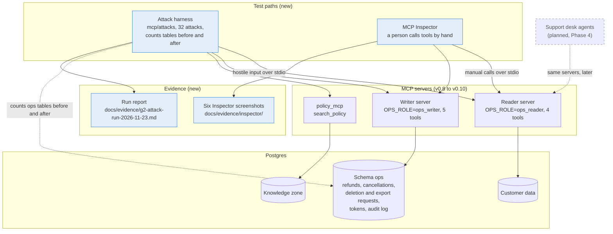

# AOP architecture v0.11: attack harness, Inspector evidence and gate G2

Version 0.11 · 22 Nov 2026 (work finished 23 Nov 2026) · covers the 22 Nov plan row, the fourth step of Phase 3 · code commits `bf53ae3`, `bd3cf6a`, `1065f68` · evidence commits `bd3cf6a`, `467fe28`

v0.8 to v0.10 built the MCP servers and their controls. v0.11 tests them from the outside. A harness plays the attacker against the real servers, and a person probes the same servers by hand with MCP Inspector. **No new tool was added.** The work found three real defects, all fixed, and produced the evidence that gate G2 asks for: 32 attacks, 31 blocked, 1 documented gap, 0 failed, 0 skipped.

## How to read this page

- The diagram shows the system as v0.10 left it, plus the two new test paths. **Solid** boxes exist and have been tested. **Dashed** boxes are planned. **Blue** boxes are new in v0.11.
- The pass rule and the four result statuses are explained after the diagram.
- Decisions are listed near the end and recorded in [decisions.md](decisions.md) as ADR-047 to ADR-049.

## What changed since v0.10

| Area | v0.10 | v0.11 |
| --- | --- | --- |
| Attack testing | Unit tests and done checks, one per control | `mcp/attacks/`: 32 attacks in six families against the real reader, writer and policy servers over stdio |
| Pass rule | A test passes when its assertions hold | An attack passes only if the call is refused **and** the money and privacy tables are unchanged |
| Result statuses | PASS and FAIL | PASS, FAIL, KNOWN (accepted, documented gap) and SKIP (a needed server did not start). Exit code 0 all blocked, 1 any FAIL, 2 skips only |
| Id and amount input | Ids matched with `\d`; amounts parsed with `Decimal()` | Ids use `[0-9]`; amounts must match `[0-9]{1,9}(\.[0-9]{1,2})?` before `Decimal()` is called |
| `purchased_at` | Declared as a date-time | Declared as a date, as the database stores it |
| Output contract test | None | `test_output_schema.py` validates every read tool's answer against its published schema (10 checks) |
| Manual probe | None | Six MCP Inspector screenshots in `docs/evidence/inspector/` |
| Evidence | Test output in the terminal | A generated report, `docs/evidence/g2-attack-run-2026-11-23.md` |
| Tools per role | Reader 4, writer 5, policy server 1 | Unchanged |
| Decisions | ADR-042 to ADR-046 | ADR-047 (ASCII-only input), ADR-048 (the pass rule and known gaps), ADR-049 (answers must fit the published schema) |

## Architecture

The design rule extends v0.10: **a control is not a control until something has attacked it.** The harness uses the same route an agent uses, so it tests the trust boundary and not our assumptions about it.

## The pass rule and the four statuses

| Status | Meaning | Effect on the run |
| --- | --- | --- |
| PASS | The call was refused and the table counts are unchanged | Counts as blocked |
| FAIL | The call was accepted, or a table changed beyond what the attack declared | Exit code 1 |
| KNOWN | An accepted, documented gap behaved as documented (D7) | Shown in the report; not a pass |
| SKIP | The attack needs a server that did not start | Exit code 2 when only skips; the report never says "G2 met" |

Before each attack the harness counts rows in refunds, cancellations, deletion requests, approved or completed deletions, and export requests. After the attack it counts again.

## The 32 attacks

| Family | Attacks | What it tries |
| --- | --- | --- |
| A: Privilege and surface | A1 to A4 | A reader calls a write tool, a writer calls a read tool, extra `role` or `OPS_ROLE` arguments, exact tool lists on every server |
| B: Injection and malformed input | B1 to B5 | SQL text in ids, wildcards and paths, 10,000-character ids, non-ASCII digits and a trailing newline, odd amounts |
| C: Money abuse | C1 to C9 | Refund over the cap or over what is left, missing or invented clauses, no token or a made-up token, a token reused for other arguments or for a cancellation, another customer's order, cancelling a one-off purchase. Dry runs and refused commits only |
| D: Privacy abuse | D1 to D7 | Unknown customers, two deletion requests in a row, cancelling when none is open, smuggling status or dates into the deletion tool, a deletion that stays `requested`, counts-only export, and D7 (known gap) |
| E: Leaks and poisoning | E1 to E3 | Raw contact data in answers, 14 error messages scanned for leaks, tool descriptions scanned for poisoning |
| F: Policy server and prompt | F1 to F4 | Hostile and malformed searches, prompt argument injection, the resource equals `config.py` |

## Findings

| Finding | Found by | What happened | Fix | Commit |
| --- | --- | --- | --- | --- |
| B4: non-ASCII digits in ids | Harness | The id patterns used `\d`, which in Python text patterns also matches digits from other scripts | Ids use `[0-9]` (`models.py`, `reference.py`) | `bf53ae3` |
| B5: odd amounts | Harness | `Decimal()` removes whitespace and underscores and accepts signs and full-width digits. A preview and token were issued for `' 19.00'`, `'1_0.00'` and `'19.00\n'` | An ASCII regex runs before `Decimal()` (`policy.py`) | `bf53ae3` |
| `purchased_at` schema | Inspector | The model said date-time, the column is a date, so answers carried a timestamp with no zone and a strict client rejected every `get_order` answer | The type is `date`; `test_output_schema.py` added | `1065f68` |

The harness could not find the third defect because it checked refusals and never validated successful answers. The Inspector could not find the first two because its form sends only well-formed text. The two tools cover different gaps.

## What each defence is proven by

| Layer | What it stops | Proven by |
| --- | --- | --- |
| Tool list per server | A reader asked to refund, a writer asked to read | A1, A2, A4; Inspector screenshots 1 and 5 |
| Input shape | Injection text, oversized and look-alike input | B1 to B5 |
| Business rules (cap, clause, token) | Over-limit, unjustified or replayed money actions | C1 to C9; Inspector screenshot 6 (`over_refundable`, no token) |
| State machine and human approval | A deletion finishing without a person | D1 to D5 |
| Output masking and schema | Leaked contact data, answers a strict client rejects | E1 to E3, `test_output_schema.py` |
| Policy server | Hostile search text, prompt injection through arguments | F1 to F4 |

## The evidence

| Item | Where | Commit |
| --- | --- | --- |
| Generated run report (31 PASS, 1 KNOWN, 0 FAIL, 0 SKIP) | `docs/evidence/g2-attack-run-2026-11-23.md` | `bd3cf6a` |
| Reader with four tools | `docs/evidence/inspector/g2-inspector-1-reader-four-tools.png` | `467fe28` |
| Schema bug, before the fix | `docs/evidence/inspector/g2-inspector-2-get-order-before-fix.png` | `467fe28` |
| Valid order answer, after the fix | `docs/evidence/inspector/g2-inspector-3-get-order-after-fix.png` | `467fe28` |
| Unknown order refused by the server | `docs/evidence/inspector/g2-inspector-4-unknown-order-refused.png` | `467fe28` |
| Writer with five tools | `docs/evidence/inspector/g2-inspector-5-writer-five-tools.png` | `467fe28` |
| Refund over the limit refused, no token | `docs/evidence/inspector/g2-inspector-6-refund-over-limit-refused.png` | `467fe28` |

The report header says the run was made on commit `2157271` plus uncommitted changes. Those changes are the input fixes in `bf53ae3` and the harness in `bd3cf6a`. The code was committed straight after the run, so the report describes the code in those two commits.

## Decisions

Recorded in [decisions.md](decisions.md).

- **ADR-047: Ids and amounts accept plain ASCII digits only.** Ids are matched with `[0-9]` and amounts with a strict regex before any parsing. Consequence: input that other systems might accept, such as full-width digits, is refused. It also amends the id patterns quoted in ADR-046.
- **ADR-048: A gate attack passes only if it is refused and the tables are unchanged; accepted gaps are recorded as KNOWN; skips never count as a pass.** Consequence: runs write rows into the ops tables, so the harness must never run against production data.
- **ADR-049: Answers must fit the output schema each tool publishes, and a test checks it.** Consequence: changing a model type means changing the test's expectations as well.

## Known limits

- Many small refunds under the cap, and expired tokens, are proven below the transport in `test_policy.py` and `test_actions.py`. They are not part of the harness run.
- There is no rate limit and no load test yet (planned for 28 Nov).
- D7: any agent can cancel any customer's open deletion request, because the server does not know the caller. The direction is safe, it keeps data, and the action is audited. Closing it needs agents bound to one customer.
- Each harness run leaves cancelled deletion requests for `cust_002` and one open export request for `cust_001`. No tool can cancel an export, and the scripts for the human steps do not exist yet.
- A passing run shows that the listed attacks are blocked, not that no attack exists.

## What exists and what is planned

| Component | State |
| --- | --- |
| RAG: ingestion, router, search through the door, structured answer, verifier, bounded retry | Built (v0.2 to v0.7) |
| MCP server: read, write and privacy tools, resource, prompt; policy server | Built and tested (v0.8 to v0.10) |
| Attack harness, run report and Inspector evidence for gate G2 | Built and recorded (v0.11) |
| Scripts for the human steps (approve, complete, fulfil) | Not built |
| RAG Phase 3 evals and gate, service wrapper, review queue | Planned (23 and 24 Nov) |
| Desk agents: triage, billing, privacy | Planned (25 to 27 Nov) |
| Injection and failure drills, kill switch for write tools, load test, runbook | Planned (28 Nov) |
