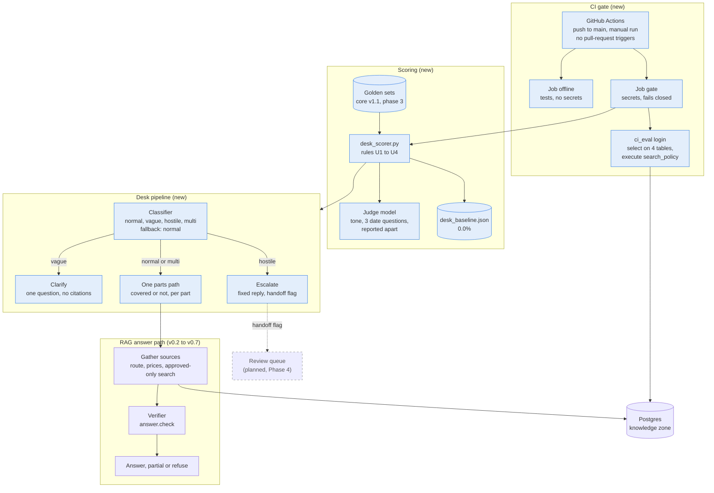

# AOP architecture v0.12: Phase 3 evals, the desk pipeline and the CI gate

Version 0.12 · 23 Nov 2026 · covers the 23 Nov plan row, RAG Phase 3 · code commits `ff2e0d8`, `f5873b5`, `784f79d`, `ab5f5c2`, `6db1a9a`, `c521e7a`, `63ee68d`, `4245eba` · CI run #4 green

v0.11 tested the MCP servers from the outside. v0.12 does the same for the answer path. RAG Phase 3 adds 30 vague, angry, multi-part and desk-style questions, a classifier that sorts every message before retrieval, a desk pipeline that answers, asks, escalates or answers in parts, a scorer that needs no model to decide pass or fail, and a GitHub Actions gate that fails the build when the unsupported-claim rate rises. **The unsupported-claim rate on Phase 3 went from 23.3% on the old path to 0.0% on the desk.**

## How to read this page

- The diagram shows the answer path as v0.7 left it, plus the new classifier and the new test and CI paths. **Solid** boxes exist and have been tested. **Dashed** boxes are planned. **Blue** boxes are new in v0.12.
- The four message kinds and the scoring rules are explained after the diagram.
- Decisions are listed near the end. They will be recorded in [decisions.md](decisions.md) as ADR-050 to ADR-054.

## What changed since v0.11

| Area | v0.11 | v0.12 |
| --- | --- | --- |
| Golden sets | Core set v1.1 (76 rows) | Adds `golden_set_phase3.csv`, 30 rows (Q41 to Q70), as a new file. The older files are never edited and a changelog records every change |
| Message handling | Every message took one answer path | A classifier labels each message normal, vague, hostile or multi before retrieval |
| Behaviours | Answer or refuse | Answer, clarify (one question), escalate (fixed reply and a handoff flag), partial (covered parts answered, the rest in fixed wording) |
| Risky sentences | Written by the model | The hostile reply and the wording for uncovered parts are fixed text in code |
| Answer path | One answer per question | One parts path for normal and multi messages: the model decides only whether each part is covered, and covered parts need verified citations |
| Scoring | Judge model plus checks | Rules first (`desk_scoring.py`); judges only for tone and for three date questions, reported apart from the gate |
| Judge check | None | A blind spot-check of 20 rows: 0 disagreements |
| CI | None | `eval-gate.yml` runs the desk against Phase 3 and fails if the unsupported-claim rate is above the stored baseline (0.0%) |
| CI database access | Not applicable | A dedicated read-only login, `ci_eval` (migration 014), proven read-only by `check_ci_role.py` |
| Decisions | ADR-047 to ADR-049 | ADR-050 to ADR-054 |

## Architecture

The design rule: **let models do the work that needs language, and let code own every sentence and every decision that carries liability.** The model labels, reads and splits. Code writes the hostile reply, the uncovered-part wording, the scoring and the verdict on the build.

## The four message kinds

| Label | What it is | Behaviour | Scored as |
| --- | --- | --- | --- |
| normal | One topic, with or without extra detail | Parts path: answer, or partial if a part is not covered | Answer, partial or refuse as expected |
| multi | Several different topics in one message | The same parts path as normal | Partial rows |
| vague | A wish with no situation stated | Clarify: exactly one question, no citations | Exactly one "?" and no citations |
| hostile | Anger, a threat, or a demand for a written promise, guarantee, admission or compensation | Escalate: fixed reply, `handoff.needed = True`, no citations, no promise wording | Behaviour escalate, flag set, no citations |

An API error or an invalid label falls back to normal. A low confidence score is recorded but never discards a label: discarding low-confidence labels cost 5 correct labels and dropped the gate from 85% to 74%.

## Scoring: what counts as an unsupported claim

| Code | Meaning |
| --- | --- |
| U1 | A forbidden document was cited |
| U2 | The verifier found problems |
| U3 | The desk answered where the documents are silent (expected partial or refuse, got answer) |
| U4 | Promise wording, such as a promised refund or guarantee |

Rules score each row first. Judge verdicts (tone for clarify, escalate and partial rows; correctness for the three date questions Q68 to Q70) are reported separately and never enter the gate rate. Q29 and Q30 are skipped by the desk scorer.

## Results

| Run | Result |
| --- | --- |
| Old path on Phase 3 | 6/60 pass, 14/60 unsupported (23.3%), all U3 |
| Desk, first run | 56/60, 5.0% (one false positive in the promise rule; narrowed and logged before the re-run) |
| Desk after the rule fix | 56/60, 3.3% (Q67 twice) |
| CI run #2 | 4/60 unsupported (6.7%): the gate failed when Q66 flipped between paths |
| Desk with one parts path, version 3 | 59/60, 0/60 unsupported (0.0%) |
| Core set v1.1 on the desk | 72/76, against 76/76 on the old path |
| Classifier, dev set | 25/27 (93%) |
| Classifier, holdout (17 fresh messages, run once) | 12/12 hard cases, 17/17 overall |
| Judge, blind spot-check | 20 labelled, 0 disagreements |

## CI gate design

| Choice | Why |
| --- | --- |
| Triggers: push to main (paths `rag/**`, `eval/**`, the workflow) and manual run. No `pull_request`, no `pull_request_target` | A forked pull request must never run with our secrets |
| `permissions: contents: read`, concurrency group, timeouts | Smallest token, no overlapping runs, bounded cost |
| Fail-closed secret check | A missing secret stops the job instead of skipping the gate |
| Two jobs: `offline` (no secrets), `gate` (with secrets) | Most tests need no secret at all |
| Dedicated `ci_eval` login: select on `documents`, `chunks`, `clause_registry`, `plans_fees`; execute on `search_policy`; row-level policies | The owner login never goes into GitHub. Read-only session defaults can be overridden, so the privileges are the real barrier |
| `check_ci_role.py` | Tries to write with `set transaction read write` and expects refusal; every probe rolls back |
| Classifier steps report-only (`continue-on-error`) | The classifier is sampled, so a single label flip must not fail the build |
| Gate: unsupported rate above `desk_baseline.json`, or any errored row | The one number that can fail the build |
| Baseline 0.0% | A single flagged row fails the build. Strict on purpose; a flaky red is re-run by hand |

CI history: #1 invalid workflow (`runner.temp` in a job-level env, fixed in `c521e7a`); #2 desk gate fail (Q66 flip); #3 classifier step fail (Q08 normal to multi, then the classifier steps became report-only); #4 green.

## Decisions

To be recorded in [decisions.md](decisions.md).

- **ADR-050: A classifier routes every message before retrieval, with a safe fallback to normal.** Only an error or an invalid label falls back. Consequence: the classifier is sampled and the SDK rejects `temperature`, so labels vary between runs.
- **ADR-051: Risky sentences are fixed text in code, and a hostile message sets a handoff flag.** Consequence: the hostile reply says the message is marked for review while no queue reads the flag until Phase 4.
- **ADR-052: Normal and multi messages share one parts path.** The classifier's normal-versus-multi boundary was a coin flip (Q66: multi 6, normal 4 in 10 runs). Consequence: core set 72/76 against 76/76 on the old path (Q36 over-split; Q11 and Q38 cautious on price questions).
- **ADR-053: Deterministic scoring first; judges for tone and three date questions only, checked blind.** Consequence: the judge is tested only on mild text, because the desk never writes hostile text.
- **ADR-054: A CI gate with a least-privilege login, fail-closed secrets, no pull-request triggers and a 0.0% baseline.** Consequence: one flagged row fails the build, and sampling noise can cause a red run that needs a manual re-run.

## Known limits

- Q60 is a classifier miss (hostile read as vague, flips by run) and Q67 stays a known miss in the dev set.
- The one parts path costs 4 core-set rows against the old path, listed above.
- The handoff flag has no consumer until the review queue (Phase 4); the hostile reply promises a review that nothing yet performs.
- The judge has not seen genuinely hostile text; the blind check is 20 rows, with a lenient rubric.
- Third-party GitHub Actions are not yet pinned to commit hashes.
- The baseline of 0.0% has no tolerance for sampling noise.
- The core set is not in the gate; only Phase 3 is.

## What exists and what is planned

| Component | State |
| --- | --- |
| RAG: ingestion, router, search, structured answer, verifier, bounded retry | Built (v0.2 to v0.7) |
| MCP servers, attack harness, Inspector evidence for gate G2 | Built and recorded (v0.8 to v0.11) |
| Phase 3 golden set, classifier, desk pipeline, scorer, judge check | Built and recorded (v0.12) |
| CI gate on the unsupported-claim rate, with a read-only database login | Built, green (v0.12) |
| RAG Phases 4 and 5, gate G3: service wrapper, Langfuse, case ID, review queue | Planned (24 Nov) |
| Desk agents: triage, billing, privacy; gates G4 and G5 | Planned (25 to 27 Nov) |
| Injection and failure drills, kill switch for write tools, load test, runbook | Planned (28 Nov) |
