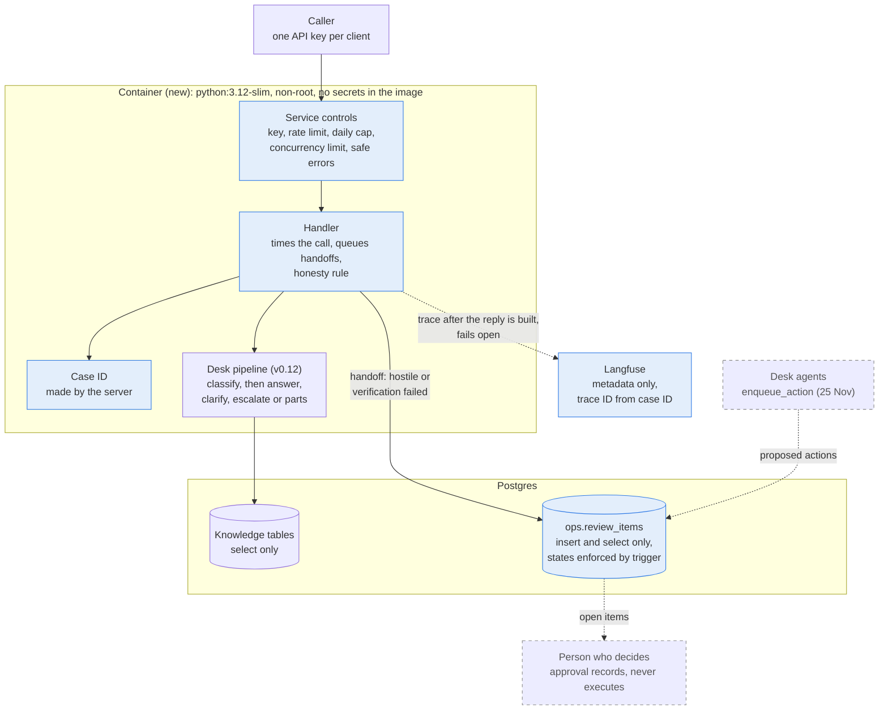

# AOP architecture v0.13: case IDs, the review queue, the desk service, the container and tracing

Version 0.13 · 25 Nov 2026 · covers the 24 Nov plan row, RAG Phases 4 and 5 · code commits `dff5642`, `ab01bc9`, `165974c`, `797fee2`, `f6c6741`, `0b3fce5`, `61a93e8`, `f1403da`, `8c46eac`, evidence `be0abde` · CI green on `0b3fce5`, `f1403da` and `8c46eac` · **gate G3 met**

v0.12 made the desk answer well and gated that in CI. v0.13 makes the desk something you can run, watch and hand to other people. Every reply now carries a case ID the server made. Cases that need a person go to a review queue whose rules the database enforces. The desk runs as an HTTP service with a key per client, a rate limit, a daily cap and a concurrency limit, inside a container with no secret baked in. Every case leaves one trace that holds metadata only. **The three live cases of 25 Nov each left one reply, and the hostile one left one open queue item and one trace with Input and Output empty.**

## How to read this page

- The diagram shows one request from the caller to the desk, and the two places the handler writes outward. **Solid** boxes exist and have been tested. **Dashed** boxes are planned. **Blue** boxes are new in v0.13.
- The control order, the queue states and the trace layers are explained after the diagram.
- Decisions are listed near the end. They are proposed as ADR-055 to ADR-062 and are **not yet recorded** in [decisions.md](decisions.md); the last recorded one is ADR-054.

## What changed since v0.12

| Area | v0.12 | v0.13 |
| --- | --- | --- |
| Identity of a conversation | None | A case ID made by the server (`case_YYYYMMDD_` plus 12 lowercase hex characters), on every reply. The trace ID is computed from it |
| Hostile and unverified cases | The reply carried a handoff flag that nothing read | The handler writes a row to `ops.review_items`. If the write fails, the reply is replaced so it promises nothing |
| Review queue | Planned | Built (migration 015). Two kinds: answer and proposed_action. Statuses and moves enforced by a database trigger |
| Database login for the service | Owner login in local runs, read-only `ci_eval` in CI | `desk_service` (migration 016): select on four knowledge tables, execute `search_policy`, select and insert on `ops.review_items`, 10 second statement timeout |
| Running the desk | A function and test scripts | `service.py`: FastAPI service with a key per client, token bucket, daily cap, concurrency limit and safe errors |
| Packaging | None | Container image: non-root, model baked in, no secrets, healthcheck |
| Observability | None | Langfuse traces keyed by case ID, metadata only, four layers of protection, fail open, flushed at shutdown |
| CI | One offline job with some tests | The offline job runs six test files with no secrets and no database; the gate job is unchanged |
| Decisions | ADR-050 to ADR-054 | ADR-055 to ADR-062 proposed |

## Architecture

The design rule: **a reply may only promise what has happened, and a record may only hold what its reader needs.** The reply never says a person will look unless the queue row exists. The trace never holds the customer's words. The service login can add a queue row but never change one.

## The request path and its control order

The service checks a request in a fixed order, so a refused request costs almost nothing before it reaches the model.

| Step | Control | What it refuses | Status code |
| --- | --- | --- | --- |
| 1 | Input check: a message of 1 to 2,000 characters. The framework runs it before the handler, so it comes first | Malformed or oversized input | 422, never echoing the input |
| 2 | API key per client, compared in constant time against every key | Unknown caller | 401 |
| 3 | Rate limit, token bucket (10 per minute, burst of 5) | Too fast | 429 |
| 4 | Daily cap, 500 accepted requests a day (each makes at most 4 model calls) | Too much spend | 503 |
| 5 | Concurrency limit, 4 requests at once | Too many at the same time | 503 |

Because the input check runs first, a caller with no key still gets a 422 for a malformed body, not a 401. It leaks nothing, but it is a detail to know.

An unexpected error becomes a generic 500. There is no `/docs` page. The reply has five fields: `case_id`, `behavior`, `answer`, `citations` (labels only) and `needs_person`.

## The review queue

| Item | Detail |
| --- | --- |
| Kinds | `answer` (a reply a person should check) and `proposed_action` (an action an agent proposes) |
| Reasons | `hostile`, `verification_failed`, `proposed_action` |
| States | `open`, `resolved`, `approved`, `rejected` |
| Allowed moves | An answer item goes open to resolved. A proposed action goes open to approved or rejected. Nothing else |
| Final states | A decided item is final. A decision needs `decided_by` and `decided_at`. An open item has neither |
| Deletion | Never. The trigger refuses delete and truncate |
| Enforcement | A database trigger and check constraints, so every writer passes the same rules |
| Approval | Records the decision only. Running an approved action is a separate step that stays under human control |

The handler queues two kinds of case: a hostile message (`hostile`) and an answer that failed verification (`verification_failed`). `enqueue_action` exists and is tested, but no agent calls it yet. The 25 Nov desk triage agent is its first consumer.

## The honesty rule

When a case needs a person, the escalate reply says it has been marked for review. If the queue write fails, that sentence would be false. So the handler replaces the reply with a fixed text that promises nothing, records `queued: false`, and keeps only the error class name, never the error message. Twelve handler tests cover this, including the failing write.

## Trace privacy: four layers

| Layer | What it does |
| --- | --- |
| 1. Named fields | The trace is built by hand from named fields (case ID, behavior, label, confidence, route, citation labels, attempts, latency and similar). No free text goes in |
| 2. Mask | Text keys become `[not recorded]`; strings over 120 characters are cut |
| 3. Export guard (`drop_io`) | Deletes the input and output attributes of every span before export. Added after a probe showed short text slipping past the mask |
| 4. Test | A test reads the spans through an in-memory exporter and fails if any text is there |

Tracing fails open: if Langfuse is down or the keys are missing, the reply is unchanged. The service flushes pending traces when it stops. The case ID is the session ID, and the trace ID is computed from it, so one case always opens one trace.

## Container

| Choice | Why |
| --- | --- |
| `python:3.12-slim`, `uv` pinned, `uv sync --frozen --no-dev` | Small image, same versions as the lock file |
| Embedding model baked into the image | The container does not download a model at start |
| Non-root user, healthcheck on `/healthz` | A compromise does not start as root; the platform can see a dead process |
| `.dockerignore` excludes `.env*`, tests and scripts | No secret enters the image. A check proved zero `.env` files in the built image |
| Settings passed with `docker run -e`, port published to 127.0.0.1 | Secrets arrive at start, and the port is not open to the network |

## CI after v0.13

The `offline` job now installs from the lock file and runs six test files with no secrets and no database: desk logic, desk scoring, case ID, handler, tracing and service. The `gate` job is unchanged. There is still no `pull_request` trigger.

## Gate G3

G3 is "RAG eval in CI and review queue". It is met when five things hold on `main`: the eval gate runs green with the secret-free tests beside it; the queue holds proposed actions and answers with database-enforced states; every reply has a server-made case ID; the desk runs as a keyed, limited service in a container with no secret; every case leaves one trace with no message text. Evidence: [g3-eval-ci-review-queue-and-service-2026-11-25.md](../evidence/g3-eval-ci-review-queue-and-service-2026-11-25.md).

## Decisions

Proposed. To be recorded in [decisions.md](decisions.md) as ADR-055 to ADR-062.

- **ADR-055: The server makes the case ID, and the trace ID is computed from it.** Consequence: one identifier joins the reply, the queue item and the trace, and a caller cannot choose it.
- **ADR-056: Proposed actions are queued, approval only records a decision, and the database enforces the states.** Consequence: an agent cannot execute its own proposal, and a bug in Python cannot skip a state.
- **ADR-057: The service runs as `desk_service`, which can only read policy and add or read queue rows.** Consequence: a stolen login can add junk rows but cannot read customers or change a decision.
- **ADR-058: A reply never promises a review that did not happen.** Consequence: a queue failure gives the customer a plain reply with no promise, and the failure is visible in the result.
- **ADR-059: The service limits who calls it and how much it can spend.** Consequence: abuse hits a key limit, a rate limit, a daily cap or the concurrency limit before it reaches the model.
- **ADR-060: The container holds no secret, runs as a non-root user and takes its settings at start.** Consequence: the image can be copied and shared without leaking a key.
- **ADR-061: Traces carry metadata only, in four layers, fail open, and flush at shutdown.** Consequence: debugging uses labels, counts and timings, never the customer's words.
- **ADR-062: CI runs the secret-free tests in a separate job, never on pull requests, and the gate uses a read-only login.** Consequence: pinning third-party actions to commit hashes stays on the debt list.

## Known limits

- Spans are written after the reply is built, so span durations are near zero. The real total time is the `latency_ms` field in the metadata.
- The daily cap counts requests, not model calls, so a request can spend up to four calls.
- The classifier's safe fallback hides API errors from the customer. The note `error: <Class>` is now in the trace metadata so they can be found.
- The queue row holds the customer's question and the reply, because a person needs them to decide. That text is protected by access control, not by the trace layers.
- No agent calls `enqueue_action` yet. Nothing reads or decides queue items automatically, and there is no screen for people to decide them; `scripts/show_review_queue.py` lists the open items.
- The `desk_service` password and the 20 Nov owner password are due for rotation.
- Third-party GitHub Actions are not yet pinned to commit hashes.
- Per-stage timing and token counts in traces are deferred to Phase 6.
- Langfuse's search box does not search metadata or session IDs. Open a trace by its URL, or find the case on the Sessions page.

## What exists and what is planned

| Component | State |
| --- | --- |
| RAG answer path, MCP servers, attack harness, Phase 3 evals, desk pipeline and CI gate | Built and recorded (v0.2 to v0.12) |
| Case ID, review queue, `desk_service` login | Built (v0.13) |
| Desk HTTP service with controls, container, Langfuse tracing, widened CI | Built, gate G3 met (v0.13) |
| Desk triage agent, the first caller of `enqueue_action` | Planned (25 Nov) |
| Billing agent | Planned (26 Nov) |
| Privacy agent, gates G4 and G5 | Planned (27 Nov) |
| Injection and failure drills, kill switch for write tools, load test, runbook | Planned (28 Nov) |
| Tag `aop-v1.0` and the AOP Handbook | Planned (30 Nov) |
