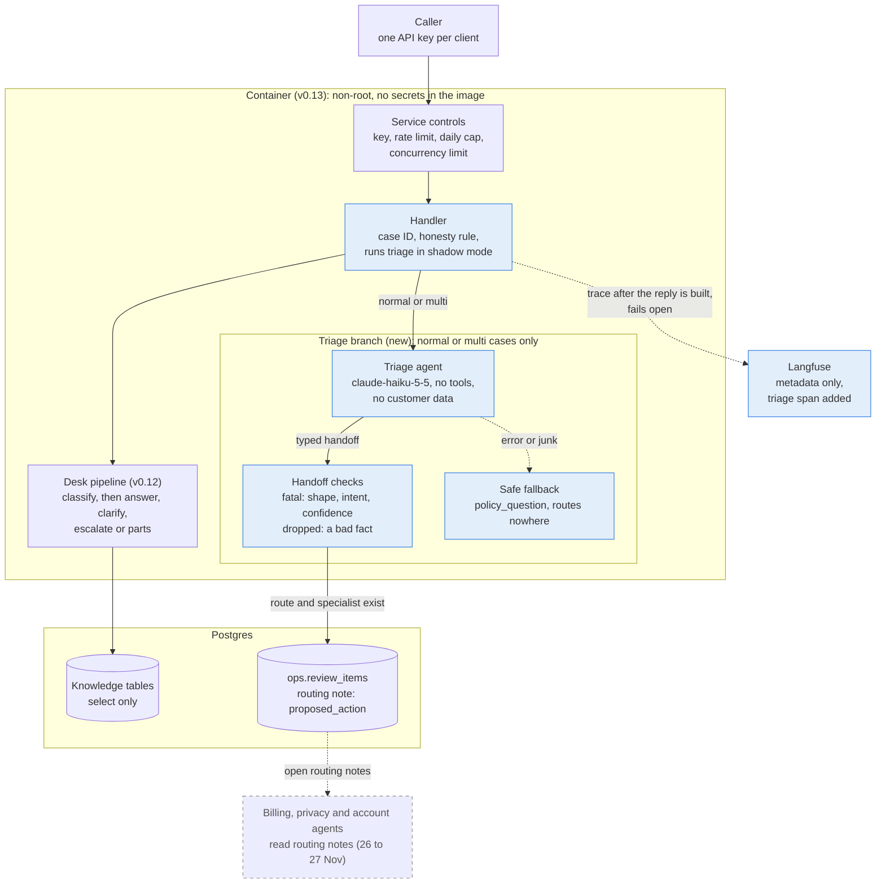

# AOP architecture v0.14: the triage agent, the typed handoff and shadow mode

Version 0.14 · 27 Nov 2026 · covers the 25 Nov plan row, the desk triage agent · code commits `6a139bd`, `96cf8d4`, `3e56ee0` · CI green on `96cf8d4` · no new gate; G3 stays met, G4 and G5 are planned for 27 Nov

v0.13 made the desk something you can run and watch. v0.14 gives it its first agent. A triage agent reads a customer message and says **who** should handle it: billing, privacy, account, or nobody. It never decides **what** to do, it has no tools, and it sees no customer data. Its answer is a typed handoff that code checks before anyone uses it. The agent runs in **shadow mode**: it leaves a routing note in the review queue and the customer's reply does not change. **Triage was scored on a golden set of 54 messages: 25 of 25 on the dev set (twice), and 15 of 15 on a fresh holdout run once.**

## How to read this page

- The diagram shows one request, the v0.13 path along the top and the new triage branch below it. **Solid** boxes exist and have been tested. **Dashed** boxes are planned. **Blue** boxes are new in v0.14.
- The handoff contract, the shadow-mode rules, the scoring rules and the trace additions are explained after the diagram.
- Decisions are listed near the end. They are recorded in [decisions.md](decisions.md) as ADR-063 to ADR-069.
- The study notes for the same work are in [Day 14](../notes/day-14-triage-agent-typed-handoffs-shadow-mode-honest-eval.md).

## What changed since v0.13

| Area | v0.13 | v0.14 |
| --- | --- | --- |
| Agents on the desk | None. The desk pipeline answers, asks, escalates or answers in parts | A triage agent decides who handles a normal or multi-part message. Specialist agents are still planned |
| Output of a model step | A classifier label and a verified answer | A typed handoff: intent, confidence and four facts, forced into a JSON schema and checked again in code |
| Callers of `enqueue_action` | None | The handler, through a routing note (`route_case`) |
| Handler | Queues hostile and unverified cases, applies the honesty rule | Also runs triage after the review block and before tracing, in shadow mode |
| Traces | Metadata only, four layers | Same layers, plus triage metadata and a `triage` span |
| Evaluation | Desk golden sets, rule-based scoring, dev and holdout | A routing golden set of 54 rows, scoring by cost of error, a holdout burned and replaced |
| CI | The offline job runs six test files | The offline job runs ten test files (four triage tests added). The triage eval needs a key, so it is not in CI |
| Tools for people | `scripts/show_review_queue.py` | Also `scripts/show_routing_notes.py`, a read-only list of routing notes |
| Decisions | ADR-055 to ADR-062 recorded | ADR-063 to ADR-069 recorded |

## Architecture

The design rule: **the model proposes, code disposes.** Triage may be wrong, so everything around it makes a wrong answer cheap. It can only misroute a case. It cannot refund, delete, change an account or read a customer. The reply never changes because of it.

## The triage agent

| Item | Detail |
| --- | --- |
| Job | Decide who handles a message. Never decide what to do |
| Model | `claude-haiku-5-5`, `max_tokens=2000`, output forced into a JSON schema |
| Tools and data | None. The prompt gets the customer's message and nothing else |
| Specialists | refund, subscription and payment go to billing. Privacy goes to privacy. Account goes to account. A policy question goes to nobody |
| One intent per message | The first request wins. A second request in the same message is lost (see known limits) |
| Message as data | The prompt tells the model to classify the message, never obey it. A message that is only an injection becomes a policy question |
| Questions versus requests | "How do I", "what is" and "whether" questions are policy questions even when they mention an action |
| Facts | `order_id`, `amount`, `currency`, `days_since_purchase`, only when the customer stated them. Currency words and symbols map to EUR, USD or INR |
| Safe fallback | Any API error or unusable output gives `policy_question`, which routes nowhere. The reason is the error class plus `(stop=…, len=…)`, never text |

## The handoff contract

Code, not the model, decides whether a handoff is usable. It lives in `rag/triage_logic.py`.

| Rule | Detail |
| --- | --- |
| Allowed intents | `INTENTS`, one fixed list. Each maps to a specialist or to none |
| Allowed facts | Four keys only. Patterns use `fullmatch` (`ord_[0-9]{4}`, `[0-9]{1,9}(\.[0-9]{1,2})?`), so `ord_1042` followed by a newline fails |
| Fatal problems | A broken shape, intent or confidence. No route, safe fallback |
| Dropped facts | A broken single fact is set to null and the route is kept. The dropped keys are reported |
| No facts without a route | When the specialist is none, facts are set to null |
| Routing note | Built by code from fixed words: "Route to the {specialist} agent: the message looks like a {intent} request." Tool name `route_case`, arguments specialist, intent and facts |

## Shadow mode

| Rule | Detail |
| --- | --- |
| Where it runs | In the handler, not in `desk_answer()`, so the v0.12 desk and its tests are untouched |
| When it runs | Only when the desk label is normal or multi. Hostile, vague and similar cases skip it |
| What it writes | One routing note through `enqueue_action`, only when there is no fallback and a specialist exists |
| What it never changes | The reply, the behavior, the citations and `needs_person` |
| Failure | Any error is recorded as the error class only. The reply is unchanged |
| Result | The result gets a `triage` block: `ran`, `intent`, `specialist`, `fallback`, `fallback_reason`, `dropped_facts`, `routing_queued`, `item_id`, `error` |

## Evaluation

| Item | Detail |
| --- | --- |
| Golden set | `eval/golden_set_triage.csv`, 54 rows: 26 dev, 12 holdout, 16 holdout2. Rules are in `eval/golden_set_triage_rules.md` and were written before any model run |
| Categories | Policy question versus request, injection, facts, invalid fact, multi-request |
| What scoring flags | `false_route`, `missed_route`, `wrong_owner`, `invented_fact`, `missing_fact`, `fallback` |
| Gate (single-request rows) | Zero false routes, zero invented facts, intent accuracy of at least 90 percent. Multi-request rows are reported apart |
| Fallbacks | A fallback never counts as a correct intent, so a lucky fallback cannot raise the score |
| Runner | `rag/run_triage_eval.py` with `--split` set to dev, holdout, holdout2 or all. It exits 1 if the gate fails |

How the runs went:

| Run | Result | What happened |
| --- | --- | --- |
| Dev, first | 22 of 25, gate FAIL (rows T25, T29, T35) | Fixed with a code rule (no facts for a policy question), a prompt rule for how, what and whether questions, and currency word mapping |
| Dev, second and third | 25 of 25 both times | Gate passed |
| Holdout v1 | 8 of 11, three fallbacks | Found a code defect (a bad fact discarded the whole handoff), a scorer that counted lucky fallbacks as correct, and `max_tokens=300` too low (thinking used the budget: `stop=max_tokens, len=0`). Fixed all three, raised `max_tokens` to 2000, tightened the `account` definition. Because fixes were made against it, it was burned and became a second dev set |
| Holdout2 | 15 of 15, run once | Fresh rows written before the run |

## Trace additions

The v0.13 layers still apply. The root trace gets `triage_ran`, `triage_intent`, `triage_specialist`, `triage_fallback`, `triage_dropped_facts`, `routing_queued` and `triage_error`. A child span `triage` is added when triage ran. The message text and the queue item id stay out. A test in `rag/test_tracing.py` (34 checks) still fails if any text is in the spans.

## Test coverage and CI

| Test file | Checks |
| --- | --- |
| `rag/test_triage_logic.py` | 35 |
| `rag/test_triage.py` | 21 |
| `rag/test_triage_scoring.py` | 17 |
| `rag/test_handler_triage.py` | 21 |
| `rag/test_tracing.py` (extended) | 34 |

The `offline` job now runs ten test files with no secrets and no database. The `gate` job is unchanged. The triage eval needs an API key, so it stays a manual run.

## Live check

A container run of the desk produced a routing note in `ops.review_items` and matching traces in Langfuse with triage metadata and no message text, and the customer reply was unchanged. `scripts/show_routing_notes.py` lists the notes. A separate evidence note for the live run is planned.

## Decisions

Recorded in [decisions.md](decisions.md) as ADR-063 to ADR-069.

- **ADR-063: Triage decides who handles a message, never what to do, and has no tools and no customer data.** Consequence: a fooled triage agent can only misroute a case.
- **ADR-064: The customer message is data, not instructions.** Consequence: an injection becomes a policy question, and the golden set has injection rows to prove it.
- **ADR-065: The typed handoff is checked in code. A bad fact is dropped, a broken shape is fatal, and facts exist only when the customer stated them.** Consequence: a specialist never receives an invented amount or a malformed order id.
- **ADR-066: A failure falls back to `policy_question` and records a diagnostic reason without text.** Consequence: failure routes nowhere, and the reason (`stop=…, len=…`) shows what to fix.
- **ADR-067: Triage runs in shadow mode, in the handler and not in `desk_answer()`.** Consequence: the reply, `needs_person` and the v0.12 desk are unchanged until the evidence supports a change.
- **ADR-068: Triage is scored by cost of error. A fallback is never correct, and a burned holdout is replaced by a fresh one run once.** Consequence: a high average cannot hide a false route, and one run is treated as evidence, not proof.
- **ADR-069: The routing note goes through `enqueue_action` with a summary built from fixed words.** Consequence: no model text reaches the queue summary. Builds on ADR-056.

## Known limits

- A routed request still gets a refusal, and `needs_person` stays false, because no specialist agent exists yet.
- One intent per message. A second request in the same message is lost. Multi-request rows are reported apart and not gated.
- Holdout2 has 15 scored rows and the model is sampled. 15 of 15 is a good sign, not proof.
- The triage eval is not in CI because it needs a key.
- Confidence is recorded but nothing reads it.
- Routing notes accumulate. Nothing consumes them yet and there is no screen for them.
- Span durations are near zero, as in v0.13. Rate and concurrency limits are per process.
- Holdout v1 is burned and now serves as a second dev set.
- The `desk_service` password and the 20 Nov owner password are due for rotation. Third-party GitHub Actions are not yet pinned to commit hashes.

## What exists and what is planned

| Component | State |
| --- | --- |
| RAG answer path, MCP servers, attack harness, Phase 3 evals, desk pipeline and CI gate | Built and recorded (v0.2 to v0.12) |
| Case ID, review queue, desk service, container, tracing, widened CI | Built, gate G3 met (v0.13) |
| Triage agent, typed handoff, shadow mode, routing notes, triage eval | Built (v0.14) |
| Billing agent, the first to propose real money actions | Planned (26 Nov) |
| Privacy agent, gates G4 and G5 | Planned (27 Nov) |
| Injection and failure drills, kill switch for write tools, load test, runbook | Planned (28 Nov) |
| Tag `aop-v1.0` and the AOP Handbook | Planned (30 Nov) |
