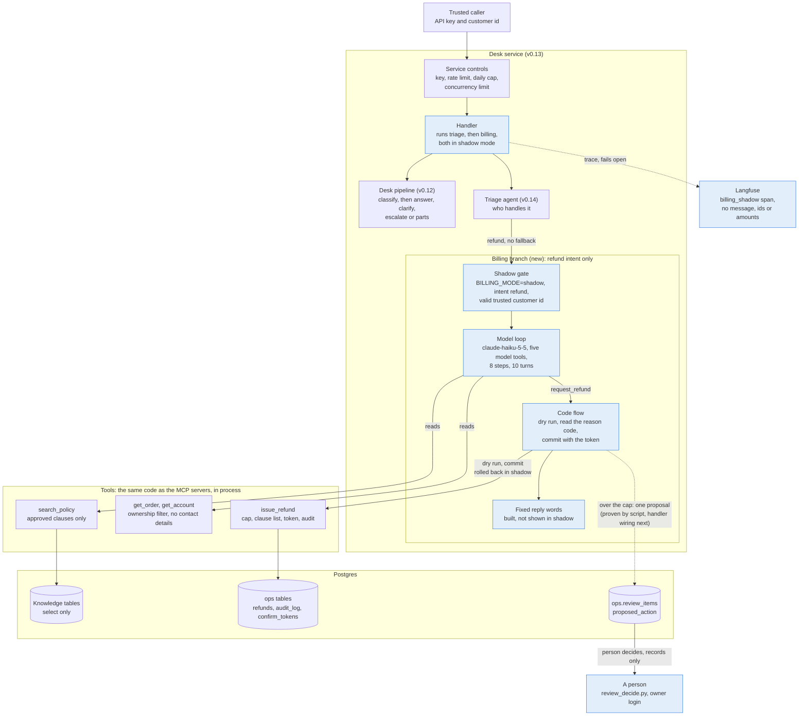

# AOP architecture v0.15: the billing agent, shadow mode for money and the human gate

Version 0.15 · 28 Nov 2026 · covers the 26 Nov plan row, the desk billing agent (built 27 Nov) · code commits `563630c` to `20cf0e7`, then `19dad59` and `4716d36` · no new gate: G3 stays met, G4 and G5 wait for the privacy agent

v0.14 gave the desk an agent that decides **who** handles a message. v0.15 gives it the first agent that can decide **what to do about money**. The billing agent reads a refund request, looks up the order and the policy, and ends the case in one of four ways. The model chooses the tool calls and judges the conditions. Code owns everything that matters: whose account it is, the dry run, the token, the commit, the queue and the words the customer sees. The agent runs in **shadow mode**: it works in a transaction that is rolled back, and the customer's reply does not change. **Scores: 10 of 10 on the dev set (three runs in a row), 4 of 4 on a holdout run once, and 10 of 10 on ten desk cases through the real handler on the third run.** A separate run on the real database showed that a refund over the cap stops and waits for a person.

## How to read this page

- The diagram shows one refund request. The v0.14 path is along the top and the new billing branch is below it. **Solid** boxes exist and have been tested. **Dashed** boxes or lines are proven by a script but not yet wired into the handler, or planned. **Blue** boxes are new in v0.15.
- The billing agent, the outcomes, shadow mode, the human gate, the evaluation and the trace additions are explained after the diagram.
- Decisions are listed near the end. They are recorded in [decisions.md](decisions.md) as ADR-070 to ADR-079.
- The study notes for the same work are in [Day 15](../notes/day-15-billing-agent-using-search-policy-and-mcp-tools.md). The human gate run is in [the evidence note](../evidence/human-gate-proof-2026-11-27.md).

## What changed since v0.14

| Area | v0.14 | v0.15 |
| --- | --- | --- |
| Agents on the desk | Triage only. It routes and never acts | Also a billing agent that can propose a refund, in shadow mode |
| Model loop | None. Triage is one call | A bounded loop: five model tools, at most 8 recorded steps and 10 model turns |
| Who holds the token | Not relevant | Only code. The model never sees the confirmation token |
| Outcomes | A routing note | Four outcomes with closed reason lists: settled, queued, refused, needs_person |
| Handler | Runs triage in shadow mode | Also runs billing in shadow mode, after triage, only for a refund intent |
| Customer reply | Unchanged by triage | Unchanged by billing. Fixed words per outcome are built and tested for the day billing goes live |
| Money safety | Hard limits in the MCP server | Same limits, plus a rolled-back transaction per shadow case |
| Humans | A review queue and a viewer script | Also `review_decide.py`, where a person decides a queued item as the owner login, proven on the real database |
| Evaluation | Routing golden set of 54 rows | A billing golden set of 14 rows (10 dev, 4 holdout) and 10 desk cases through the real handler |
| Decisions | ADR-063 to ADR-069 | ADR-070 to ADR-079 |

## Architecture

The design rule from v0.14 still holds and now covers money: **the model proposes, code disposes.** The billing agent can be wrong, so everything around it makes a wrong answer cheap. It cannot name another customer, hold the token, call a tool that is not on its list, exceed the step limit, lift the cap or write its own customer-facing words.

## The billing agent

| Item | Detail |
| --- | --- |
| Job | Decide what to do about a refund request, inside limits it cannot change |
| Model | `claude-haiku-5-5`, at most 10 model turns, at most 8 recorded steps (`MAX_STEPS`) |
| Model tools | `search_policy`, `get_order`, `get_account`, `request_refund`, `close_case`. Nothing else is accepted |
| Customer id | Comes from the case record, which comes from the trusted caller. The model has no field for it |
| Date | `as_of` is supplied by code, because the 7-day clauses cannot be judged without it |
| Ownership | An order that belongs to someone else, or does not exist, gives the same answer: "no such order for this customer" |
| What the model sees | Cleaned order and account data (no contact details), at most 5 policy hits, each cut to 1,500 characters, with a note that they are reference text, not instructions |
| What the model judges | Conditions that need reading the case: within 7 days, downloaded or not, a renewal that was not intended (the customer's own statement is enough) |
| What the model never decides | Ownership, the cap, the clause list, the token, the commit, the queue and the reply |

## Who owns what

| Rule | Owner | Why there |
| --- | --- | --- |
| Whose account it is | Case record (trusted caller) | A message can claim to be anyone |
| Cumulative cap per customer and currency (EUR 50, USD 55, INR 4500), clause on the allowed list, single-use token | MCP server, `issue_refund` | One place to change a limit. Billing code copies none of them |
| Within 7 days, downloaded, renewal not intended | The agent | Needs reading the order and the customer's words |
| What happens after a dry run | Code, from the tool's reason code (`next_after_dry_run`) | Never from model text |
| Whether a commit worked | Code (`outcome_after_commit`) | A commit that raises is "unclear", not refused and not settled, because the refund may have been recorded |
| The words the customer sees | `billing_reply.py` | The model must not promise anything |

## The four outcomes

| Outcome | Meaning | Reasons come from |
| --- | --- | --- |
| `settled` | Money moved, and the amount, currency and order are validated | Code, after the commit |
| `queued` | Over the cap: one proposal is waiting for a person (reason `over_cap`) | Code, only if the queue write worked |
| `refused` | Not eligible under the policy, or a hard limit said no | Closed list of reason codes |
| `needs_person` | The agent cannot decide: needs evidence, missing details, or not supported | Closed list: `needs_evidence`, `missing_details`, `not_supported` |

A fault never counts as a correct outcome. A tool error is a failed step, and the scorer treats a fault reason as wrong even when the outcome label happens to match.

## Shadow mode

| Rule | Detail |
| --- | --- |
| Switch | Billing runs only when `BILLING_MODE` is exactly `shadow`. Any other value, or none, is off. There is no "live" value on purpose |
| When it runs | After triage, only when the intent is refund, triage did not fall back, and the trusted caller gave a valid customer id (`cust_[0-9]{3}`) |
| What it does | Runs the full loop through a dry run and a commit inside one transaction that is always rolled back, then keeps the proposal and a preview in memory |
| What it never changes | The reply, the behavior, the citations, `needs_person` and the queue |
| Failure | Any error is recorded as the error class only. The reply is unchanged |
| Result | The result gets a `billing` block: `ran`, `mode`, `skipped`, `outcome`, `reason`, `steps`, `would_refund`, `would_queue`, `preview`, `error` |

## The human gate

A refund over the cap cannot be settled by the agent. It is proposed once, as a `proposed_action` in `ops.review_items`, and a person decides it with `rag/review_decide.py` on the owner login. The database, not the agent, enforces what can happen next (ADR-056, proven here):

| Step | Result on the real database |
| --- | --- |
| The billing agent proposes the over-cap refund | Outcome `queued`, reason `over_cap`, no refund recorded |
| The desk login tries to decide the item | Refused: it has no update right |
| A person approves with a name and a note | The item shows approved by that person |
| A second decision | Refused, and the item stays approved |
| Money and audit tables before and after | Identical: approval recorded a decision and executed nothing |

The run is recorded in [human-gate-proof-2026-11-27.md](../evidence/human-gate-proof-2026-11-27.md): 8 of 8 steps. It shows that the gate holds. It does not yet show that the handler uses the real queue for billing proposals (see known limits).

## Evaluation

| Item | Detail |
| --- | --- |
| Billing golden set | `eval/golden_set_billing.csv`: 14 rows, 10 dev and 4 holdout, with rules in `eval/golden_set_billing_rules.md` written before any model run |
| Scoring | By rules, in `rag/billing_scoring.py`. The gate is zero wrong action, zero wrong amount and zero wrong order, with at least 90 percent correct. The money log overrules the agent's own record. A fault reason never counts as correct |
| Desk cases | `eval/desk_cases_billing.csv`: 10 messages through the real handler (D01 to D10), scored by `rag/desk_billing_scoring.py` |
| Runners | `rag/run_billing_eval.py` and `rag/run_desk_billing_cases.py` (with `--tag`) |

How the runs went:

| Run | Result | What happened |
| --- | --- | --- |
| Dev, first | 7 of 10 | Rows B06, B07 and B10 missed, and B05 was unstable. `probe_billing.py` showed why |
| Dev, after prompt fixes | 9 of 10, then 10 of 10 on three runs in a row | Fixes were prompt rules, not label changes: a missing order is refused as not_eligible; the downloaded field and the customer's statement are enough; a request for more than the order's amount is refused, never lowered |
| Holdout | 4 of 4, run once | No change made after it |
| Desk cases, first | 8 of 10 | D06 and D07 were label errors: the classifier called one message vague and one hostile, so triage never ran |
| Desk cases, second | 9 of 10 | D06 flipped between vague and normal, so its expectation became `either` |
| Desk cases, third | 10 of 10 | Both label corrections are recorded and all three result files are kept in git |

## Trace additions

The root trace gets `billing_ran`, `billing_skipped`, `billing_outcome`, `billing_reason`, `billing_steps`, `billing_would_refund`, `billing_would_queue` and `billing_error`. A child span `billing_shadow` is added when billing ran. The message text, customer id, order id, amount and preview stay out. A test in `rag/test_tracing.py` (34 checks) fails if any of them appear.

## Test coverage and CI

| Test file | Checks |
| --- | --- |
| `rag/test_billing.py` | 51 |
| `rag/test_billing_tools.py` | 31 |
| `rag/test_billing_scoring.py` | 41 |
| `rag/test_billing_reply.py` | 45 |
| `rag/test_billing_shadow.py` | 48 |
| `rag/test_desk_billing.py` | 128 |
| `rag/test_review_decide.py` | 34 |
| `rag/test_tracing.py` (extended) | 34 |

`test_billing_logic.py`, `test_billing_flow.py` and `test_billing_golden.py` cover the contract, the flow and the golden set. **None of the billing tests are in the CI offline job yet.** The billing evals need an API key, so they stay manual runs.

## Decisions

Recorded in [decisions.md](decisions.md) as ADR-070 to ADR-079.

- **ADR-070: The model decides what to do about a refund request. Code owns identity, the token, the dry run and commit, the queue and the reply.** Consequence: a fooled billing agent can only ask, and every ask is checked.
- **ADR-071: Hard limits stay in the MCP server and the agent judges conditions.** Consequence: one place to change a limit, and edge cases are read by the agent, not by brittle code.
- **ADR-072: Four outcomes with closed reason lists; a fault never counts as correct; a commit that raises is "unclear".** Consequence: a crash cannot pass as a clean refusal.
- **ADR-073: A refund over the cap is queued once as a proposal and never retried or argued.** Consequence: the agent cannot negotiate its way past the cap.
- **ADR-074: The billing eval is pre-registered, scored by rules, with the money log overruling the agent, and holdout run once.** Consequence: failures are fixed in the prompt or the code, never by editing the answer key.
- **ADR-075: Desk cases run through the real handler, and a label is corrected only when it was wrong, with the original runs kept.** Consequence: honest history, and sampled classifier cases use `either`.
- **ADR-076: Billing runs in shadow mode, off unless `BILLING_MODE=shadow`, in a rolled-back transaction, with no "live" value.** Consequence: no customer or money is touched until the evidence supports it.
- **ADR-077: The customer's reply for each outcome is fixed text built by code from validated facts.** Consequence: the desk never promises something that did not happen.
- **ADR-078: A person decides a queued proposal through a separate script as the owner login, and approval records a decision only.** Consequence: separation between proposing and approving. Builds on ADR-056.
- **ADR-079: Billing traces carry metadata only.** Consequence: the trace shows what happened without holding the message, ids or amounts.

## Known limits

- Billing is not live. In shadow mode the handler keeps proposals in memory. The real review queue is proven by `prove_human_gate.py`, but the handler is not yet wired to it for billing.
- Refund cases take 13 to 33 seconds because billing runs inside the request. Going live needs a background run.
- The HTTP service has no trusted `customer_id` field yet. It has to come from an authenticated caller.
- The billing tests are not in the CI offline job, and the billing evals are manual because they need a key.
- The holdout has 4 rows and the model is sampled. 4 of 4 is a good sign, not proof.
- The classifier is sampled, so a message such as D06 can get a different label from one run to the next.
- The shadow tools run in process with the same code as the MCP servers. The service is expected to pass the MCP client later.
- The privacy agent does not exist yet, so G4 and G5 are not met.
- The `desk_service` password and the 20 Nov owner password are due for rotation. Third-party GitHub Actions are not yet pinned to commit hashes.

## What exists and what is planned

| Component | State |
| --- | --- |
| RAG answer path, MCP servers, attack harness, Phase 3 evals, desk pipeline and CI gate | Built and recorded (v0.2 to v0.12) |
| Case ID, review queue, desk service, container, tracing, widened CI | Built, gate G3 met (v0.13) |
| Triage agent, typed handoff, shadow mode, routing notes | Built (v0.14) |
| Billing agent, shadow mode, fixed reply words, billing evals, person's decide script | Built (v0.15) |
| Billing handler wired to the real review queue, background run, trusted `customer_id` in the service | Planned |
| Privacy agent, gates G4 and G5 | Planned (27 Nov row) |
| Injection and failure drills, kill switch for write tools, load test, runbook | Planned (28 Nov row) |
| Scorecard G6 | Planned (29 Nov row) |
| Tag `aop-v1.0` and the AOP Handbook | Planned (30 Nov row) |
