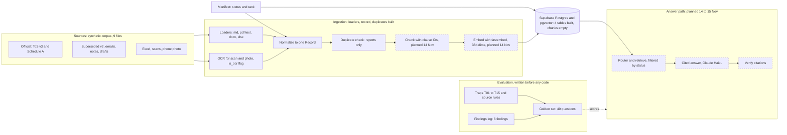

# Architecture v0.2: ingestion front half complete (12 Nov 2026)

What changed since v0.1:

- Schema is built (four tables, RLS on, `plans_fees` filled). v0.1 said "schema next".
- One loader per format (md, pdf text, docx, xlsx), plus OCR for scans and photos, flagged `is_ocr`.
- Normalizer builds one `Record` per file. Status and rank come from the manifest.
- New: duplicate check, which reports related documents and never deletes.
- New: findings log, six findings, each becoming a golden-set trap.

