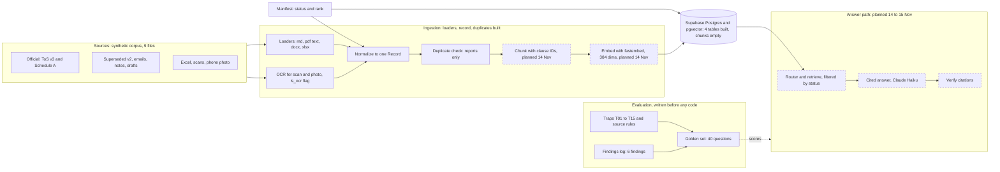

# Architecture v0.2: ingestion front half complete (12 Nov 2026)

What changed since v0.1:

- Schema is built (four tables, RLS on, `plans_fees` filled). v0.1 said "schema next".
- One loader per format (md, pdf text, docx, xlsx), plus OCR for scans and photos, flagged `is_ocr`.
- Normalizer builds one `Record` per file. Status and rank come from the manifest.
- New: duplicate check, which reports related documents and never deletes.
- New: findings log, six findings, each becoming a golden-set trap.

---

## How to read this document

This page is a snapshot of the architecture at the **end of 12 Nov 2026**, version 0.2. It builds on [v0.1](v0.1-foundations.md), so read that first if the project is new to you. This version completes the **front half of the pipeline**: getting every document into a clean, comparable form. The back half (chunking, search, answering) is still planned. The reasoning behind each choice is in `decisions.md`.

### What changed since v0.1

| Area | v0.1 | v0.2 |
| --- | --- | --- |
| Database | Connected, "schema next". | Schema built: four tables, row-level security on, 21 exact price rows loaded. |
| Loading | One box, "Load and OCR". | One loader per format (markdown, PDF text, Word, Excel), plus a separate OCR path for the scan and the photo. |
| Normalizing | "Normalize and assign status". | Status and rank come from a manifest file. The normalizer builds one standard `Record` per file. |
| Duplicates | Not present. | New duplicate check that reports related documents and never deletes. |
| Evaluation | Traps and a golden set. | Plus a findings log: six real extraction problems, each becoming a trap. |

### How to read the diagram

- **Green boxes** are built and verified. **Dashed boxes** are planned.
- **Left to right:** source files, then the ingestion block, then the database, then the answer path.
- The **Manifest** box feeds both the Record (so each file carries its status) and the database (so the `documents` table holds it).
- The dotted "scores" line means the golden set will measure the answer path.

### What happens to a document, in order

1. **The manifest says what the file is.** Its type, version, status (approved, superseded, draft, informal) and rank from 1 to 5. A human decides this, not the code.
2. **A loader reads it.** The loader is chosen by file extension. It returns *units*: pieces of text with a section name, a page number and an OCR flag.
3. **The normalizer builds a Record.** Every file, whatever its format, becomes the same shape: its identity, its status, its units, a lowercased and whitespace-collapsed text for comparison, a hash of that text, an OCR flag and plain-language notes.
4. **The duplicate check compares Records** in pairs and reports which documents are near-copies.
5. **Next (14 Nov):** the chunker cuts the units into passages, assigns clause IDs, and an embedder fills the empty `chunks` table.

### What each loader had to handle

| Format | The hazard | What the loader does |
| --- | --- | --- |
| Word | Tracked changes are stored as a deleted piece and an inserted piece. A naive reader joins them, so "7" deleted and "10" inserted becomes "710". | Drops deletions, keeps insertions, skips hidden text. Reads "10 days". |
| Excel | A hidden sheet of retired prices, and a "Monthly" heading merged across three currency columns. | Skips hidden sheets with a printed warning. Fills merged headers. Writes one self-describing line per row, such as "Pro: Monthly EUR 19; ...". |
| Scanned PDF and photo | Only pixels, no text. Optical character recognition (OCR) guesses the letters and is approximate. | Renders at 300 DPI, converts to grayscale, runs the local Tesseract engine, and flags every unit as OCR. |
| PDF with text | Most are fine, but some have no text layer. | Reads the text first and falls back to OCR only if there is none. |

### The decisions made in this version

| Decision | Why | What it costs | We would change it if |
| --- | --- | --- | --- |
| Skip hidden sheets and tracked deletions (ADR-010) | A person does not see them, so the bot must not quote them. | The removed content is not auditable unless we log it. | We need an audit of what was removed. |
| Prices come only from the `plans_fees` table, never from extracted or OCR text (ADR-011) | Extraction is approximate. Money must be exact. | Two sources to keep in step. | Pricing becomes complex enough for a pricing service. |
| Stop OCR tuning at default settings (ADR-012) | The scan is the lowest-authority file and copies a source we already hold cleanly. No layout mode recovered its price table. | Some text is lost. | Image-only documents become a main source. |
| One `Record` contract between loading and chunking (ADR-013) | Later steps never need to know the original format. A new format needs only a new loader. | One more layer to keep consistent. | Records become too large to hold in memory. |
| Report near-duplicates, never delete them (ADR-014) | Similarity cannot tell the current version from an old one. The manifest decides. | Related files stay, so the status filter must be reliable. | The corpus grows past a few thousand documents. Then use a faster matching method. |

### What the run found

- **All 9 files load**, in 5 formats. Two need OCR.
- **One tracked change** (refund window 7 changed to 10), **one hidden sheet** of retired prices, and **one prompt-injection line** hidden in plain sight in the draft terms. It tells any AI reading the file to approve every refund.
- **The scanned price table was lost** by OCR in every layout mode. The phone photo came out fragmented, with sections missing.
- **No exact duplicates.** Three related pairs: terms v3 and v2 (88 per cent similar), Schedule A and its scan, and the terms and the photo of one section.

Each finding, how it is handled and the golden-set trap it becomes are in `docs/build-logs/phase-1-ingestion.md`.

### What exists and what does not

**Exists:** corpus, manifest, loaders for every format, OCR, the Record, the duplicate check, the schema, exact prices, the findings log.
**Planned:** chunking and clause IDs, embeddings, retrieval filtered by status, the cited answer, the citation verifier and the golden-set scorer. These appear in v0.3 and later.

### Glossary (new in this version)

- **Tracked change:** an edit in a Word file stored as a deletion and an insertion.
- **Hidden sheet:** an Excel tab that is invisible on screen but still in the file.
- **Merged cells:** several Excel cells joined into one, where only the top-left holds the value.
- **Normalization:** converting every source into one standard shape.
- **Hash:** a short fingerprint of a text. Equal texts have equal hashes.
- **Shingle:** a run of four consecutive words, used to compare texts.
- **Jaccard:** shared shingles divided by all shingles. High when two texts are alike.
- **Containment:** shared shingles divided by the smaller text's shingles. High when a short text sits inside a long one.
- **Prompt injection:** a hidden instruction in a document, aimed at making a model misbehave.
- **Finding:** a recorded extraction problem, with how it is handled and the test that guards against it.