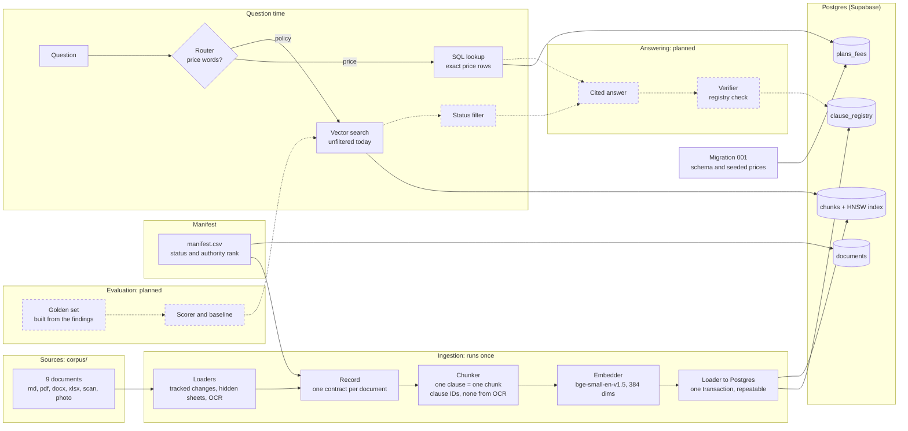

# Architecture v0.3: chunking, embeddings and routing

Status: after the 14 Nov build. Builds on [v0.2](v0.2-ingestion.md). Dashed boxes are planned, not built.

## How to read this document

This page describes the system as it stands after 14 Nov: the corpus is cut into citable chunks, embedded locally, stored in Postgres with a vector index, and a rule decides whether a question goes to SQL or to vector search. It is written so that someone new to the project can follow what exists, why it looks this way, and what is still missing.

### What changed since v0.2

| Area | v0.2 | v0.3 |
| --- | --- | --- |
| Chunking | Planned | Built: one clause is one chunk, 96 chunks over 9 documents |
| Clause IDs | Planned | Built: read from the document's numbering, 71 registry rows |
| Embeddings | Planned | Built: `bge-small-en-v1.5`, 384 dimensions, run locally |
| Load into Postgres | Planned | Built: one transaction, safe to rerun |
| Plans and fees | Table designed | 21 rows in `plans_fees`, the only source of prices |
| Routing | Planned | Built: price questions to SQL, policy questions to vectors |
| Status filter, answer, verifier, scorer | Planned | Still planned, next up on 15 Nov |

### How to read the diagram

There are two paths. The **ingestion** path runs once, left to right, and fills the database. The **question** path starts at the question and picks SQL or vectors before it searches. Dashed boxes and lines are planned: the status filter, the cited answer, the verifier and the evaluation. Today the vector search has no status filter, so superseded and draft clauses can come back in results. That is deliberate, because it is the baseline we measure the filter against.

### The ingestion path, step by step

1. **Loaders** read each file in its own format and keep what a reader would see: tracked deletions are skipped, hidden sheets are skipped, scans are read with OCR.
2. **Records** give every document one shape: text, units, status and authority rank from the manifest, and a flag for OCR.
3. **The chunker** cuts each record on its own structure. A numbered clause is one chunk and takes the number as its clause ID. Unnumbered text is packed paragraph by paragraph up to 1,200 characters. OCR text never receives a clause ID.
4. **The embedder** turns each chunk, together with its section title, into 384 numbers.
5. **The loader** deletes the old rows for these documents and inserts the new chunks and registry rows in one transaction, so a rerun gives the same database.
6. **The schema** holds the tables and the HNSW index. `plans_fees` is filled by the migration, not by the loader.

### The question path

A rule looks for price words (price, cost, how much, fee, per month, per year). A match goes to SQL, which reads the plan, currency and billing period from the question and returns exact rows from `plans_fees`. Anything else is embedded and searched against `chunks` by cosine similarity. The word "annual" on its own does not trigger the SQL path, because "Can I cancel my annual plan?" is a policy question.

### Chunking hazards found on 14 Nov

| Hazard | What happened | How it is handled |
| --- | --- | --- |
| Heading-only chunks | Section headings became chunks of their own (7 in the approved terms) | Dropped; the heading is kept in `section_ref` |
| Flat PDF text | The approved fees and disputes PDF is one line with clauses `B.1` to `B.3` inline | Letter-style clause IDs are split inline |
| Price table in a chunk | The Schedule A price table sat inside a chunk | Cut out before chunking; prices come only from `plans_fees` |
| OCR misread an ID | OCR read `B.2` as `8.2` | OCR text never receives a clause ID |
| Similarity ignores authority | The refund search ranked v2 (14 days) and the draft (10 days) above the approved 7 | Baseline recorded; status filter and authority rank next |

## The decisions behind v0.3

These need entries in [decisions.md](decisions.md) as ADR-015 to ADR-018. ADR-010 to ADR-014 from [v0.2](v0.2-ingestion.md) are also still to be written there.

| ADR | Decision | Why | What it costs |
| --- | --- | --- | --- |
| 015 | One clause is one chunk, and the clause ID comes from the document's own numbering | Sharp matches, and every chunk is a citable unit that stays stable across edits | Depends on documents being numbered; unnumbered ones fall back to paragraphs |
| 016 | OCR text never receives a clause ID | An ID read by OCR can be wrong and would look real in the registry | OCR content cannot be cited by number |
| 017 | Price tables are kept out of the vector index; prices come only from `plans_fees` | One source of truth for every price | Price text in documents must be cut before chunking |
| 018 | Route by data type with plain rules first | Free, instant, deterministic and easy to test | Brittle on unusual phrasing; a model-based router can be compared later with the same tests |

Two smaller choices are worth knowing. The embedding model runs locally, so there is no key, no cost and no data leaves the machine. Every document is indexed, including superseded and draft ones, and the exclusion happens at query time. That lets tests prove the filter works, and it means the filter must be built before any answer is trusted.

## What exists and what does not

**Exists**

- `rag/ingest/chunk.py`: the chunker and clause IDs.
- `rag/ingest/embed.py`: local embeddings for chunks and questions.
- `rag/ingest/load_chunks.py`: the repeatable load.
- `rag/retrieval.py`: the router, the price lookup and the vector search.
- `rag/scripts/show_chunks.py` and `rag/scripts/db_counts.py`: inspection helpers.
- In the database: 9 documents, 96 chunks with vectors, 71 registry rows and 21 price rows.

**Planned for 15 Nov**

- The status filter before similarity, with authority rank to break ties.
- The cited answer and the verifier that checks every citation against the registry.
- The golden set built from the findings, the scorer and the baseline.

## Known limits

- Until the status filter exists, retrieval can return superseded, draft and informal chunks. The informal spreadsheet, including an old price list, is in the vector index.
- The router is a rule. A price question without a price word, such as "What do I pay for Pro?", would go to the vectors.
- The embedding model name is not stored with the vectors. Changing the model means re-embedding everything, and mixing two models in one index gives meaningless scores.
- A low best score, around 0.65 for the cancellation question, is a signal that nothing relevant was found. A minimum-score rule is still to be designed.

## Glossary

- **Chunk:** a piece of a document that is embedded, retrieved and cited as one unit.
- **Clause ID:** the number a clause carries in its document, such as `2.2` or `B.2`.
- **Registry:** the table of every real clause ID per document, used to check citations.
- **Embedding:** a list of numbers, 384 here, that stands for the meaning of a text.
- **Cosine similarity:** how close two embeddings are, measured by the angle between them.
- **HNSW:** an index that finds near neighbours quickly by searching a layered graph; it is approximate.
- **Router:** the rule that sends a question to SQL or to vector search.
- **Repeatable (idempotent) load:** a load that gives the same database however many times it runs.
- **Baseline:** the result before a fix, kept so the improvement can be measured.
- **Provenance:** the fields that say where a chunk came from: document, section, page and OCR flag.
