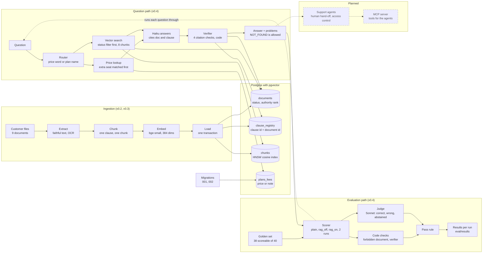

# AOP architecture v0.4: cited answers and evaluation

Version 0.4 · 13 Nov 2026 · covers the 15 Nov plan row · commits `b2095db` and `991227d`

v0.3 ended with a router and a vector index that could retrieve the right clause. v0.4 adds what turns retrieval into an answer a customer can rely on: a cited answer step, a verifier written in code, a status filter applied before ranking, and an evaluation harness that scores all of it against a golden set.

## How to read this page

- The diagram shows the whole system. **Solid** boxes exist and have been tested. **Dashed** boxes are planned.
- The five groups are ingestion (built in v0.2 and v0.3), the database, the question path, the evaluation path, and what comes next.
- Decisions are listed as proposed ADRs near the end. Their numbers must be checked against `decisions.md` before they are copied in.

## What changed since v0.3

| Area | v0.3 | v0.4 |
| --- | --- | --- |
| Answering | Retrieval only, no answer | Haiku answers from labelled sources and cites each statement, or replies `NOT_FOUND` |
| Checking | None | A code verifier rejects citations that were not given, are not approved, are not in the registry, or are missing |
| Authority | Authority rank as a tiebreaker | A status filter inside the SQL removes non-approved text before ranking; rank is the tiebreaker |
| Routing | Price words send the question to SQL only | Price rows are added next to the vector results; the vector search always runs, retrieving 8 chunks instead of 5 |
| Price data | 21 price rows | 24 rows: three "not offered on annual billing" rows with a note, price now nullable |
| Evaluation | Spot checks | Golden-set scorer, three conditions, two verdicts per answer, saved baseline and after-fix results |

## Architecture



The status filter is the join from the vector search to `documents`. The verifier reads the same table and the clause registry, so a bad citation is caught even if retrieval let something through.

## The question path, step by step

1. **Question arrives** with a mode: `plain` (no documents), `rag_off` (retrieval, no status filter) or `rag_on` (retrieval with the filter).
2. **Router** (`route` in `rag/retrieval.py`) returns `sql` if the question has a price word or names a plan or an extra seat, otherwise `vector`.
3. **Price lookup**, only on the `sql` route. `price_lookup` finds the plan, currency and billing words and queries `plans_fees`. The extra-seat pattern is tested before the plan names. A row with no price returns its note instead.
4. **Vector search**, always. The question is embedded as a query, compared by cosine distance on the HNSW index, filtered to `approved` documents in the SQL when the filter is on, and ordered by distance then authority rank. Eight chunks come back.
5. **Sources are labelled** as lines such as `[tos_v3 2.2] <clause text>` and `[plans_fees] Extra seat, annual, INR: not offered on annual billing`.
6. **Haiku answers** (`claude-haiku-5-5`) using only those sources, citing every statement, or replies exactly `NOT_FOUND`.
7. **Verifier** (`verify` in `rag/answer.py`) rejects a citation that was not among the sources given, points to a non-approved document, names a clause missing from the registry, or is absent.
8. **Result** is returned with the route, the source labels, the answer and the list of problems.

## The evaluation path, step by step

1. **Load** `eval/golden_set_core.csv`: 40 questions, 26 normal and 14 trap. Q29 and Q30 are skipped because they need a human hand-off and access control.
2. **Run** each question through three conditions, twice each, because these models take no temperature setting and vary between runs.
3. **Code checks:** did the answer cite a document in the question's `must_not_cite_files`, and did the verifier report a problem?
4. **Judge:** Sonnet (`claude-sonnet-5-5`) compares the answer with the reference and returns `correct`, `wrong` or `abstained`.
5. **Pass rule:** the judge accepts (or the answer abstained on Q27, Q35, Q39 or Q40) and no code check fired. In `plain` only the judge applies.
6. **Save** per-run rows and a summary under `eval/results`, with a tag so a later run never overwrites the baseline. Re-runs after an API outage are merged by question id, and the comparison refuses to report while error rows remain.

## Failure modes the design guards against

| Failure | Layer that catches it | Evidence |
| --- | --- | --- |
| A superseded or draft clause is cited | Status filter, then verifier | `rag_off`: 30 forbidden citations and 35 verifier problems; `rag_on`: 0 and 0 |
| Informal text drives an unapproved answer (Q27) | Status filter | `rag_off` judged wrong in both runs |
| An invented or OCR-misread clause id | Clause registry | OCR read B.2 as 8.2; the registry has no such clause |
| A rule question sent to the price table only (Q06, Q15, Q32) | Additive routing | All three failed before the change and pass after |
| The wrong plan row returned (Q11) | Extra seat matched before plan names | "Extra Team seat" no longer returns Team rows |
| A fact held in an absence (Q12) | A note row in `plans_fees` | "Not offered on annual billing" had no row at all |
| A model guessing with no documents | Abstention rule | `plain`: 7 confident wrong answers |
| Run-to-run noise read as progress | Two runs per question | `plain` code unchanged, score 21 then 18 |
| An API outage read as failures | Error-row check in the merge | Q27 and Q28 re-run; 0 error rows remain |

## Data model change: migration 002

```sql
alter table plans_fees add column if not exists note text;
alter table plans_fees alter column price drop not null;
alter table plans_fees add constraint plans_fees_price_or_note
  check (price is not null or note is not null);
insert into plans_fees (plan, billing, currency, price, note) values
  ('Extra seat','annual','EUR',null,'not offered on annual billing'),
  ('Extra seat','annual','USD',null,'not offered on annual billing'),
  ('Extra seat','annual','INR',null,'not offered on annual billing');
```

The Schedule A table has a merged cell reading "not offered on annual billing". It holds no number, so converting the table to rows dropped it. Every row must now have a price or a note.

## Decisions (proposed)

Numbers continue from ADR-018 and must be checked against `decisions.md`.

- **ADR-019: Filter by status inside the query, before ranking.** Similarity cannot tell an approved clause from a superseded one. Consequence: the HNSW index filters after searching, so on a large table a strict filter can return fewer rows than asked for; partition or over-fetch at scale.
- **ADR-020: Verify citations in code, not with a model.** Deterministic, free and independent of the answering model's blind spots. Consequence: it proves provenance, not that the clause supports the claim, so the judge is still needed.
- **ADR-021: Price rows are added to the vector results, not substituted for them.** A price word is a weak routing signal. This revises the routing part of ADR-018; the rule-based router itself stays. Consequence: a longer prompt and slightly more cost per question.
- **ADR-022: Store "not offered" cells as rows with a note.** A fact can be an absence. Consequence: price is nullable and every lookup must handle a row with no number.
- **ADR-023: Evaluate with two verdicts and two runs, and never overwrite the baseline.** Code and a judge fail differently, and runs vary. Consequence: about 450 model calls and about an hour per full run; later runs are tagged and merged by id.

## What exists and what is planned

| Component | State |
| --- | --- |
| Ingestion, chunking, embeddings, load | Built (v0.2, v0.3) |
| Router, price lookup, vector search with status filter | Built and scored |
| Cited answer step with Haiku | Built and scored |
| Verifier and clause registry checks | Built and scored |
| Golden-set scorer, judge, comparison | Built; baseline and after-fix saved |
| Human hand-off and access control (Q29, Q30) | Planned, with the agents |
| MCP server | Planned |
| Multi-agent support desk | Planned |

## Known limits

- **Scope of the score.** The numbers cover retrieval and answering only. Q29 and Q30 are not scored.
- **Two changes at once.** The router fix and the move from 5 to 8 chunks shipped together, so the gain cannot be split between them.
- **One judge.** One model grades against hand-written references, and Q24's reference omits a true suspension reason (clause 4.4). A correction belongs in golden set v1.1, and a human spot-check of a sample is still missing.
- **Heuristic router.** It is rules, not a model, and relies on price words and plan names.
- **Over-abstention.** The filtered pipeline is safe but can answer `NOT_FOUND` when the answer exists; the abstention rate should be tracked as its own number.
- **Small scale.** At 96 chunks the filter behaviour, cost and run time are not stressed.
- **Q11 wording.** The price row says "Extra seat" while Schedule A says "Extra seat (Team)", so the model hedges on the plan.

## Glossary additions

| Term | Meaning |
| --- | --- |
| Grounding | The model may use only the sources it is handed |
| Abstention | Replying `NOT_FOUND` instead of guessing |
| Verifier | Code that checks every citation after the model answers |
| Status filter | Removes non-approved documents before ranking |
| Golden set | Fixed questions with reference answers, including traps |
| rag_off, rag_on | Retrieval without and with the status filter |
| Noise floor | The run-to-run swing, about 3 runs here, below which a difference means nothing |
