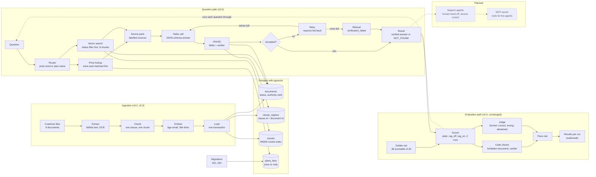

# AOP architecture v0.5: structured answers and verified retry

Version 0.5 · 14 Nov 2026 · covers the 16 Nov plan row · commit `70f1c56`

v0.4 ended with a model that wrote cited text and a verifier that checked it after the fact: a failed check was recorded and the answer was still returned. v0.5 changes the contract. The model returns a schema-shaped answer, the same verifier gates it, a failed answer gets a bounded retry with the reasons fed back, and if retries run out the user gets a refusal. An unverified answer is never returned.

## How to read this page

- The diagram shows the whole system. **Solid** boxes exist and have been tested. **Dashed** boxes are planned.
- The five groups are ingestion (built in v0.2 and v0.3), the database, the question path, the evaluation path, and what comes next.
- Decisions are listed near the end and recorded in [decisions.md](decisions.md) as ADR-024 to ADR-028.

## What changed since v0.4

| Area | v0.4 | v0.5 |
| --- | --- | --- |
| Answer format | Free text with `[doc clause]` brackets, refusal is the string `NOT_FOUND` | JSON with `answer`, `citations`, `refused`, `refusal_reason`, enforced by the API |
| Checking | Verifier output recorded next to the answer | The same verifier gates the answer; structured citations are converted to it |
| Failed check | Answer still returned with the problems listed | Up to 2 retries with the verifier's reasons; then a refusal with `verification_failed` |
| Invalid reply | Not applicable | Invalid JSON counts as a failed attempt and is retried |
| Result keys | question, mode, route, sources, answer, problems | Same keys, plus `refused`, `refusal_reason`, `citations`, `attempts`, `attempt_log` |
| Scorer | Reads `NOT_FOUND` and brackets | Unchanged: a refusal is returned as `NOT_FOUND`, citations are re-appended as brackets |
| Tests | Spot checks of the verifier | Offline tests for the verifier gate and for the retry loop using a stub model |
| Evaluation | Baseline and after-fix | Adds `structured_v1`, with a re-run merged by id and a three-way comparison |

## Architecture

The gate is `check()`. It reads the same `documents` table and clause registry as v0.4, so a bad citation is caught even if retrieval let something through. The retry loop is the only new control flow.

## The question path, step by step

Steps 1 to 5 are unchanged from v0.4.

1. **Question arrives** with a mode: `plain` (no documents), `rag_off` (retrieval, no status filter) or `rag_on` (retrieval with the filter).
2. **Router** (`route` in `rag/retrieval.py`) returns `sql` if the question has a price word or names a plan or an extra seat, otherwise `vector`.
3. **Price lookup**, only on the `sql` route, from `plans_fees`. A row with no price returns its note.
4. **Vector search**, always: filtered to `approved` documents in the SQL when the filter is on, ordered by distance then authority rank, eight chunks.
5. **Sources are labelled** as lines such as `[tos_v3 2.2] <clause text>` and `[plans_fees] ...`.
6. **Haiku answers** (`claude-haiku-5-5`) through `ask_structured`, with the JSON schema in `output_config.format`. The reply is parsed; invalid JSON counts as a failed attempt.
7. **`check()`** accepts a refusal at once. Otherwise it rejects an empty answer, rejects an answer with no citations, converts each citation to a label (`doc_id clause_id`, or `plans_fees`), and passes them to the v0.4 `verify()`.
8. **Retry** (`answer_with_retry`): on problems, the rejected reply and the reasons are appended as new messages and the model is called again, up to 2 retries (3 attempts in total).
9. **Fallback**: if the last attempt still fails, the result is a refusal with reason `verification_failed`.
10. **Result** keeps the v0.4 keys. A refusal is returned as `answer = "NOT_FOUND"`. An accepted answer gets its citations re-appended as `[doc clause]`.

## The answer schema

| Field | Type | Meaning |
| --- | --- | --- |
| `answer` | string | One or two sentences, no brackets |
| `citations` | list of `{doc_id, clause_id}` | Every source used; `clause_id` is empty for `plans_fees` |
| `refused` | boolean | True when the sources do not contain the answer |
| `refusal_reason` | string | Short reason; `verification_failed` is set by the pipeline, not the model |

All four fields are required and `additionalProperties` is false. The schema guarantees shape only: a citation can be valid JSON and still be invented, which is why the verifier stays.

## The evaluation path

The scorer, judge, code checks and pass rule are unchanged. What changed is how results are read.

| Mode | Baseline | After router fix | Structured v1 | Wrong | Abstained |
| --- | --- | --- | --- | --- | --- |
| plain | 21/76 | 18/76 | 22/76 | 7 | 49 |
| rag_off | 46/76 | 38/76 | 72/76 | 3 | 8 |
| rag_on | 66/76 | 75/76 | 76/76 | 0 | 8 |

- **Merged run.** Ten rows errored when the local network dropped (Q23, Q31, Q32, Q33), including in `plain`, which ruled out the new code. Those four questions were re-run with tag `structured_v1_rerun` and merged by id into `structured_v1_merged_runs.csv`. The comparison script refuses to report while error rows remain; it reported zero.
- **Columns that are now true by design.** "Verifier problems" and "forbidden cited" are zero in the final answers because a failed answer is never returned. They no longer measure anything.
- **What the numbers do not show.** The runs file has no `attempts` column, so the share of answers rescued by a retry is unknown.

## Failure modes the design guards against

| Failure | Layer that catches it | Evidence |
| --- | --- | --- |
| A made-up citation (`tos_v9 7.7`) | `check()` calls the verifier | `rag/test_structured.py`: rejected as "not among the sources it was given" |
| A real-looking clause that was not given (`tos_v3 9.9`) | `check()` | Same test, rejected for the same reason |
| An answer with no citation | `check()` | Same test, rejected as "answer has no citations" |
| A citation to a superseded document | Status filter, then verifier | v0.4 evidence; in v0.5 the retry steers the model to approved sources or a refusal |
| A first answer that fails, a second that passes | Retry with feedback | `rag/test_retry.py` case A; seen once live (rag_off, Pro plan question, 2 attempts) |
| A model that never fixes its answer | Bounded retry and fallback | Case B: 3 attempts, then `verification_failed` |
| Invalid JSON from the model | Parse failure counts as an attempt | Case C |
| A model that correctly refuses | Accepted without retry | Case D |
| A test passing for the wrong reason | Real-format ids in the test | A hyphenated id was rejected as "no citation"; test rewritten with `tos_v9` and a positive case |
| An outage read as failures | Error-row check in the comparison | 10 error rows found, 4 questions re-run, 0 remain |

## Decisions

Recorded in [decisions.md](decisions.md). ADR-026 and ADR-027 refine the verifier decision in ADR-020.

- **ADR-024: Use schema-constrained output for answers.** `output_config.format` with a JSON schema; `refused` replaces the `NOT_FOUND` string. Consequence: cannot be combined with the API's own citations feature or with prefill, and changing the format invalidates the prompt cache. Haiku 5.5 support was confirmed with a test, not assumed from the docs.
- **ADR-025: Reuse the one verifier; convert structured citations to it.** A rule change lands in one place. Consequence: the verifier still speaks the bracket pattern, so an id with a hyphen is rejected as unparseable. That fails safe.
- **ADR-026: Retry at most twice, feeding back the verifier's reasons.** A fixable slip should not cost a good answer. Consequence: up to 3 model calls for one answer, and the attempt count is not yet recorded.
- **ADR-027: Fail closed.** After the last retry the pipeline returns a refusal with `verification_failed`, never the unverified answer. Consequence: over-refusal is the main remaining risk, and verifier columns in the results are now true by design.
- **ADR-028: Keep the scorer interface stable.** A refusal is returned as `NOT_FOUND` and citations are re-appended as brackets, so the harness and its baseline stay comparable. Consequence: the structured fields are converted back to text at the boundary.

## What exists and what is planned

| Component | State |
| --- | --- |
| Ingestion, chunking, embeddings, load | Built (v0.2, v0.3) |
| Router, price lookup, vector search with status filter | Built and scored |
| Structured answer step with Haiku | Built and scored |
| Verifier gate and bounded retry with fallback | Built, tested offline, scored |
| Golden-set scorer, judge, comparison | Built; baseline, after-fix and structured v1 saved |
| Attempts recorded per run, attempt log stored | Planned |
| Human hand-off and access control (Q29, Q30) | Planned, with the agents |
| MCP server | Planned |
| Multi-agent support desk | Planned |

## Known limits

- **Provenance, not truth.** A valid, approved citation does not prove the sentence is right. Only the judge model catches that, and only in evaluation.
- **Three changes at once.** The prompt, the schema and the retry shipped together, so the `rag_off` gain (38 to 72 of 76) cannot be split between them. The v0.4 confound (router fix and 8 chunks together) also still stands.
- **The retry may be doing the filter's job.** In `rag_off` the verifier rejects citations to superseded documents and the retry steers the model away, so a green `rag_off` score does not show that retrieval is healthy.
- **Attempts are unmeasured.** The scorer does not record them and `attempt_log` is returned but not stored.
- **Over-abstention.** The filtered pipeline refuses on 8 of 76 runs; that rate should be tracked as its own number.
- **One judge.** One model grades against hand-written references, and Q24's reference omits a true suspension reason (clause 4.4). The correction belongs in golden set v1.1.
- **Heuristic router and small scale.** Unchanged from v0.4: rules, not a model, and 96 chunks do not stress the filter, cost or run time.
- **Scope of the score.** Q29 and Q30 are not scored.

## Glossary additions

| Term | Meaning |
| --- | --- |
| Structured output | The model's reply must match a JSON schema, enforced by the API |
| Constrained decoding | How the API forces schema-valid output while the model writes |
| Shape versus truth | A schema guarantees fields, not that their contents are real |
| Bounded retry | A failed answer is sent back with reasons, a fixed number of times |
| Fail closed | When no verified answer exists, refuse instead of returning an unverified one |
| Stub model | A scripted stand-in for the model call, used to test failure paths offline |
| True by design | A metric guaranteed by the pipeline's rules, so it no longer measures anything |