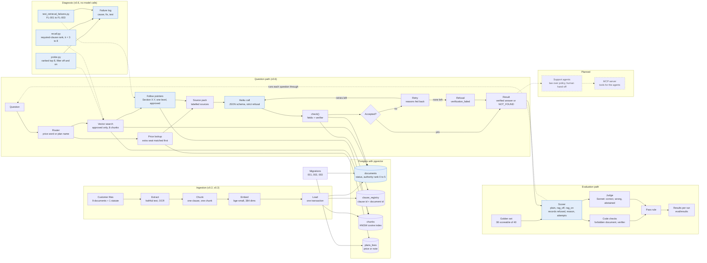

# AOP architecture v0.6: failure diagnosis, pointer expansion and the statute tier

Version 0.6 · 17 Nov 2026 · covers the 17 Nov plan row · commits `c209f65`, `2f049a2`, `e34358b`, `8f07cdd`

v0.5 ended with a verified answer path. v0.6 asks what that path does when retrieval hands it the wrong evidence. Three planted failures were diagnosed with a probe, fixed at their cause and pinned with tests that run without a model: a stale version outranking the current one, a rule whose formula sits in a different clause, and a policy that a law overrides. The corpus gained a statute tier, retrieval gained one step (follow pointers), and the answer prompt now separates a refusal from a denial.

## How to read this page

- The diagram shows the whole system. **Solid** boxes exist and have been tested. **Dashed** boxes are planned. **Blue** boxes are new or changed in v0.6.
- The groups are ingestion, the database, the question path, diagnosis (new), the evaluation path, and what comes next.
- Decisions are listed near the end and recorded in [decisions.md](decisions.md) as ADR-029 to ADR-031. The failure log is [failure-log.md](../failure-log.md).

## What changed since v0.5

| Area | v0.5 | v0.6 |
| --- | --- | --- |
| Corpus | 9 documents, sources ranked official 1 to scan 5 | 10 documents; a fictional statute added as source type `statute`, approved, authority rank 0 (migration 003) |
| Retrieval | Status filter, 8 chunks by distance, price rows added | Same, plus pointer expansion: clauses named as "Section X.Y" in retrieved text are added, one level, same document, status filter kept |
| Refusal | `refused` true when the sources do not contain the answer | `refused` only when the sources lack the information; a rule that leads to a no is a cited answer |
| Scorer | Does not store attempts or refusal reasons | Records `refused`, `refusal_reason` and `attempts` per run |
| Diagnosis | None | `probe.py`, `recall.py`, `recall_expand.py` and a failure log |
| Tests | Verifier gate and retry loop, offline | Adds `test_retrieval_failures.py`: one characterization test per failure, no model calls |
| Evaluation | `structured_v1`, merged | Adds tagged re-runs and a full run after the changes: rag_on 76/76, 0 error rows |

## Architecture

Retrieval stays neutral: it returns approved evidence and does not decide which source wins. The statute and the policy are both retrieved; the step that decides the law outranks the policy is planned with the agents. The diagnosis group reads the same retrieval code the question path runs, so a probe shows exactly what the model would see.

## The question path, step by step

Steps 1 to 3 and 5 to 10 are unchanged from v0.5. Step 4 gained a second half.

1. **Question arrives** with a mode: `plain`, `rag_off` (retrieval, no status filter) or `rag_on` (retrieval with the filter).
2. **Router** returns `sql` for a price word or a plan name, otherwise `vector`.
3. **Price lookup**, only on the `sql` route, from `plans_fees`.
4. **Vector search**, always, then **follow pointers**. The search is filtered to `approved` documents inside the SQL when the filter is on, ordered by distance then authority rank, eight chunks. `expand_references` then reads each retrieved clause for the phrase "Section X.Y" and adds that clause from the same document, one level only, status filter kept. Added rows carry no score.
5. **Sources are labelled** as `[tos_v3 2.2] <clause text>` and `[plans_fees] ...`.
6. **Haiku answers** through `ask_structured` with the JSON schema. The prompt now says: set `refused` only when the sources do not contain the information; a rule that leads to a no is an answer, cited.
7. **`check()`** accepts a refusal at once; otherwise it rejects an empty answer or one with no citations and passes the citations to the verifier.
8. **Retry** up to 2 times, feeding back the verifier's reasons.
9. **Fallback** to a refusal with `verification_failed`.
10. **Result** keeps the v0.5 keys. A refusal is returned as `NOT_FOUND`. The scorer now also saves `refused`, `refusal_reason` and `attempts`.

## The three failure families

| ID | Family | Question | Cause | Fix | Test |
| --- | --- | --- | --- | --- | --- |
| FL-001 | Stale version | Q28 | Near-identical versions of one clause; three scored within 0.007 | Status filter before ranking (ADR-019) | Filter on: `tos_v3 2.2` first. Filter off: `tos_v2 2.2` outranks it |
| FL-002 | Rule split across clauses | Q07, Q38 | Formula clause 3.5 is dissimilar to the question; clause 3.6 names it | Pointer expansion (ADR-029) | Required clauses present after expansion, at most 2 added, no non-approved rows, Q07 still lacks 3.5 without it |
| FL-003 | Law versus policy | Q29 | Similarity cannot encode authority; the statute was not in the corpus | Statute tier at authority rank 0 (ADR-030) | `tos_v3 2.2` and `consumer_act` 2.2, 3.1, 3.2 in the top 8; policy outranks statute by similarity; filter off leaves the statute side incomplete |

FL-003 is fixed on the retrieval side only. The escalation, where the law wins and a person takes over, is planned with the agents, so Q29 stays out of the scorer.

## The evaluation path

The scorer, judge, code checks and pass rule are unchanged. What changed is how results are read and what the runs file records.

| Mode | Structured v1 (merged) | Full run after FL-003 | Wrong | Abstained |
| --- | --- | --- | --- | --- |
| plain | 22/76 | 18/76 | 6 | 54 |
| rag_off | 72/76 | 73/76 | 1 | 6 |
| rag_on | 76/76 | 76/76 | 0 | 6 |

- **Error rows.** The full run has 0. The comparison is only read after that check.
- **Refusals.** On rag_on, 8 of 76 runs refused, all on Q27, Q35, Q39 and Q40, the questions expected to refuse. Two of those were judged `correct` and six `abstained`, which is why the abstained column shows 6.
- **Q37.** Before the prompt change, rag_on abstained on 2 of 8 runs. The new columns showed the model had applied the 7-day rule and returned it as a refusal, which the scorer turned into a bare `NOT_FOUND`. After the change, 6/6.
- **Refusal check.** Q27, Q35, Q39 and Q40 are 12/12 on every mode over 3 runs, with 0 wrong answers.
- **Plain mode.** It uses no sources and moves between runs; its change from 22 to 18 is not caused by these changes.

## Failure modes the design guards against

| Failure | Layer that catches it | Evidence |
| --- | --- | --- |
| A superseded clause ranks first | Status filter in the SQL | FL-001 test, with the planted failure still reproducible |
| A needed clause is dissimilar to the question | Pointer expansion | FL-002 test; 0.1 extra chunks per question against 4 for k=12 |
| The law is not in the evidence | Statute tier in the corpus | FL-003 test: statute clauses in the top 8 |
| A new document collides with a planted trap | Collateral check after a corpus change | The statute said "14 days", the T02 number; changed to 21 after confirming no other document used it |
| A refusal hides a correct denial | Strict `refused` definition, recorded reasons | Q37: 5/6 before, 6/6 after; refuse questions 12/12 |
| A made-up or ungiven citation | `check()` and the verifier | v0.5 evidence, unchanged |
| An outage read as failures | Error-row check | Unchanged from v0.5 |

## Decisions

Recorded in [decisions.md](decisions.md). ADR-029 refines the retrieval design in ADR-019. ADR-031 resolves the limit noted in ADR-028, that the scorer could not see attempts.

- **ADR-029: Add the clauses a retrieved clause points to.** "Section X.Y", same document, one level, status filter kept. Alternatives rejected: k=12, neighbouring clauses, hybrid search, reranking. Consequence: works only where the text contains that exact phrase.
- **ADR-030: Add a `statute` source type at authority rank 0 and leave ranking neutral.** Alternatives rejected: boost the score by authority, hybrid search or reranking, leave Q29 unscoreable. Consequence: a new approved document changes context for unrelated questions, and the statute is fictional.
- **ADR-031: Define `refused` strictly and record `refused`, `refusal_reason` and `attempts`.** Alternatives rejected: keep the loose wording, change the judge, change the scorer boundary again. Consequence: the prompt could make the model answer when it should refuse; checked on four questions at three runs.

## What exists and what is planned

| Component | State |
| --- | --- |
| Ingestion, chunking, embeddings, load | Built (v0.2, v0.3) |
| Router, price lookup, vector search with status filter | Built and scored |
| Pointer expansion | Built, tested offline, scored |
| Statute tier (source type, rank 0, migration 003) | Built, tested offline, scored |
| Structured answer, strict refusal, verifier gate, bounded retry | Built, tested offline, scored |
| Probe, recall scripts, retrieval failure tests, failure log | Built |
| Scorer records refusals and attempts | Built |
| Chunk size experiments, hybrid search, reranking | Not built; considered and not adopted |
| Law over policy and human hand-off (Q29, Q30) | Planned, with the agents |
| MCP server | Planned |
| Multi-agent support desk | Planned |

## Known limits

- **Escalation is not built.** Retrieval gives the model both policy and law, but nothing decides that the law wins. Q29 is not scored.
- **Provenance, not truth.** The verifier checks that every citation present is legitimate, not that every claim has one. One earlier Q31 answer carried an uncited statute sentence and passed.
- **Pointer expansion needs the phrase.** A document that says "see the clause above" gets nothing. Q06 and Q40 are fragile.
- **A fictional statute.** It proves the retrieval path, not that real law retrieves this way.
- **Thin runs.** Two to six runs per question and one judge model show direction, not proof. The attempt counts are now recorded but the retry-rescue rate has not been analysed.
- **Chunk size is untested.** The planned chunk-size experiments were not run; the T14 failure was handled as a dependency problem.
- **Golden set v1.1 is pending.** Q24's reference omits clause 4.4, Q28's `must_not_cite_files` omits the meeting note, and Q29's authoritative source still reads "regulation text (to be read)".
- **Heuristic router and small scale.** Unchanged from v0.4: rules, not a model, and about 100 chunks do not stress the filter, cost or run time.

## Glossary additions

| Term | Meaning |
| --- | --- |
| Failure family | A group of retrieval misses that share one cause and one fix |
| Probe | A script that prints the ranked results for one question, filter off and on |
| Characterization test | A test that proves the fix and that the planted failure still reproduces without it |
| Pointer expansion | Adding the clauses that a retrieved clause names, from the same document |
| Authority rank | A number for how strong a source is; used as a tiebreaker, not a score |
| Statute tier | A source type above the official policy, rank 0, for a law that overrides policy |
| Collateral effect | A change in an unrelated question's result caused by adding a document or changing a prompt |
| Refusal versus denial | A refusal means the sources are silent; a denial is a rule that leads to a no, and is answered and cited |
