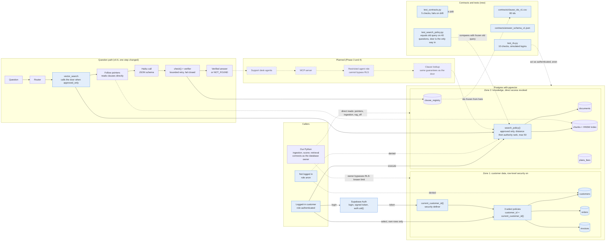

# AOP architecture v0.7: access control, the guarded door and frozen contracts

Version 0.7 · 18 Nov 2026 (work finished 20 Nov 2026) · covers the 18 Nov plan row and gate G1 · commits `783f766`, `54bdac1`, `9878e58`, `e44c35a`, `38825de`, `dc468ac`, `d6b51d0`, `116d131`

v0.6 ended with retrieval that finds the right evidence. v0.7 asks who is allowed to see what, and what must never change underneath the other parts. The database now decides which customer rows a logged-in user can read, the policy knowledge sits behind one guarded function, and the two shapes that citations, the verifier, the golden set and later the MCP server and agents depend on (clause ids and the answer schema) are frozen as versioned files with a test that fails on drift. Gate G1, the RAG foundation, is met.

## How to read this page

- The diagram shows the whole system. **Solid** boxes exist and have been tested. **Dashed** boxes are planned. **Blue** boxes are new or changed in v0.7.
- The groups are callers, Supabase Auth, the database with its two zones, the question path, contracts and tests, and what comes next.
- Decisions are listed near the end and recorded in [decisions.md](decisions.md) as ADR-032 and ADR-033.

## What changed since v0.6

| Area | v0.6 | v0.7 |
| --- | --- | --- |
| Database | One zone: documents, chunks, registry and fees, readable by whoever connects | Two zones with different rules. Zone 1: customer data with row-level security. Zone 2: knowledge tables closed to the API roles, reachable only through `search_policy()` |
| Customer data | None | `customers`, `orders`, `invoices` (migration 004). Two synthetic customers: cust_001 (Pro, monthly, EUR) and cust_002 (Team, annual, USD) |
| Identity | None | Two Supabase Auth logins linked by email to the two customers (migration 005) |
| Access rule | None | `current_customer_id()` security-definer helper (migration 006) and three select policies on `customer_id = current_customer_id()`; `anon` revoked |
| Retrieval | `vector_search` read the tables directly and applied the status filter in its own SQL | `vector_search` calls `search_policy()` when `approved_only`. The unfiltered direct query remains for evaluation only (`rag_off`) |
| Contracts | Clause ids and the answer schema were conventions | `contracts/clause_ids_v1.csv` (80 `(doc_id, clause_id)` pairs) and `contracts/answer_schema_v1.json`, frozen; `freeze_contracts.py` refuses to overwrite a version |
| Tests | Retrieval failures, verifier gate, retry loop (offline) | Adds `test_rls.py` (10 checks), `test_search_policy.py` and `test_contracts.py` (5 checks). None call the model |
| Evaluation | Full run after v0.6: rag_on 76/76 | Equivalence test on all 40 golden questions, plus a six-question scorer re-run saved as `after_door_*`. No full re-run |
| Decisions | ADR-029 to ADR-031 | ADR-032 (guarded door and lockdown), ADR-033 (frozen contracts) |

## Architecture

The design rule behind the picture: nothing that protects data may depend on what the model says. Protection sits in layers the model cannot reach, and the prompt is the weakest of them.

## The two zones and who can do what

Supabase gives four roles that behave differently. The last two skip row-level security, which is why the tests pretend to be a customer.

| Role | What it is | Customer tables (zone 1) | Knowledge tables (zone 2) | `search_policy()` |
| --- | --- | --- | --- | --- |
| `anon` | Not logged in | No rights | No direct access | Cannot call it |
| `authenticated` | A logged-in customer | `select` on three tables, own rows only; no insert, update or delete | No direct access | May call it |
| `service_role` | A server key | Bypasses row-level security | Direct access | May call it |
| Database owner | What our Python connects as | Bypasses row-level security | Direct access | Can call it |

## The query paths

**Customer data.** A query such as `select * from invoices` runs under the caller's role. `anon` is denied. `authenticated` gets the policy `customer_id = current_customer_id()`, where the helper looks up the customer whose `auth_user_id` equals `auth.uid()`. Rows of any other customer are hidden, as if they did not exist. The helper is `security definer` because it must read `customers`, which a customer may not read directly.

**Policy knowledge.** Step 4 of the v0.6 question path changed from reading the tables to calling `search_policy(query_embedding, match_count)`. The function returns approved clauses only, ordered by distance and then authority rank, with the limit capped at 50. It has no parameter that turns the filter off. Because the tables are closed to the API roles, it is the only way in for them. The unfiltered direct query used by `rag_off` and the pointer step in `expand_references` still read the tables as the owner; both are recorded as known limits.

## The tests

| Test | What it proves | Checks |
| --- | --- | --- |
| `test_rls.py` | Each customer sees only their own customer row, orders and invoices; Q30 (cust_001 asks for cust_002's invoice) returns nothing, by filter and by id; a login with no customer sees nothing; `anon` is denied; a customer cannot change an invoice or delete an order. Run as simulated logins with `set local role` and `request.jwt.claims` | 10 |
| `test_search_policy.py` | The function equals a frozen copy of the old Python query on all 40 golden questions at k=8; a logged-in customer can call it; it returns only approved clauses even with a huge `match_count`; the count is capped at 50; a customer and `anon` cannot read the four knowledge tables directly; `anon` cannot call it | Equivalence plus door checks |
| `test_contracts.py` | The schema in `answer.py` equals the frozen schema; all 80 frozen clause ids are still in the registry; a changed schema would be caught; a renamed clause id would be caught | 5 |

The positive checks matter as much as the denials: cust_001 must still see their own invoices, or the policy is broken in the other direction. The equivalence test keeps the old SQL inside the test. Comparing the function with `vector_search` would have become a comparison with itself after the switch. `test_contracts.py` includes two checks that break a copy of the data to prove the test can fail.

## The evaluation path

The scorer, judge, code checks and pass rule are unchanged. The door switch was checked in two ways, and not by a new full run.

| Check | Result |
| --- | --- |
| Function against frozen old query, all 40 golden questions, k=8 | Same rows on every question |
| Scorer subset after the switch (`after_door_*`): 6 questions, 2 runs each | rag_on 12/12 and rag_off 12/12, 0 wrong, 0 forbidden citations, 0 verifier problems. `plain` is 0/12 on this subset, as expected for a model with no sources |
| Full run | Last full run is the v0.6 one: plain 18/76, rag_off 73/76, rag_on 76/76 |

A six-question subset is a smoke check, not a new baseline. If retrieval ranking ever changes, the equivalence test is the check that catches a drift between the door and the old query.

## Failure modes the design guards against

| Failure | Layer that catches it | Evidence |
| --- | --- | --- |
| One customer reads another's invoices | Row-level security in the database | `test_rls.py`; Q30 returns nothing |
| A caller skips the status filter and unapproved text reaches the model | The door has no filter parameter; tables closed to API roles | `test_search_policy.py` |
| A forgotten table is readable by default | Explicit revoke, not reliance on a default | Checked: no default rights existed; locked anyway |
| A policy test passes because it ran as the owner | Tests switch to `authenticated` first | `test_rls.py` |
| A refactor silently changes retrieval | Frozen reference query inside the test | `test_search_policy.py` on 40 questions |
| A clause id or the answer schema changes silently | Versioned contracts and a drift test | `test_contracts.py` |
| A test that has never failed proves little | Checks that break a copy of the data | `test_contracts.py` |

## Decisions

Recorded in [decisions.md](decisions.md).

- **ADR-032: Put the knowledge base behind one guarded function and lock the tables.** Row-level security on customer tables through `current_customer_id()`, and direct access to documents, chunks, clause_registry and plans_fees revoked from the API roles. Alternatives rejected: filter by customer in application code; leave the knowledge tables readable and rely on the prompt. Consequence: Python connects as the owner, which bypasses row-level security, and `expand_references` still reads clauses directly. Revisit in Phase 3, when agents get a restricted database role and a clause lookup equivalent to `search_policy()`.
- **ADR-033: Freeze clause ids and the answer schema as versioned files.** The latest version is the contract, and `test_contracts.py` fails on drift. Alternatives rejected: freeze the whole registry including `section_ref` and `topic`; rely on convention and review. Consequence: any change to the schema or a frozen id needs a new version and an ADR; new clause ids are allowed and only reported. Revisit if the answer needs a new field, such as attempts or claim coverage.

## What exists and what is planned

| Component | State |
| --- | --- |
| Ingestion, chunking, embeddings, load | Built (v0.2, v0.3) |
| Router, price lookup, vector search through the door | Built and tested |
| Pointer expansion, statute tier | Built (v0.6); pointer step still reads directly |
| Structured answer, verifier gate, bounded retry | Built (v0.5) |
| Customer tables, login link, row-level security | Built and tested |
| `search_policy()` and table lockdown | Built and tested |
| Frozen contracts and drift test | Built and tested |
| Gate G1 (RAG foundation) | Met on 20 Nov 2026 |
| Restricted agent role | Planned, Phase 3 |
| Clause lookup equivalent to the door; pointer step moved behind it | Planned, Phase 3 |
| MCP server, with tools running under the restricted role | Planned, Phase 3 |
| Law over policy and human hand-off (Q29), write paths and refunds | Planned, Phase 3 and 4 |

## Known limits

- **Owner bypass.** Our Python connects as the database owner, which skips row-level security. The guarantee holds for the API roles and not yet for our own code. A bug in our code could read any row.
- **Direct reads remain.** `expand_references`, ingestion and the `rag_off` evaluation path read the knowledge tables directly.
- **Provenance, not truth.** The verifier checks where a citation came from, not that every sentence has one or that the clause supports the claim.
- **Select-only policies.** Writes are denied because no write policy exists. Phase 3 actions such as a refund will need write paths designed deliberately.
- **Filter after the index.** The approved filter runs after the HNSW index finds neighbours, so on a very large table a strict filter could return fewer than 8 rows. At about 100 chunks it does not bite; it is a scale limit.
- **Small and synthetic.** Two synthetic customers and 40 questions prove the mechanism, not behaviour under load or against a real attacker. Behaviour under load was not tested.
- **No audit trail.** There is no durable, protected record of who asked what. Not built yet.
- **Escalation is not built.** Q29 and Q30 are not scoreable in the scorer; Q30 is proven by the database test instead.

## Glossary additions

| Term | Meaning |
| --- | --- |
| Authentication | Proving who you are (a login and a signed token) |
| Authorization | Deciding what you may do once the system knows who you are |
| Row-level security (RLS) | A rule on a table that decides, row by row, who can read or change each row |
| Policy | The condition Postgres adds to every query on a table, such as `customer_id = current_customer_id()` |
| `auth.uid()` | The id of the logged-in user, read from the signed token |
| Security definer | A function that runs with its creator's rights, not the caller's, so it can do one narrow lookup |
| Deny by default | Start closed and open only what is needed |
| Guarded door | One function that does the safe thing every time, with direct table access closed |
| Least privilege | Give each role only what it needs |
| Frozen contract | A shape other parts depend on, saved as a versioned file and protected by a drift test |
| Drift test | A test that fails if a frozen shape changes without a new version |
