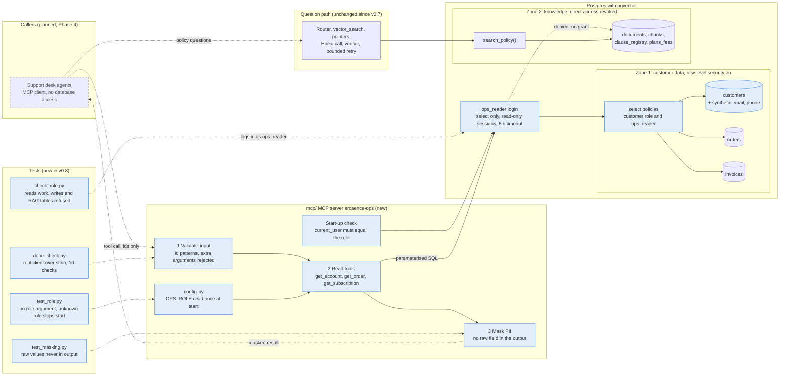

# AOP architecture v0.8: MCP read tools, a read-only role and a launch-fixed role

Version 0.8 · 19 Nov 2026 (work finished 22 Nov 2026) · covers the 19 Nov plan row, the first step of Phase 3 · commits `692f7ab`, `a9127a3`

v0.7 ended with retrieval that finds the right evidence and a database that protects customer rows. v0.8 adds the first live-facts path: a small MCP server that lets an agent ask what is true for one customer (their account, an order, a subscription) without ever holding database access. The server connects with its own read-only login, masks personal data before a reply leaves it, and takes its role from the launch environment, so no argument in a call can change it. The planned desk agents are not built yet. This version is the door they will use.

## How to read this page

- The diagram shows the whole system. **Solid** boxes exist and have been tested. **Dashed** boxes are planned. **Blue** boxes are new in v0.8.
- The groups are the planned callers, the new MCP server, the database with its two zones, the question path that did not change, tests, and what comes next.
- Decisions are listed near the end and recorded in [decisions.md](decisions.md) as ADR-034, ADR-035 and ADR-036.

## What changed since v0.7

| Area | v0.7 | v0.8 |
| --- | --- | --- |
| Live customer facts | None. Customer tables existed and were protected by row-level security, but nothing outside a logged-in customer could read them | `mcp/` holds a server with three read tools: `get_account`, `get_order`, `get_subscription` |
| Database login for tools | None. Our Python connected as the database owner, which bypasses row-level security (the known limit in ADR-032) | A dedicated login `ops_reader` (migration 008): `select` on `customers`, `orders`, `invoices` only; read-only sessions; 5 second statement timeout; one select policy per table; no access to the knowledge tables |
| Personal data | `customers` held no contact data | `customers` has synthetic `email` and `phone` (migration 008). The server masks them: `a***@example.com`, and a phone that keeps only its last two digits |
| Tool inputs | Not applicable | Ids must match `cust_` plus three digits or `ord_` plus four digits. Parameterised SQL. Extra arguments are rejected |
| Tool outputs | Not applicable | Output models forbid extra fields. `Account` carries `email_masked` and `phone_masked` and has no raw field |
| Role | Not applicable | `OPS_ROLE` is read once at start. An unknown role stops the process. Only that role's tools are registered. At start the server asks the database for `current_user` and refuses to run if it is not the expected login |
| Tests | `test_rls.py`, `test_search_policy.py`, `test_contracts.py` | Adds `check_role.py` (5 checks), `test_masking.py` (2), `test_role.py` (5) and `done_check.py` (10, through a real MCP client over stdio). None call the model |
| Decisions | ADR-032 and ADR-033 | ADR-034 (read-only role), ADR-035 (masking in the server), ADR-036 (role fixed at launch) |

## Architecture

The design rule behind the picture is the same as v0.7: nothing that protects data may depend on what the model says. The MCP server adds a second rule: **the model gets answers, never access.** The agent sends an id and receives a masked reply. It holds no credentials and cannot reach a table.

## The four layers that refuse a write

A call that tries to change data has to get past four independent layers. Each one refuses it alone, so a bug in one layer does not become a breach.

| Layer | Where it lives | What it does |
| --- | --- | --- |
| 1 Tool list | Server code, fixed at start | No write tool is registered for the role, so `update_account` does not exist |
| 2 Schema | Server code | Extra arguments such as `role` are rejected, and ids must match a pattern |
| 3 Read-only session | Database role setting | `default_transaction_read_only` is on, so any write fails with `ReadOnlySqlTransaction` |
| 4 Database grants | Database | `ops_reader` has select only on three tables and no grant on the knowledge tables, so those fail with `InsufficientPrivilege` |

Layers 1 and 2 live in code. Layers 3 and 4 live in the database, so a bug in our code alone cannot let a write through.

## Who can do what, now with a fifth login

| Role | What it is | Customer tables (zone 1) | Knowledge tables (zone 2) | Writes |
| --- | --- | --- | --- | --- |
| `anon` | Not logged in | No rights | No direct access | No |
| `authenticated` | A logged-in customer | `select`, own rows only | No direct access | No |
| `ops_reader` | The MCP server's login (new) | `select` on three tables, all rows | No access at all | No: read-only sessions |
| `service_role` | A server key | Bypasses row-level security | Direct access | Yes |
| Database owner | What the RAG Python connects as | Bypasses row-level security | Direct access | Yes |

`ops_reader` sees all customer rows, because a support desk legitimately reads any customer. What limits it is not the row policy but the tool layer in front of it: validated ids, masked output, and three fixed queries. That is why masking and validation are part of the design and not extras.

## How a call travels

1. The agent calls a tool by name with only an id, for example `get_account(customer_id="cust_001")`.
2. The server rejects the call if the id does not match its pattern or if any argument is not on the tool's form. A `role` argument is one of those.
3. The tool runs one fixed, parameterised query as `ops_reader`.
4. The server builds the output model. For an account, the email and phone are masked first, and the model has no field that could carry the raw value.
5. The masked result goes back to the agent.

A missing record returns a plain message such as "No account found for cust_404", not a guess.

## The tests

| Test | What it proves | Checks |
| --- | --- | --- |
| `check_role.py` | Against the real database as `ops_reader`: selects work; an insert and an update fail with `ReadOnlySqlTransaction`; a read of `clause_registry` fails with `InsufficientPrivilege` | 5 |
| `test_masking.py` | The mask functions behave, including bad input becoming `***`; the raw email and phone appear nowhere in `get_account` output | 2 |
| `test_role.py` | The tool list is exactly the role's tools; no tool has a `role` argument and every schema forbids extras; calls with a role argument are refused; a normal call still works; an unknown `OPS_ROLE` stops start-up | 5 |
| `done_check.py` | Starts the real server over stdio and talks like an agent: three tools, masked data for both customers, an order with its invoice, a subscription, and refusal of `role=admin`, `role=ops_writer`, SQL text in an id and a write tool that does not exist | 10 |

The refusal checks matter as much as the successes. The normal calls prove the tools work. Without the refusal checks, a server that accepted everything would also pass.

## Findings from testing

| Finding | What happened | How it was handled |
| --- | --- | --- |
| SDK rename | The installed `mcp` 2.3.0 renamed `FastMCP` to `MCPServer`, so most examples fail on import | Code written and tested for 2.3.0 |
| Silent extra arguments | The SDK ignored an unknown argument such as `role="admin"` instead of rejecting it. A test exposed this | At start-up each tool's argument model is set to forbid extras, so every schema says `additionalProperties: false`. This uses internal SDK attributes, and the tests would fail if a later release changed them |
| Unclear not-found error | A missing customer first came back as an unexpected-error message | It now returns a clear tool error |
| Secrets | The `ops_reader` password was set by hand and the connection string lives only in the ignored `mcp/.env` | Nothing secret is committed. `mcp/.env.example` holds the key name only |

## Failure modes the design guards against

| Failure | Layer that catches it | Evidence |
| --- | --- | --- |
| A bug or injected instruction tries to write | Read-only session and select-only grants in the database | `check_role.py` |
| The agent asks for a higher role | No `role` argument exists; extras are rejected; role is fixed at launch | `test_role.py`, `done_check.py` |
| SQL text arrives in an id | Id pattern, then parameterised SQL | `done_check.py` |
| Personal data reaches the model | Masking in the server; output model has no raw field | `test_masking.py` |
| The declared role differs from the real login | Start-up check of `current_user` | Code path in `db.py`; not exercised by an automated test |
| The tool layer reads the RAG corpus | No grant for `ops_reader` | `check_role.py` |
| A wrong role starts the server | Unknown `OPS_ROLE` stops the process | `test_role.py` |

## Decisions

Recorded in [decisions.md](decisions.md).

- **ADR-034: Give the MCP server its own database login, `ops_reader`.** Select on three customer tables, read-only sessions, 5 second timeout, no access to the knowledge tables. Alternatives rejected: reuse the owner connection; use the Supabase service key; column-level grants. Consequence: the role can read raw contact columns, so masking is only as strong as the tool layer. Revisit when write tools are added or when contact columns hold real data.
- **ADR-035: Mask personal data inside the server, and give output models masked fields only.** Alternatives rejected: ask the model not to reveal it; mask in the model's answer; return raw data and filter later. Consequence: agents cannot see a full email or phone even when a task needs it, and names are not yet masked. Revisit when a task needs the raw value or when real names enter the data.
- **ADR-036: Fix the role at launch from `OPS_ROLE`.** Register only that role's tools, forbid unknown arguments, and check the database login at start. Alternatives rejected: accept a `role` argument; read the role per request; trust the declared role without checking the login. Consequence: the extra-argument rule uses internal SDK attributes, and a role change needs a restart. Revisit when the SDK adds a supported strict-arguments setting or when more than one role must run in one process.

## What exists and what is planned

| Component | State |
| --- | --- |
| RAG: ingestion, router, search through the door, structured answer, verifier, bounded retry | Built (v0.2 to v0.7) |
| Customer tables, row-level security, guarded door, frozen contracts | Built and tested (v0.7) |
| `ops_reader` login and synthetic contact data (migration 008) | Built and tested |
| MCP server with three read tools, masking and a launch-fixed role | Built and tested |
| Gate G2, the MCP attack harness | Not started |
| Audit trail, rate limits, connection pool | Not built |
| Write tools, a second role and a human gate | Planned |
| Per-caller check that a caller may see a given customer | Planned, desk logic |
| Clause lookup equivalent to the door; pointer step moved behind it | Planned |
| Support desk agents | Planned, Phase 4 |

## Known limits

- **Owner bypass remains for the RAG code.** The RAG Python still connects as the database owner. `ops_reader` closes this for the MCP path only.
- **Contact columns are readable by the role.** `ops_reader` has whole-table select, so it can read the raw email and phone. Only the tool layer masks them. Column-level grants would remove this.
- **Names are not masked.** `display_name` is synthetic and returned as is. A real name is personal data and would be cut to a first name or initials.
- **No check on which customer.** The tools accept any valid id. Whether a caller may see that customer is desk logic, still to come.
- **Internal SDK attributes.** The rejection of extra arguments depends on them. The tests would fail if a later release changed them.
- **No audit trail, no rate limit, no pool.** Every call opens a new database connection and nothing records who asked what.
- **The start-up login check has no automated test.** It was written and read, but it only runs when the real server starts.
- **Small and synthetic.** Two synthetic customers and three orders prove the mechanism, not behaviour under load or against a real attacker.
- **Untrusted text is not yet tested.** The desk will read customer messages, which can carry hidden instructions. Masking and a read-only role reduce the damage, and they do not remove injection risk. The 28 Nov drills cover this.

## Glossary additions

| Term | Meaning |
| --- | --- |
| MCP (Model Context Protocol) | A standard way for an AI application (the client) to call tools published by a separate program (the server) |
| Tool contract | A tool's name, description and input schema: the fixed form a call must fill in |
| Read-only role | A database login that can read some tables and cannot write anything |
| PII | Personal data such as an email address or a phone number |
| Masking | Hiding most of a value before the model sees it, for example `a***@example.com` |
| Role fixed at launch | Permissions set once from configuration when the process starts, never from a call |
| Defence in depth | Several independent layers each stopping the same mistake |
| Fail closed | When something is unknown or unclear, the safe default is to refuse |
| Trust boundary | The line between a part of the system that is not trusted (the model) and a part that is (the database) |
