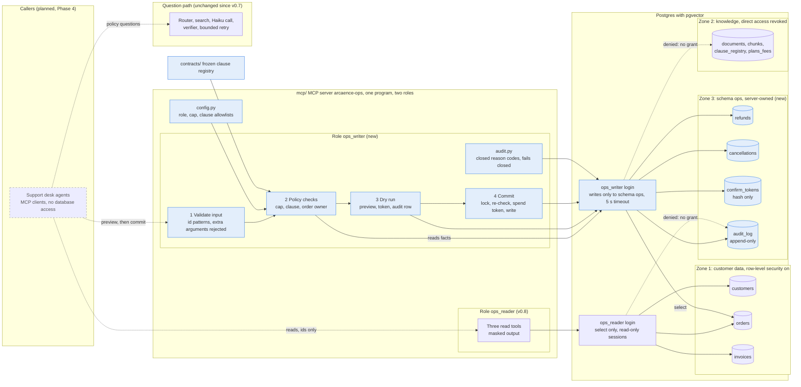

# AOP architecture v0.9: MCP write tools, dry run, single-use token, cap and audit

Version 0.9 · 20 Nov 2026 (work finished 22 Nov 2026) · covers the 20 Nov plan row, the second step of Phase 3 · code commit `2dfc21e`

v0.8 gave agents a way to look. v0.9 gives them a way to act, and builds the controls that make acting safe. The same MCP server now starts in a second role, `ops_writer`, that offers two write tools, `issue_refund` and `cancel_subscription`. A write is two calls: a dry run that previews and returns a one-time token, then a commit that must present that token. Behind it sit a cumulative refund cap, a required policy clause, a server-owned write schema, and an append-only audit log that records every attempt, allowed or refused. A refund here is a record in our own schema. No payment call exists yet, and the shop's own tables are never changed. The desk agents that will call these tools are not built yet.

## How to read this page

- The diagram shows the whole system. **Solid** boxes exist and have been tested. **Dashed** boxes are planned. **Blue** boxes are new in v0.9.
- The groups are the planned callers, the MCP server with its two roles, the database with three zones, the question path that did not change, and the tests.
- Decisions are listed near the end and recorded in [decisions.md](decisions.md) as ADR-037 to ADR-041.

## What changed since v0.8

| Area | v0.8 | v0.9 |
| --- | --- | --- |
| Tools | Three read tools | Adds two write tools, `issue_refund` and `cancel_subscription`, offered only to the `ops_writer` role |
| How a write happens | Not applicable | Two calls. A dry run (the default) checks everything and changes nothing, then returns a preview and a token. A commit must present that token |
| The token | Not applicable | Random, single-use, valid for 600 seconds. Only its SHA-256 hash is stored. It is bound to a hash of the exact arguments and the tool name, and is spent by one atomic update |
| Spending limit | Not applicable | A cumulative cap per customer per currency (EUR 50, USD 55, INR 4500), held in `config.py`, checked at the dry run and again at commit under a per-customer lock |
| Reason for an action | Not applicable | A clause is required. It must exist in the frozen registry and be on the per-action allowlist. Superseded and draft documents are refused even though their ids exist |
| Where writes go | Not applicable | A server-owned schema `ops` with four tables: `refunds`, `cancellations`, `confirm_tokens`, `audit_log` (migration 009) |
| Audit | None. The v0.8 limits said nothing records who asked what | Every attempt writes an audit row: allowed or refused, dry run or commit, with a reason from a closed list of 16 codes and arguments from a whitelist of keys. The table is append-only. If the audit write fails, the action fails |
| Database logins | `ops_reader` | Adds `ops_writer` (migration 009): writes only to schema `ops`, 5 second timeout, no read of email or phone, cannot change or delete an audit row |
| Roles of the server | `ops_reader` | `OPS_ROLE` accepts `ops_reader` or `ops_writer`. The writer has no read tools. At start the server checks the database login against the declared role for either one |
| Tests | `check_role.py` 5, `test_masking.py` 2, `test_role.py` 5, `done_check.py` 10 | Adds `check_writer.py` (16), `test_audit.py` (8), `test_policy.py` (25), `test_actions.py` (27), `test_cancel.py` (25) and `done_check_writes.py` (18, through a real MCP client over stdio). None call the model |
| Decisions | ADR-034 to ADR-036 | ADR-037 (dry run and token), ADR-038 (cumulative cap), ADR-039 (clause required), ADR-040 (own write schema and audit), ADR-041 (reader and writer roles) |

## Architecture

The design rule is the same as in v0.7 and v0.8: nothing that protects data or money may depend on what the model says. v0.9 adds a third rule: **the model proposes, and code and the database decide.** An agent can ask for a refund, but it cannot make one without a preview, a valid token, a cap with room left, and a real clause, and every attempt leaves a record.

## What the server checks, in order

The checks are plain functions in `policy.py` that take facts and return a reason code or nothing. The numbers and lists they use are plain data in `config.py`.

| Step | Refund | Cancel subscription |
| --- | --- | --- |
| 1 | Amount is positive, finite and has at most two decimals (`invalid_amount`) | Clause is present, real and approved |
| 2 | Clause is present (`no_clause`), exists in the frozen registry (`unknown_clause`) and is on the refund allowlist (`clause_not_allowed`) | Order exists (`order_not_found`) |
| 3 | Order exists (`order_not_found`) | Order belongs to the customer (`wrong_customer`) |
| 4 | Order belongs to the customer (`wrong_customer`) | Order is a subscription and not already cancelled (`subscription_not_active`) |
| 5 | Amount does not exceed what is left on the order (`over_refundable`) | |
| 6 | Total refunded to the customer plus this amount does not exceed the cap for the currency (`over_cap`; also when a currency has no cap) | |

The server enforces **hard limits**: money, ownership and the provenance of the rule. It does not judge whether a clause's conditions are met. Clause 2.2, for example, allows a refund only within seven days and only if the item was not downloaded. That judgement stays with the agent, the verifier and, later, the review queue.

## How a write travels

1. The agent calls `issue_refund` with a customer, an order, an amount as text, a clause, and `dry_run` left at its default of true.
2. The server rejects unknown arguments and malformed ids. Everything else, including a missing clause or an odd amount, reaches the policy check so a refusal can be logged.
3. The policy check loads the order and the refunds so far and runs the checks above. On a refusal, an audit row is written (`dry_run`, `refused`, a reason) and no token exists.
4. On success the server creates a random token, stores its hash and a hash of the exact arguments with an expiry, writes an audit row (`dry_run`, `allowed`) and returns a preview and the token.
5. To go ahead, the agent calls again with `dry_run` false, the same arguments and the token.
6. Inside one savepoint the server takes a per-customer lock, reloads the facts, checks the token (`token_missing`, `token_invalid`, `token_used`, `token_expired`, `args_mismatch`), re-runs the policy, spends the token with one atomic update, inserts the refund and writes the audit row (`commit`, `allowed`).
7. If any check fails, that savepoint's writes are undone and then the refusal is recorded (`commit`, `refused`, a reason). The caller commits the surrounding transaction, so the refund, the spent token and the audit row are saved together or not at all.
8. Any unexpected error rolls everything back, returns only "the action could not be completed and was not applied", and tries to write an `internal_error` audit row.

A wrong-argument commit is refused but does not spend the token, so a mistaken call does not waste a valid preview.

## Who can do what, now with a sixth login

| Role | What it is | Customer tables (zone 1) | Knowledge tables (zone 2) | Schema `ops` (zone 3) |
| --- | --- | --- | --- | --- |
| `anon` | Not logged in | No rights | No direct access | No access |
| `authenticated` | A logged-in customer | `select`, own rows only | No direct access | No access |
| `ops_reader` | The MCP server's read login (v0.8) | `select` on three tables | No access at all | No access: cannot read refunds or the audit log |
| `ops_writer` | The MCP server's write login (new) | `select` on orders and invoices, and on customers without email and phone | No access at all | Insert and select on the four tables; may mark a token used and nothing else; cannot update or delete an audit row, or change a refund after it is made |
| `service_role` | A server key | Bypasses row-level security | Direct access | Bypasses |
| Database owner | What the RAG Python connects as | Bypasses row-level security | Direct access | Can change the schema (the limit in ADR-032) |

## The tests

| Test | What it proves | Checks |
| --- | --- | --- |
| `check_writer.py` | Against the real database: the writer can add audit and token rows, mark a token used, and read orders; it cannot read email or phone, cannot change, delete or truncate the audit log, cannot rewrite a token's arguments or a refund, cannot write to the customer tables or touch the knowledge tables; the reader cannot read `ops` | 16 |
| `test_audit.py` | The audit writer accepts only known modes, outcomes, reasons and argument keys, and fails closed | 8 |
| `test_policy.py` | Every refusal path of the policy, including many small refunds not slipping under the cap, exactly the cap being allowed, and every allowlisted clause existing in the frozen registry | 25 |
| `test_actions.py` | The refund dry run and commit: a token is stored only as a hash, a mismatch does not spend it, a replay is refused, the cap is re-checked at commit, an expired token is refused. Runs in one transaction that is rolled back | 27 |
| `test_cancel.py` | The same for cancellation, including that a refund token cannot cancel. Rolled back | 25 |
| `done_check_writes.py` | Starts the real server as `ops_writer` over stdio and talks like an agent: exactly two write tools and no read tools; an over-cap refund and a refund with no clause are refused and each leaves an audit row; a commit with no token, a made-up token or a mismatched amount is refused; an extra `role`, SQL text in an id and a float amount are rejected; no refund or cancellation row is created | 18 |

The earlier tests from v0.8 (`check_role.py` 5, `test_masking.py` 2, `test_role.py` 5, `done_check.py` 10) still pass. Replay of a spent token is proven in `test_actions.py`, not over the transport, because proving it over the wire would need a real commit and would use up the customer's cap. The done check moves no money, so it can be run repeatedly. It leaves audit rows and unused tokens behind, which is the audit log doing its job.

## Findings from testing

| Finding | What happened | How it was handled |
| --- | --- | --- |
| Tests that assumed empty tables | The done check leaves audit rows, so tests that expected zero rows would fail on a second run | The action tests now compare the table before and after instead of expecting zero |
| A check that could never fail | A test assertion ended with `or True` and was caught on review | Replaced with a real assertion |
| Refusals that left no trace | If the clause fields were required in the tool schema, a missing clause would be rejected before the server's own code ran, and nothing would be logged | The clause and amount fields are optional in the schema, so the policy refuses and the audit logs it |
| Environment in a child process | The server process started by the test client does not inherit shell variables | The server reads its own `.env`, and the role is passed explicitly at launch |
| Duplicate file | A download that would not overwrite `config.py` left a copy named `config (1).py` | Removed before the commit |

## Failure modes the design guards against

| Failure | Layer that catches it | Evidence |
| --- | --- | --- |
| A model asks for a very large refund | Cumulative cap in policy; the writer can only write to `ops` | `test_policy.py`, `done_check_writes.py` |
| A commit is sent without a preview | Token required | `test_actions.py`, `done_check_writes.py` |
| A token is used for different arguments or a different tool | Token bound to a hash of the arguments and the tool | `test_actions.py`, `test_cancel.py` |
| The same commit is sent twice | Atomic spend of the token | `test_actions.py` |
| Two commits at the same moment | Per-customer lock, and the cap is re-checked under it | Design and `test_actions.py` (re-check); the lock itself is not exercised by a concurrent test |
| An invented, superseded or draft clause | Frozen registry plus per-action allowlist | `test_policy.py` |
| The log is edited afterwards | Insert-only grants plus a trigger on update, delete and truncate | `check_writer.py` |
| A refund exists without its record | One savepoint for the write and the audit row; audit failure fails the action | `test_audit.py`, design |
| Raw email or phone reaches the writer | The writer has no read tools and no column grant on those columns | `check_writer.py` |
| An extra `role` argument | Schema forbids unknown arguments; role fixed at launch | `test_role.py`, `done_check_writes.py` |

## Decisions

Recorded in [decisions.md](decisions.md).

- **ADR-037: A write is two calls.** A dry run returns a preview and a single-use token, and the commit must present it. The token is random, hashed at rest, bound to the exact arguments and tool, expires after 600 seconds and is spent by one atomic update. Alternatives rejected: a `confirm=true` flag, a signed stateless token, a human approval on every write. Consequence: two calls per write and a growing token table. Revisit when a person or review queue must approve before commit.
- **ADR-038: The refund cap is cumulative per customer per currency.** It lives in `config.py` and is checked at the dry run and again at commit under a per-customer lock. Alternatives rejected: a cap per call, a cap in the prompt, a database constraint, one currency with conversion. Consequence: the cap counts only refunds made through this server, and refunds over the cap are refused, not yet queued. Revisit when the review queue exists.
- **ADR-039: A write must cite a clause that exists in the frozen registry and is on the per-action allowlist.** The clause fields are optional in the schema so a missing clause is refused and logged. Alternatives rejected: registry check only, a free-text reason, requiring the clause in the schema. Consequence: the server checks that the basis exists and is approved, not that its conditions are met. Revisit when the server can call the verifier.
- **ADR-040: Writes go to a server-owned schema with its own login, and every attempt is logged in an append-only audit table.** The refund and its audit row are written in one transaction. Alternatives rejected: writing into the shop tables, logging only to application logs, free-text reasons. Consequence: a refund is a record, not yet money moved. Revisit when a real payment call is added.
- **ADR-041: Reader and writer run as separate roles.** The writer has no read tools and `dry_run` defaults to true. Alternatives rejected: one server with all tools, a writer that can also read, a default of false. Consequence: an agent that refunds connects to two servers. Revisit when the desk agents prove the split awkward.

## What exists and what is planned

| Component | State |
| --- | --- |
| RAG: ingestion, router, search through the door, structured answer, verifier, bounded retry | Built (v0.2 to v0.7) |
| Customer tables, row-level security, guarded door, frozen contracts | Built and tested (v0.7) |
| MCP server with three read tools, masking and a launch-fixed role | Built and tested (v0.8) |
| Schema `ops`, `ops_writer` login, append-only audit log (migration 009) | Built and tested |
| Write tools `issue_refund` and `cancel_subscription` with dry run, token, cap and clause | Built and tested |
| Gate G2, the MCP attack harness | Not started |
| Review queue for refunds over the cap | Planned (26 Nov) |
| Kill switch for write tools | Planned (28 Nov) |
| A real payment call behind a refund, rate limits, connection pool | Not built |
| Per-caller check that a caller may see a given customer | Planned, desk logic |
| Support desk agents | Planned, Phase 4 |

## Known limits

- **Clause conditions are not checked.** The server proves the clause exists and is approved for the action, not that the facts meet its conditions.
- **Schema rejections are not logged.** A call rejected for an unknown argument or a malformed id never reaches the write path, so the audit log does not record it.
- **Replay and the lock are tested below the transport.** Replay is proven in the action tests. The lock is not exercised by a concurrent test.
- **The writer's start-up login check has no automated test.** It runs only when the real server starts as the writer.
- **A refund is a record.** No payment call exists, so the shop's own data does not change.
- **Owner bypass remains.** The owner role could change the `ops` schema or drop the audit trigger. This is the limit named in ADR-032.
- **The cap is narrow.** It counts only refunds made through this server, and amounts are not converted between currencies.
- **Tables grow.** Audit rows and unused tokens accumulate, and there is no clean-up job.
- **The clause lists are code.** Changing what may justify a refund needs a code change and a review.
- **Untrusted text is not yet tested.** The desk will read customer messages, which can carry hidden instructions. The 28 Nov drills cover this.

## Glossary additions

| Term | Meaning |
| --- | --- |
| Write tool | A tool that changes data, as opposed to a read tool that only looks |
| Dry run | A rehearsal that does every check and changes nothing |
| Confirmation token | A one-time code, issued by a dry run, that a commit must present |
| Idempotent | Doing it twice has the same effect as doing it once |
| Replay | Sending the same request again, by mistake or on purpose |
| Cumulative cap | A ceiling on the total refunded to one customer, not on a single request |
| Clause | One numbered rule in a policy document, for example `tos_v3` clause 2.2 |
| Allowlist | A short list of what is permitted, here which clauses may justify an action |
| Audit log | A record of every attempt, kept so it cannot be edited afterwards |
| Append-only | A table that can be added to but never changed or emptied |
| Savepoint | A bookmark inside a transaction that can be undone without losing what came before it |
| Advisory lock | A lock the application asks the database for, here one per customer, so two commits queue up |
| Race condition | A bug that appears only when two things happen at the same moment |
