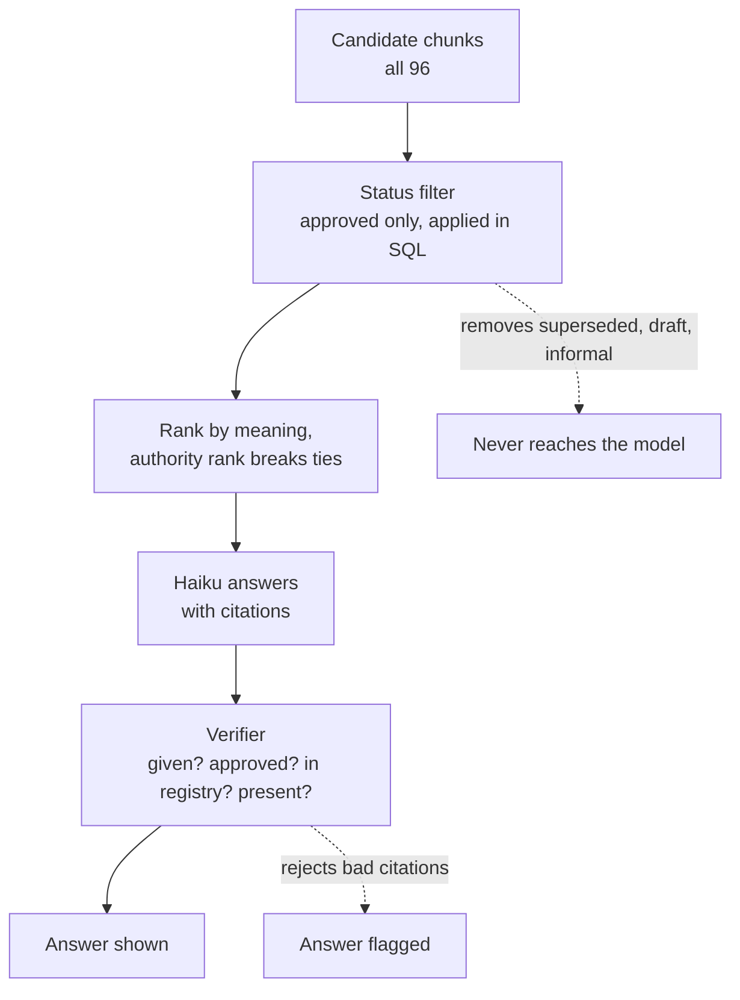
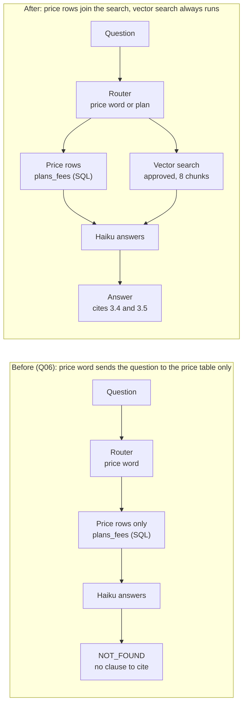
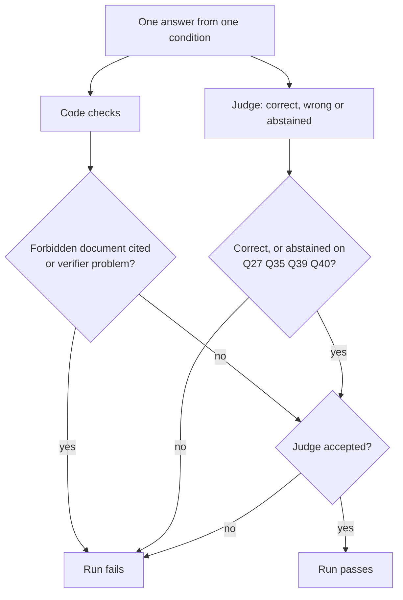
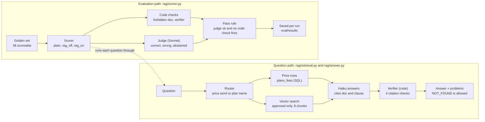

# Study notes: 15 Nov, cited answers, verification and the first baseline

AOP (Arcaence Online Project) · plan row Sun 15 Nov · notes written 13 Nov 2026

Plan row: retrieval plus a cited answer step with Haiku. First run of the golden set: plain prompt against RAG, filter on and off. Done check: baseline numbers saved and committed. That check is met: the baseline is in commit `b2095db` and the after-fix numbers are in `991227d`.

Structure of these notes: (1) each concept in plain words with an example, why it is needed, how it is built in AOP and the architect's view; (2) the architecture covered today; (3) results; (4) the architect's point of view; (5) check yourself and glossary. Diagrams are Mermaid, so they render on GitHub.

---

## 1. Concepts we learnt today

Five concepts, in the order a question meets them.

### Concept 1: Grounded, cited answers, with the right to say "not found"

**In plain words.** Grounding means the model may use only the text you hand it, not what it remembers from training. A citation is a label on each statement saying which passage it came from. Example: asked whether a refund is possible after 10 days, a grounded answer reads "No, the window is 7 days [tos_v3 2.2]". If the passages don't cover the question, the model replies `NOT_FOUND` instead of guessing.

**Why we need it.** An answer nobody can check cannot be trusted. With no documents, the plain condition gave 7 confident wrong answers in the baseline, because the model fills gaps with plausible text. A citation turns "trust me" into "check clause 2.2", and `NOT_FOUND` turns a gap into a safe hand-off.

**How I built it.** `rag/answer.py` sends Haiku (claude-haiku-5-5) a system prompt with three rules: answer only from the labelled sources; cite after every statement as `[doc_id clause_id]`, or `[plans_fees]` for price rows; reply exactly `NOT_FOUND` if the sources lack the answer. Answers are capped at one or two sentences. Each source goes in as a line like `[tos_v3 2.2] <clause text>`.

**Architect's view.** The label format is a contract between three components: the prompt, the verifier and the scorer all parse the same `[doc_id clause_id]` pattern, so changing it means changing all three. Abstention is a product decision, not a model quirk: you decide how often "not found" is acceptable. In the results, abstaining was the main remaining failure of the filtered pipeline, which is the cheap kind of failure to have.

### Concept 2: Verifying the model's output in code

**In plain words.** After the model answers, ordinary code reads its citations and checks them against facts the database already knows. Example: the model answers "7 days [tos_v2 2.2]". The sentence reads fine, but the code sees that `tos_v2` is superseded and rejects the answer. Another case: OCR read clause B.2 of a scan as 8.2, and the clause registry has no such clause for that document, so a citation to it fails.

**Why we need it.** A model checking itself shares its own blind spots, and a fluent answer that cites the wrong source looks right to a reader. Code is deterministic, free and never tired. The evidence is in the results: without the status filter, the verifier flagged 35 answers and 30 cited a forbidden document.

**How I built it.** `verify(answer, given)` in `rag/answer.py` rejects a citation that (1) was not among the sources given, (2) points to a document that is superseded or draft, (3) names a clause not in the registry, or (4) is missing. The registry is keyed by clause id and document id. Price citations to `plans_fees` skip the document and clause checks. Every answer comes back with a `problems` list, and the scorer counts any problem as a failure.

**Architect's view.** The verifier proves provenance, not truth: it can say "this came from an approved clause", not "this clause supports the claim". The judge covers truth, so the two checks are complementary and neither replaces the other. Today the verifier only reports. In production it becomes a gate at the boundary: on a problem, retry once, then hand off to a human, never show the answer. Keep it free of model calls so it stays cheap and predictable.

### Concept 3: Authority-aware retrieval, the status filter before ranking

**In plain words.** Vector search ranks by meaning, and meaning has no idea which document is official. Example: the old version 2 of the terms and the approved version 3 say nearly the same thing about refunds, so both score high for the same question. Authority-aware retrieval removes the unofficial documents from the candidate list before ranking, and uses an authority rank only to break ties among what is left.

**Why we need it.** Similarity cannot tell authority, and an AI that quotes a superseded policy or an unpublished draft gives a customer a wrong promise in the company's voice. Q27 shows it: the official documents say nothing about a student discount, and without the filter the system cited the informal meeting notes and was judged wrong in both runs.

**How I built it.** The `documents` table carries a status (approved, superseded, draft, informal) and an `authority_rank`. `vector_search` in `rag/retrieval.py` applies `where d.status = any(['approved'])` inside the SQL, then orders by cosine distance and `authority_rank`. The `rag_off` condition switches the filter off so the scorer can measure what it is worth. The layers behind it are the verifier and the clause registry.

**Architect's view.** This is defence in depth: the filter, the rank, the verifier and the registry each catch what the previous one misses, so one failure does not become a wrong answer. One trade-off to remember: this database index (HNSW) filters after the search, so on a large table a strict filter can return fewer rows than asked for. At 96 chunks it does not matter; at scale you would partition by status or over-fetch. Keeping `rag_off` permanently is what lets us show the control's value with numbers, not with an argument.

### Concept 4: Hybrid retrieval and routing, and facts that live in an absence

**In plain words.** Some questions are about numbers in a table (what Pro costs in euros), others about rules in prose (can I get a refund). A router decides where to look: an exact query on the price table, or a meaning-based search over the document text. Example: "How is the price worked out when I upgrade mid-cycle?" contains the word "price" but asks about a rule, so a table alone cannot answer it. The fix is to give the model both kinds of evidence and let it use what fits.

**Why we need it.** Prices must be exact, and text search can return a close but wrong number (the informal fees sheet still holds old prices). Rules live in prose and tables can't hold them. Real questions mix both, so a router that picks only one will fail on the mixed ones. It did: Q06, Q15 and Q32 all failed the first run for this reason.

**How I built it.** `route` in `rag/retrieval.py` returns `sql` when the question has a price word or names a plan or an extra seat. `price_lookup` builds the table query from the plan, currency and billing words it finds. The extra-seat pattern is checked before the plan names, because "extra Team seat" used to match Team and return the wrong row (Q11). `answer_question` now always runs the vector search (8 chunks) and adds the price rows when the route is `sql`. Migration 002 added a `note` column, allowed a null price, and added three rows saying extra seats are "not offered on annual billing".

**Architect's view.** Two lessons. First, a fact can be an absence: the Schedule A cell "not offered on annual billing" held no number, so it vanished when the table became rows, and the system had no evidence for Q12 anywhere. Any table-to-rows schema needs a place for cells that are not values ("not offered", "contact sales", "included"). Second, a rule-based router is cheap and explainable but its signal is weak; making the SQL rows additive fixed the errors without training a classifier. Caveat: the router change and the move from 5 to 8 chunks went in together, so their effects are not separated.

### Concept 5: Evaluating with a golden set, a judge and code checks

**In plain words.** A golden set is a fixed list of questions with the right answers written down beforehand, including trick questions (traps) built to catch specific mistakes. You run the system on all of them and score the results, so "it seems better" becomes a number. A baseline is the first score, taken before you change anything, so every later change has something to be compared with. Example: Q28's reference answer is "No. The current window is 7 days (version 3.0)", and the question lists version 2 as a document that must not be cited, so an answer that cites it fails even if its number looks right.

**Why we need it.** Without a baseline you cannot tell a real improvement from luck, and a fix for one question can quietly break another. Our own numbers show why: the `plain` condition's code never changed, yet it moved from 21 to 18 passes between two runs, so anything under about 3 runs is noise.

**How I built it.** `rag/scorer.py` runs the 38 scoreable questions through three conditions (plain, rag_off, rag_on), twice each. Each answer gets two verdicts. Code checks ask whether a forbidden document was cited and whether the verifier found a problem. A Sonnet judge (claude-sonnet-5-5) replies `correct`, `wrong` or `abstained` against the reference answer. A run passes only if the judge accepts it and no code check fires. Abstaining counts as a pass only for the four questions that should abstain (Q27, Q35, Q39, Q40). Q29 and Q30 are listed as not scoreable until the agent and permission layers exist. Results are saved per run in `eval/results`.

In `plain` there are no sources, so only the judge applies.

**Architect's view.** Use two kinds of check because they fail differently: code is strict and shallow, the judge is flexible and noisy. Save the baseline before fixing anything and give later runs their own tag, so the before and after comparison cannot be overwritten. Treat evaluation errors as data problems, not as failures: Q27 and Q28 hit an API outage, were re-run, and the merge script refuses to report unless zero error rows remain. Finally, the reference answers need maintenance too: Q24's reference omitted a true suspension reason, which the judge penalised in one of two runs.

---

## 2. Architecture diagram we covered today

Today added two paths to AOP: the question path that produces a checked answer, and the evaluation path that scores it. Read each lane left to right.

The status filter inside the vector search removes unofficial documents before ranking. The router adds price rows next to the vector results instead of replacing them. The verifier checks every citation after Haiku answers, and the scorer then applies code checks and a judge to every answer.

---

## 3. Results: baseline against after the fix

The filtered pipeline went from 66 to 75 passes out of 76 runs, with zero forbidden citations and zero verifier problems. Counts are runs: 38 questions, each run twice.

| Mode | Baseline | After | After: normal | After: trap | Wrong | Forbidden cited | Verifier problems |
| --- | --- | --- | --- | --- | --- | --- | --- |
| plain | 21/76 | 18/76 | 8/52 | 10/24 | 7 | 0 | 0 |
| rag_off | 46/76 | 38/76 | 31/52 | 7/24 | 5 | 30 | 35 |
| rag_on | 66/76 | 75/76 | 51/52 | 24/24 | 1 | 0 | 0 |

How to read it:

- **Noise floor is about 3 runs.** The plain code did not change, yet it moved from 21 to 18.
- **rag_off got worse after the fix.** Retrieving 8 chunks instead of 5 without the filter pulls in more unofficial text, so forbidden citations rose from 19 to 30. That is the filter's argument getting stronger, not a regression.
- **The one remaining rag_on failure is Q24.** Its reference answer omits a true suspension reason, and the judge penalised it in one of two runs.
- **Q27 and Q28 were re-run** after an API outage, and the merged set has zero error rows.
- **Two changes at once.** The router fix and the move to 8 chunks shipped together, so the gain cannot be split between them.
- **Sample size.** 38 questions is a strong signal, not a precise rate.

Files: `eval/results/baseline_runs.csv`, `baseline_summary.md`, `after_router_fix_runs.csv`, `after_runs_merged.csv`, `comparison.md`.

---

## 4. The architect's point of view

The principle behind today's work: the model must never be the only thing standing between a customer and an unofficial document. Every layer we added removes one way for a wrong answer to get out.

### Decisions and their trade-offs

These are candidate ADRs for the decisions file; the number of each is still to be assigned.

| Decision | Why | Trade-off accepted |
| --- | --- | --- |
| Status filter inside the SQL, before ranking | Similarity cannot tell an approved clause from a superseded one | The vector index filters after searching, so on a large table a strict filter can return too few rows |
| Verifier written in code, not a model | Deterministic and free, with no blind spots shared with the answering model | Proves where a citation came from, not that it supports the claim |
| Price rows added to the vector results, not substituting for them | A price word is a weak signal that a question is about a price | A longer prompt and a little more cost per question |
| "Not offered" stored as a row with a note | A fact can be an absence, and a table of numbers has nowhere to put it | Price becomes nullable, so lookups must handle rows with no number |
| Two verdicts per answer, two runs per question | Code and a judge fail in different ways, and models here vary run to run | More model calls (about 450 for a full run) and more time (about an hour) |
| Baseline saved before any fix, later runs tagged | The before and after comparison cannot be overwritten | More result files to manage |

### Risks to watch

- **Over-abstention.** The filtered pipeline is safe but can say `NOT_FOUND` when the answer exists. Track the abstention rate as its own number.
- **The judge and the references.** One judge model and a hand-written reference can both be wrong. Q24 showed it, and a human spot-check of a sample is still missing.
- **A heuristic router.** The router is rules, not a model. Replace it only if the miss rate justifies the cost.
- **Scale.** At 96 chunks nothing here is stressed. Filter behaviour, cost per run and run time all change at 10,000 chunks.
- **Scope of the score.** Q29 (human hand-off) and Q30 (access control) are not scored until the agent and permission layers exist, so the numbers cover retrieval and answering only.

### Mistakes we hit and what each one taught

| What we saw | Cause | Fix and lesson |
| --- | --- | --- |
| Q06, Q15, Q32 answered NOT_FOUND | The router sent any question with a price word to the table only, and these are rule questions | Price rows now sit beside the vector results. A weak signal should add evidence, not remove it |
| Q11 answered NOT_FOUND | The first plan name matched, so "extra Team seat" returned Team rows | Match "extra seat" before the plan names. Order of patterns is logic |
| Q12 answered NOT_FOUND | The cell "not offered on annual billing" held no number and disappeared when the table became rows | Migration 002 stores it as a row with a note. Absent facts need a home in the schema |
| Q06 missed clause 3.5 | Five retrieved chunks were not enough | Retrieve eight. Check recall before blaming the model |
| `temperature` raised a TypeError | These models take no temperature setting | Removed it. Variation between runs is expected, so run twice |
| `ThinkingBlock` has no attribute `text` | A reply can begin with a thinking block | Join only the blocks whose type is `text`, with room in `max_tokens` |
| Plain mode crashed on `NoneType` | The plain condition returns no problems list | Treat `None` as an empty list |
| Judge reply could not be parsed | It was not always a bare word | Search the reply for the verdict word |
| Migration failed with a syntax error at the first line | PowerShell wrote an invisible byte-order mark at the start of the file | Save SQL without it and read with `utf-8-sig` |
| `No module named answer` | A script in the scripts folder cannot see the rag folder | Run such scripts from the rag folder, or put them there |
| Q27 and Q28 failed with `credential validation failed`, then a 503 | A temporary API outage mid-run | Re-run those questions, merge by id, and refuse to report while error rows remain |

### Still open

- **Golden set v1.1.** Q24's reference omits the bank-dispute suspension reason (clause 4.4). Fix it in a new version of the set, not by editing it after seeing results.
- **Blog 1 trap count.** The published post says 15 deliberate traps, but the file has 14 trap questions (T10 and T11 have no question). Check the plan, then correct the post.
- **Q11 wording.** The price row says "Extra seat" while Schedule A says "Extra seat (Team)", so the model hedges on which plan it applies to.
- **Separating the two changes.** Re-run with 5 chunks and the new router, or 8 chunks and the old one, if the split ever matters.
- **Paperwork.** Build logs for 14 and 15 Nov, and the candidate ADRs above.

---

## 5. Check yourself and glossary

Try answering each before reading the line under it.

1. Why is the verifier code and not another model?
    - A model checking a model shares its blind spots; code is deterministic and free. It proves provenance, not truth.
2. Why can similarity search not tell version 2 from version 3 of the terms?
    - It ranks by meaning, and the two versions mean almost the same. Authority has to be enforced by a filter on status.
3. Why is abstaining a pass on Q27 but a failure on Q06?
    - Q27 is not covered by the official documents, so "not found" is the right answer. Q06 is covered by clauses 3.4 and 3.5, so abstaining there is a miss.
4. The plain code did not change but its score moved from 21 to 18. What does that tell you?
    - Runs vary, so differences of about 3 runs are noise and each question needs two runs.
5. Why were Q27 and Q28 re-run instead of counted as failures?
    - They hit an API outage, which says nothing about the system. The merge refuses to report while error rows remain.
6. Why did "not offered on annual billing" disappear, and what fixed it?
    - It held no number, so the table-to-rows step dropped it. Migration 002 stores it as a row with a note.

| Term | Meaning |
| --- | --- |
| Grounding | The model may use only the sources it is handed |
| Abstention | Replying `NOT_FOUND` instead of guessing |
| Verifier | Code that checks every citation after the model answers |
| Status filter | Removes non-approved documents before ranking |
| Authority rank | Tiebreaker that prefers the higher-authority document |
| Golden set | Fixed questions with reference answers, including traps |
| Judge | A stronger model that grades an answer against the reference |
| Forbidden citation | A cited document the question lists as must-not-cite |
| rag_off, rag_on | Retrieval without and with the status filter |
| Noise floor | The run-to-run swing (about 3 runs here) below which a difference means nothing |
| BOM | An invisible byte at the start of a file that some tools add and SQL rejects |
