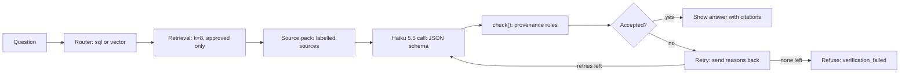
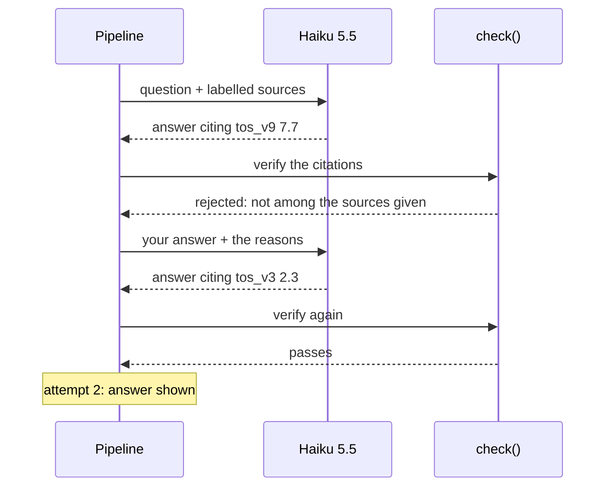
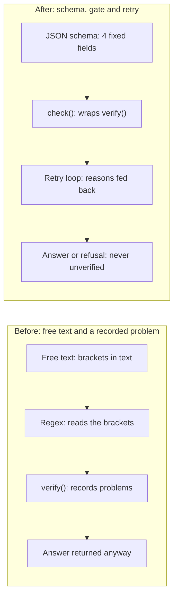

# Day 5 notes: structured answers, verification and retry

Plan row: Mon 16 Nov, RAG Phase 2 (answer schema with citations and a refusal option, deterministic citation verifier, validation and retry). Code: commit `70f1c56`, `rag/answer.py`.

## 1. What we learnt, in easy language

The question for this row: when the model answers, how do we make sure a made-up citation never reaches the user? Eight ideas, each with an example from AOP.

### 1.1 Structured output (an answer schema)

Instead of letting the model write free text, we hand it a form with fixed boxes and it must fill exactly those boxes. Our form has four: `answer` (text), `citations` (a list of `doc_id` + `clause_id`), `refused` (true or false) and `refusal_reason`. The API enforces this while the model writes (constrained decoding), so the reply is always valid JSON in that shape.

Example: the smoke test sent one source, `[POL-01 4.2] Refunds are issued within 14 days.`, and Haiku 5.5 returned the answer text, one citation `{doc_id: POL-01, clause_id: 4.2}`, `refused: false` and an empty reason. No regex was needed to find the citation.

### 1.2 Shape is not truth

The schema guarantees the answer has the right boxes. It does not guarantee what is in them. A model can write a perfectly valid citation for a clause that does not exist.

Example: `{doc_id: tos_v9, clause_id: 7.7}` is valid JSON and a complete lie. Think of a form where the box for "licence number" is always filled in, but nobody checked the number.

### 1.3 Refusal as a field, not a magic word

Before, "I don't know" was the literal string `NOT_FOUND` that the model had to remember to write. Now it is `refused: true` plus a reason. Code can read a field reliably; it can only guess at a string.

Example: the rag_off run on "Can I cancel my annual plan?" came back `refused: True` on the first attempt, and the pipeline turned that into `NOT_FOUND` for the scorer.

### 1.4 A deterministic verifier (code, not a model)

A checker written in plain code decides whether each citation is acceptable. It asks four things: was this source given to the model, is its document approved (not superseded or draft), is the clause in the clause registry, and is there a citation at all. It proves where a claim came from, not that the claim is true.

Example, from the demo run: `[tos_v3 9.9]` fails with "not among the sources it was given"; `[tos_v2 2.2]` fails with "document is superseded, not citable"; an answer with no brackets fails with "no citation".

### 1.5 Validation, then a bounded retry with feedback

When the verifier rejects an answer, we do not just give up. We send the model its own answer back together with the exact reasons, and ask again. It gets a limited number of tries: the first attempt plus two retries.

Example: a teacher returning a marked exam with "question 3: the source you cited was not in your pack", then letting the student fix it twice at most. In a real run, the rag_off Pro-plan question needed 2 attempts and then passed.

### 1.6 A safe fallback when retries run out

If the third attempt still fails, the system does not return the unverified answer. It returns a refusal with reason `verification_failed`. The rule: an answer that failed verification is never shown.

Example: a bank that cannot confirm a transaction declines it, instead of approving it and hoping.

### 1.7 Testing failure paths with a stub model

A real model rarely makes up a citation on demand, so the retry path may never run in a normal test. We swap the model call for a stub that returns scripted replies, then check what the loop does. This needs no API call and runs the same every time.

Example: four scripted cases. A bad answer then a good one is accepted on attempt 2. A model that never fixes it falls back after 3 attempts. Invalid JSON is retried. A refusal is accepted at once.

### 1.8 Reading evaluation results honestly

Three things came up. Some columns became true by design: "verifier problems 0" is now guaranteed because an unverified answer is never returned. Three changes shipped together (prompt, schema, retry), so a gain cannot be pinned on one. And 10 rows errored because the laptop lost its network mid-run, so they were re-run and merged by id before any comparison counted.

Example: rag_off went from 38/76 to 72/76, but we cannot yet say how much of that is the retry, because the scorer did not record the number of attempts.

## 2. Why we need each concept

A support desk answers customers about money and rights: refunds, cancellation, renewal. One wrong sentence with a believable citation is worse than no answer, because the customer trusts the citation. Each concept closes one specific gap.

| Concept | The gap it closes | What goes wrong without it |
| --- | --- | --- |
| Answer schema | The model's format was a convention (brackets in text) | A regex has to guess what the model meant, and a reply that breaks the pattern is silently misread |
| Shape is not truth | A valid-looking answer can still be fabricated | The team believes the schema made answers safe, and ships made-up citations |
| Refusal as a field | "I don't know" was a magic string | A typo or reworded refusal is read as an answer, and refusals cannot be counted reliably |
| Deterministic verifier | Only code can be trusted to check a citation the same way every time | A model checking a model can agree with its own mistake, and results change between runs |
| Bounded retry with feedback | One bad draft would become a refusal even when a correct answer was reachable | Over-refusal: good questions get no answer because of one fixable slip |
| Safe fallback | Retries must end, and the end state must be safe | A loop that never stops, or one that returns the last unverified draft |
| Stub-model tests | The failure path rarely happens on demand | The retry code ships untested and first runs in front of a customer |
| Honest evaluation | Numbers drive decisions and get quoted publicly | A headline score that is true by construction, or a gain credited to the wrong change |

The two ideas that matter most:

- **Separate the shape check from the truth check.** They fail differently and are fixed differently. The schema is cheap and always on. The verifier needs data (what was given, what is approved, what exists) and is where the real safety comes from.
- **Never show an unverified answer.** Everything else serves this rule. Retry exists so the rule does not cost us good answers; the fallback exists so the rule always holds.

## 3. How I implemented it in AOP

All code lives in `rag/answer.py`. The retrieval, routing and verifier from earlier days were reused unchanged.

1. **Smoke test** (`rag/scripts/check_structured.py`): confirmed `claude-haiku-5-5` accepts `output_config={"format": {"type": "json_schema", ...}}` and returns schema-valid JSON. The docs examples use Opus, so Haiku support had to be checked, not assumed.
2. **Schema, label helper and `check()`**: `SCHEMA` has `answer`, `citations`, `refused`, `refusal_reason`, all required, `additionalProperties: false`. `label_of()` turns a citation into the label the retriever used (`tos_v3 2.3`, or `plans_fees` with no clause). `check()` accepts a refusal, rejects an empty answer or one with no citations, and otherwise converts the citations back to bracket text and calls the existing `verify()`. One verifier, not two.
3. **Offline test for the done check** (`rag/test_structured.py`): a valid citation passes; a made-up one (`tos_v9 7.7`) and a real-looking one that was not given (`tos_v3 9.9`) are rejected for the right reason; an uncited answer is rejected.
4. **`ask_structured()` and `answer_with_retry()`**: one schema-constrained call; the loop runs up to 3 attempts (`MAX_RETRIES = 2`), appends the rejected reply and the verifier's reasons as new messages, and on exhaustion returns a refusal with `verification_failed`. Invalid JSON counts as a failed attempt.
5. **`answer_question()` rewired**: same return keys as before so the scorer needed no change. A refusal is returned as `answer = "NOT_FOUND"`; an accepted answer gets its citations re-appended as `[doc clause]` so the scorer's checks still see them. New keys: `refused`, `refusal_reason`, `citations`, `attempts`, `attempt_log`.
6. **Stub tests for the loop** (`rag/test_retry.py`): four cases (A to D), described in 1.7.
7. **Scored run** `structured_v1`, then a re-run and merge, then a three-way comparison (`rag/scripts/compare_structured.py`).

Two problems found on the way:

- **A test that passed for the wrong reason.** The first made-up citation used a hyphenated id (`POL-99`). The citation pattern uses `\w+`, which does not match a hyphen, so it was rejected as "no citation", not as "not given". The test was rewritten with ids in the real format (`tos_v9`) and now also has a positive case.
- **Ten error rows from a network gap.** Q23, Q31, Q32 and Q33 failed with DNS and "Network is unreachable" errors, including in `plain` mode, which never touches the database. That ruled out a bug in the new code. The four questions were re-run (`--ids`, tag `structured_v1_rerun`) and merged by id into `structured_v1_merged_runs.csv`.

Results (76 runs per mode: 38 questions, 2 runs each):

| Mode | Baseline | After router fix | Structured v1 | Wrong | Abstained |
| --- | --- | --- | --- | --- | --- |
| plain | 21/76 | 18/76 | 22/76 | 7 | 49 |
| rag_off | 46/76 | 38/76 | 72/76 | 3 | 8 |
| rag_on | 66/76 | 75/76 | 76/76 | 0 | 8 |

Zero error rows in the merged run. Files: `eval/results/comparison_structured.md`, `eval/results/structured_v1_merged_runs.csv`.

## 4. The architecture covered today: the answer path

Retrieval and routing are unchanged from Day 4. What is new is everything after the source pack: a schema-constrained model call, one deterministic gate, and a loop that either returns a verified answer or ends in a refusal. The verifier reads document statuses and the clause registry from Postgres.

## 5. From an architect's point of view

The design principle is **generate with a model, decide with code, and fail closed**. The model proposes an answer; deterministic code decides whether it may be shown; if nothing verifiable can be produced, the user gets a refusal and not a guess.

### 5.1 Layers of guarantees

Each layer guarantees one thing and is blind to the next. That is why there are several.

| Layer | Guarantees | Does not guarantee |
| --- | --- | --- |
| Retrieval filter (approved documents only) | The model is not shown superseded or draft text | That the right clause was retrieved (recall at k=8) |
| Answer schema | The reply has the right fields and is parseable | That any field is true |
| Verifier | Every citation was given, is approved, and exists in the registry | That the cited clause supports the sentence, or that the sentence is correct |
| Retry and fallback | A failed answer is never shown | That a good answer is found (it may refuse) |
| Judge model in the scorer | A measured view of correctness on 38 questions | A precise rate: one judge, hand-written references |

### 5.2 Trade-offs taken

- **Cost and latency for safety.** A failing answer can cost up to 3 model calls instead of 1. Most answers took 1 attempt in the demo, but the scorer does not record attempts yet, so the real rate is unmeasured.
- **Fail closed, so over-refusal is the main risk.** Refusing is safe for provenance but unhelpful. The filtered pipeline still abstains on 8 of 76 runs; that is the number to watch.
- **One verifier, two entry points.** Converting structured citations back to bracket text reuses the existing verifier, so a rule change lands in one place. The cost is that the verifier still speaks the bracket pattern, which is why a hyphenated id would be rejected as unparseable: it fails safe, but it is a coupling to remember.
- **Structured outputs cannot be combined with the API's own citations feature or with prefill, and changing the format invalidates the prompt cache.** None of these hurt us today. They would matter if we later wanted native citations or cached prompts.

### 5.3 Failure modes still open

- **A valid citation does not prove the sentence is right.** The model can cite a real, approved clause and still misstate it. Only the judge model catches this, and only in evaluation.
- **Retry can hide a retrieval problem.** In rag_off the unfiltered index still offers superseded documents. The verifier rejects citations to them and the retry steers the model to approved sources or a refusal, so the verifier is quietly acting as the authority filter. That is useful defence in depth, but a green rag_off score does not tell us retrieval is healthy.
- **Some columns are now true by design.** Verifier problems and forbidden citations in the final answers are zero because failures are never returned. They stopped being measurements. The measurable signal moved to attempts and refusals.
- **Confounded change.** Prompt, schema and retry shipped together, so the rag_off gain (38 to 72 of 76) is a combined effect.
- **Evaluation hygiene.** A local network gap produced 10 error rows. The rule held: no comparison counts until error rows are zero, and re-runs merge by id.

### 5.4 The governance angle

The control that matters is not in the prompt; it is a deterministic gate the model cannot talk its way past. Refusals are explicit and countable. Every attempt can be logged (`attempt_log` is returned but not yet stored). The rule is stated once and enforced in code: no answer without a verifiable citation.

### 5.5 Decisions worth recording as ADRs

1. Use `output_config.format` with a JSON schema for answers; `refused` replaces the `NOT_FOUND` string.
2. Keep one deterministic verifier; structured citations are converted to it, not given a second implementation.
3. Bounded retry (1 attempt plus 2 retries) with the verifier's reasons fed back; then a refusal with `verification_failed`.
4. The pipeline never returns an unverified answer (fail closed).
5. Keep the scorer interface stable: refusal returned as `NOT_FOUND`, citations re-appended as brackets.

### 5.6 Next, in order of value

1. Record `attempts` per row in the scorer and re-run, so the retry-rescue rate is a number.
2. Persist `attempt_log` for audit and later analysis.
3. Split the three confounded changes if attribution ever matters.
4. Golden set v1.1: fix Q24's reference (add the bank-dispute suspension reason, clause 4.4).

## 6. Diagrams that explain the points

### 6.1 One retry, step by step

Test case A from `rag/test_retry.py`: the first answer cites `tos_v9 7.7`, which was never given, so `check()` rejects it. The reasons go back to the model, the second answer cites `tos_v3 2.3`, and it passes.

### 6.2 What changed in the answer contract

On Day 4 a failed check was recorded and the answer was still returned. Now the failure triggers a retry, and if retries run out the user gets a refusal.

