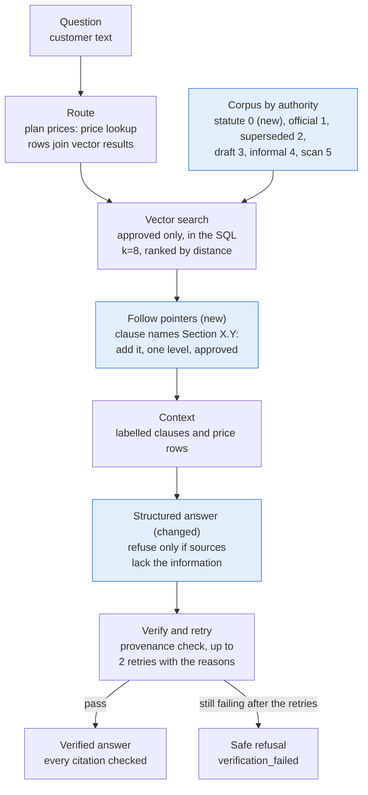
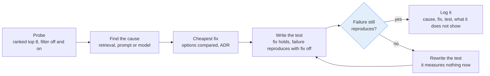
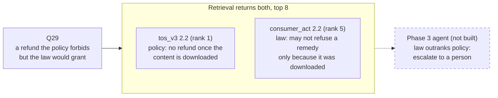
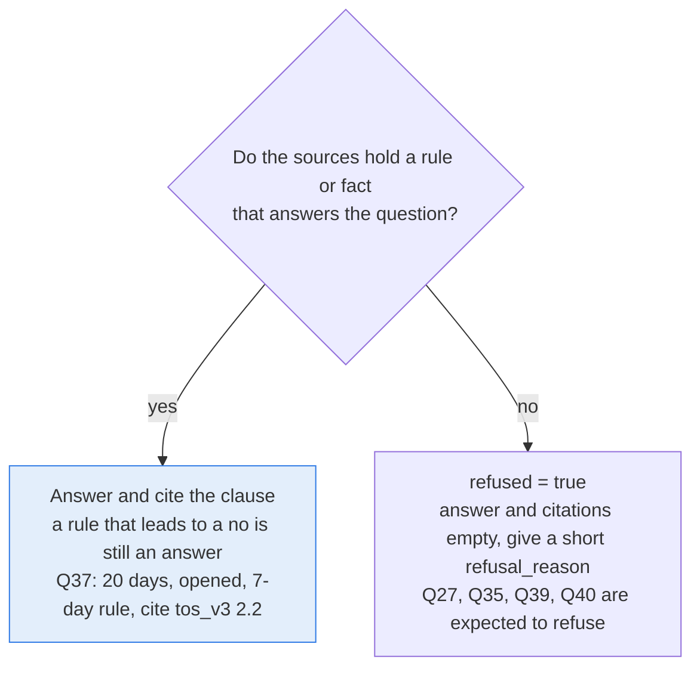

# Day 6 notes: retrieval failures, diagnosis and fixes (17 Nov 2026)

Today's lesson: a RAG system fails in a few predictable ways, and each failure can be planted, diagnosed, fixed and pinned down with a test. Phase 2 of AOP, day 2.

## 1. Concepts learnt

**1. Retrieval failure families.** Failures are not random. They fall into groups with one cause each, and the cause decides the fix. We planted and fixed three: stale version (FL-001), rule split across clauses (FL-002) and law versus policy (FL-003).
Example: a customer asks "I have 14 days to get a refund, right?" The superseded terms say 14 days and the current terms say 7. The two clauses are almost the same text, so the old one can rank first.

**2. Probing before fixing.** A probe prints the ranked top 8 for one question with the filter off and on, next to the clause the answer needs. You look at the ranking first and only then decide what is broken.
Example: `probe.py Q28` showed three versions of clause 2.2 within 0.007 of each other, and with the filter off the v2 clause (14 days) outranked the v3 clause (7 days).

**3. Measuring retrieval without a model.** Retrieval quality can be checked with no model calls: where does the required clause rank, and does it appear in the top k?
Example: `recall.py` lists the rank of the needed clause for all 28 questions that vector search can answer, and shows how many are covered at k = 3, 4, 5 and 8. It is free, fast and repeatable.

**4. Similarity is not authority.** Embedding similarity says "this text is close to the question". It cannot say "this source outranks that one". A policy written about downloaded content is closer to a refund question than the law that overrides it. So authority has to be handled outside the ranking: filter first, then decide.

**5. Filter before ranking.** Status is a hard rule, not a preference. Only `approved` documents are allowed, so the filter sits inside the SQL query before any ranking. With the filter on, superseded and draft clauses never compete. `authority_rank` only breaks ties.

**6. Following a pointer.** Sometimes the needed clause looks nothing like the question, but a retrieved clause names it ("see Section 3.5"). Pulling in the clauses a retrieved clause points to, one level, same document, with the status filter still applied, recovers the formula.
Example: Q07 retrieved 3.6, which names Section 3.5; the expansion added the missing clause at a cost of 0.1 extra chunks per question.

**7. Characterization tests.** A test that proves the fix works and also proves the planted failure is still reproducible with the fix turned off. If the failure stops reproducing, the test is no longer measuring anything.
Example: FL-001 asserts both that the filter puts `tos_v3 2.2` first and that, with the filter off, `tos_v2 2.2` outranks it.

**8. Collateral effects and the failure log.** Adding one approved document changes the context for questions that have nothing to do with it. Every failure gets a log entry with a cause, a fix and a test, plus a line on what the fix does not show.
Example: the new statute said "14 days", the same number as the stale refund window, and showed up at Q28 rank 3. Changing it to 21 days restored the clean trap.

One more lesson came from the scorer: a refusal and a denial are different. When Q37 abstained, the reason was hidden because the scorer turned every refusal into the word `NOT_FOUND`. The new columns showed the model had applied the 7-day rule correctly and put it in the wrong field.

## 2. Why we need these concepts

A RAG system that scores well on easy questions can still give a customer the wrong refund window. These concepts exist so that wrong answers are found on purpose, before a customer finds them.

| Concept | Why it is needed |
| --- | --- |
| Failure families | Without a name for the cause, every miss gets a one-off patch. A family has one fix that covers every question in it. |
| Probing | A wrong answer can come from retrieval, the prompt or the model. The ranked list shows whether the right clause was ever retrieved, so you fix the right layer. |
| Retrieval metrics without a model | Model runs cost money and vary between runs. Rank and recall are exact and free, so they can run after every change. |
| Similarity is not authority | A legal answer must follow the stronger source. Nothing in the vector score knows which source that is. |
| Filter before ranking | A superseded clause that reaches the model can be quoted as current. Removing it before ranking means it cannot be. |
| Pointer expansion | It recovers a needed clause cheaply when the text names it: 0.1 extra chunks per question, against 4 for k=12. |
| Characterization tests | A fix with no test regresses silently. A test that also reproduces the failure proves it still measures something. |
| Collateral checks and the failure log | Fixing one question can move others. A log with cause, fix and test makes each fix reviewable. |
| Refusal versus denial | Treating "the rule says no" as "the sources are silent" fails answerable questions and hides why. |

## 3. How I implemented it in AOP

| Concept | What was built | Where |
| --- | --- | --- |
| Probing | `probe.py <Qid>` prints trap id, expected behaviour, authoritative source and the ranked top 8 with the filter off and on | `rag/probe.py` |
| Retrieval metrics | Required-clause rank for 28 questions at k = 3, 4, 5, 8; a second script compares k=12, pointer, neighbours and both | `rag/recall.py`, `rag/recall_expand.py` |
| Stale version (FL-001) | Status filter inside the SQL query before ranking; authority rank only breaks ties | `rag/retrieval.py`, ADR-019 |
| Pointer expansion (FL-002) | `expand_references(rows, approved_only)` follows "Section X.Y", same document, one level, status filter kept | `rag/retrieval.py`, `rag/answer.py`, ADR-029 |
| Statute tier (FL-003) | A fictional Digital Goods Consumer Rights Act, source type `statute`, approved, authority rank 0; migration 003 widened the check constraint | `corpus/statute/10_digital_goods_consumer_rights_act_fictional.md`, `supabase/migrations/003_statute_source_type.sql`, ADR-030 |
| Characterization tests | One function per failure, asserting the fix and that the planted failure still reproduces | `rag/test_retrieval_failures.py` |
| Failure log | One table row plus a full entry per failure | `docs/failure-log.md` |
| Strict refusal | `refused` only when the sources lack the information; a rule that leads to a no is a cited answer | `rag/answer.py`, ADR-031 |
| Visible refusals | The scorer records `refused`, `refusal_reason` and `attempts` per run | `rag/scorer.py` |

**Numbers worth keeping.**

- Status filter: three versions of clause 2.2 scored within 0.007; with the filter off the v2 clause (14 days) outranked the v3 clause (7 days).
- Pointer expansion: 0.1 extra chunks per question, against 4 for k=12 and 6 for neighbouring clauses.
- Statute collision: the first draft said "14 days" and surfaced at Q28 rank 3. After changing it to 21 days, Q28 and Q31 answers cite one source each.
- Q37: 2 abstentions in 8 runs before the prompt fix; 6/6 after it. The four questions that should refuse (Q27, Q35, Q39, Q40) stayed 12/12 on every mode.
- Full run after all changes: rag_on 76/76, 0 error rows, 0 forbidden citations, refusals only on Q27, Q35, Q39 and Q40.

**Commits.** `c209f65` (FL-001), `2f049a2` (FL-002, recall scripts), `e34358b` (FL-003, prompt, scorer columns), `8f07cdd` (full run results).

## 4. Architecture of the day (v0.6)

Three things changed on 17 Nov: the corpus gained a statute tier, retrieval follows pointers between clauses, and the prompt allows a refusal only when the sources are silent.

## 5. Architect's view

The main lesson: keep retrieval neutral and put judgement in a separate step. Retrieval's job is to put the right evidence in front of the model, all of it, from approved sources only. It must not decide which source wins, because a similarity score cannot know that. That decision belongs to an agent, which is Phase 3.

**Three decisions, with what each one costs.**

| ADR | Decision | Alternatives rejected | Cost accepted | Revisit when |
| --- | --- | --- | --- | --- |
| 029 | Follow "Section X.Y" pointers from retrieved clauses, one level, same document, status filter kept | k=12; neighbouring clauses; hybrid search; reranking | Works only where the text contains that exact phrase | A second miss appears that has no pointer (Q06 and Q40 are fragile) |
| 030 | Add a `statute` source type at authority rank 0 and leave ranking neutral | Boost score by authority; hybrid search or reranking; leave Q29 unscoreable | A new approved document changes context for unrelated questions; the statute is fictional | Phase 3 builds escalation, or a question is missed because the statute does not outrank on similarity |
| 031 | Allow `refused` only when the sources lack the information; record `refused`, `refusal_reason` and `attempts` | Keep the loose wording; change the judge; change the scorer boundary again | The prompt could make the model answer when it should refuse (checked on 4 questions at 3 runs) | A refuse-expected question starts returning wrong answers |

**Principles this work set.**

- *Hard rules go in the query, soft signals go in the ranking.* Status is a hard rule, so it is a SQL filter. Authority is a decision, so it is not a score.
- *Cheapest fix that removes the cause.* Pointer expansion cost 0.1 chunks per question. Raising k to 12 would have cost 4 and pulled in more near-duplicates.
- *A test must be able to fail.* Every fix is paired with a test that still reproduces the planted failure.
- *Every new approved document is a change to the whole system.* Adding the statute moved Q28, Q31 and Q37. A full scorer run after each corpus change is the cost.
- *Make failures explainable.* A refusal with no reason is a dead end. The scorer now stores why.

**Risks that remain.**

- The escalation half of FL-003 is open. Retrieval hands the model both policy and law, but nothing yet decides that the law wins and routes the case to a person.
- The verifier checks that every citation present is legitimate, not that every claim has one. One earlier Q31 answer carried an uncited statute sentence and passed.
- Pointer expansion depends on the document using the phrase "Section X.Y". A document that says "see the clause above" gets nothing.
- Results rest on 2 to 6 runs per question and a single judge model. They show direction, not proof.

**What not to do.** Do not add hybrid search or a reranker until a miss exists that has no pointer. Do not weight the score by authority. Do not edit the baseline run; tag every re-run and compare against it.

## 6. Supporting diagrams

### The diagnose, fix, test loop

A fix is finished when its test can still reproduce the failure. If it cannot, the test measures nothing and gets rewritten.

### Q29: law versus policy

Both sources reach the model. The step that decides the law outranks the policy is Phase 3 work and is not built.

Similarity ranks the policy first; the law is in the evidence but does not outrank it.

### The refusal rule after ADR-031

A refusal means the sources are silent. A rule that leads to a no is answered and cited.

## Sources

All figures come from this repository: `docs/failure-log.md`, `docs/architecture/decisions.md` (ADR-029 to 031), `eval/results/full_after_fl003_summary.md`, `eval/results/refuse_check_summary.md`, `eval/results/q37_prompt_summary.md`.
