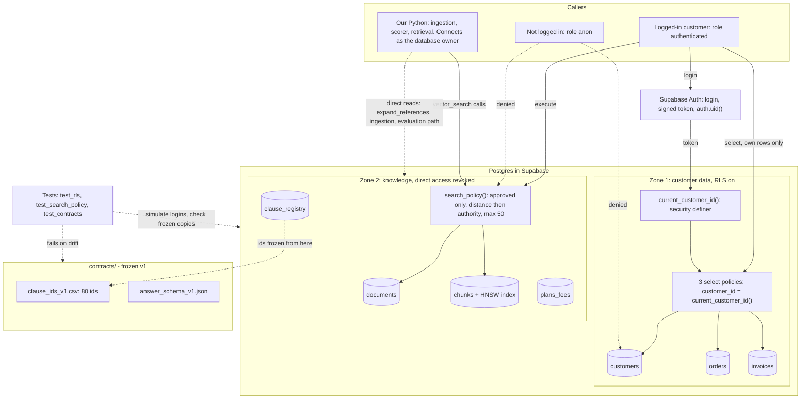
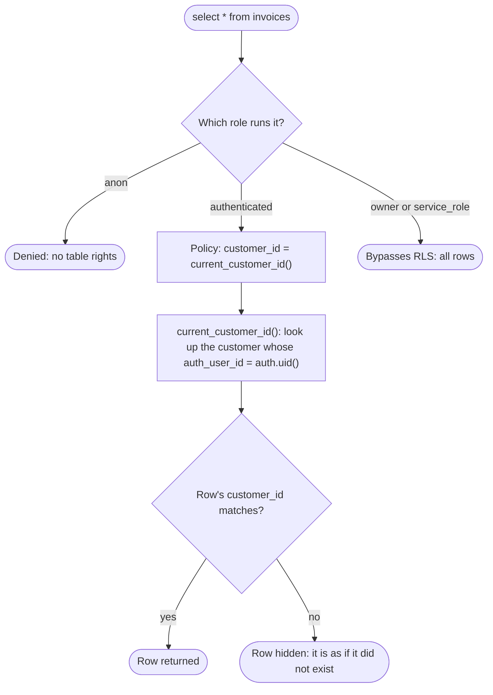
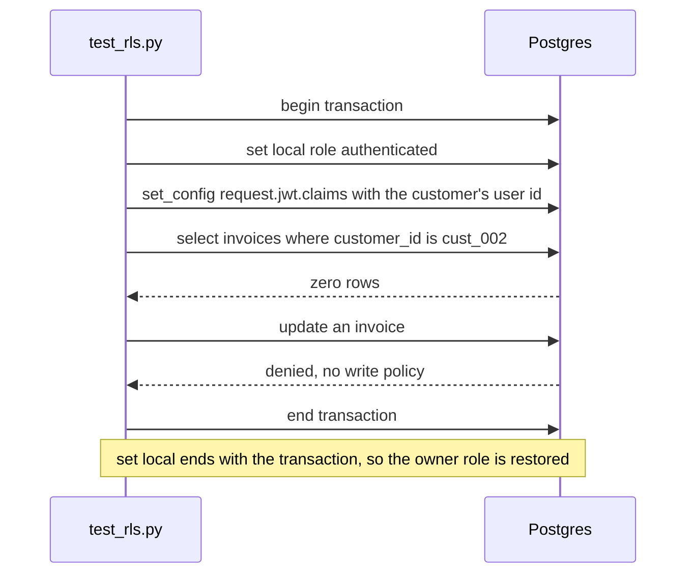
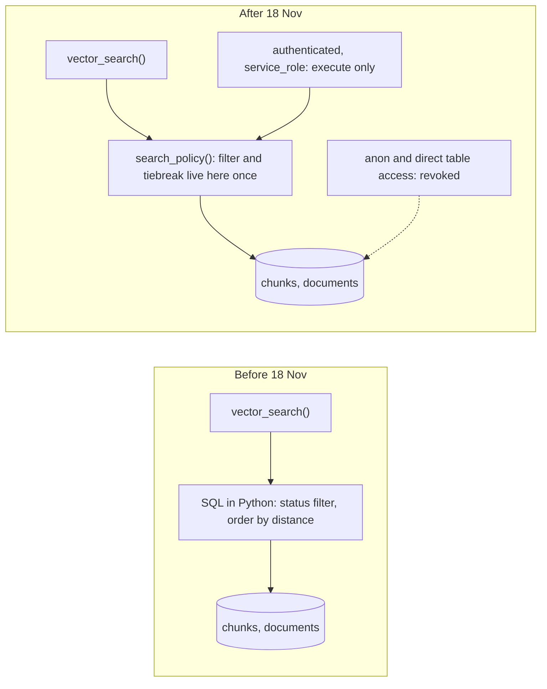
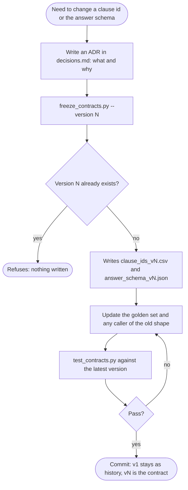
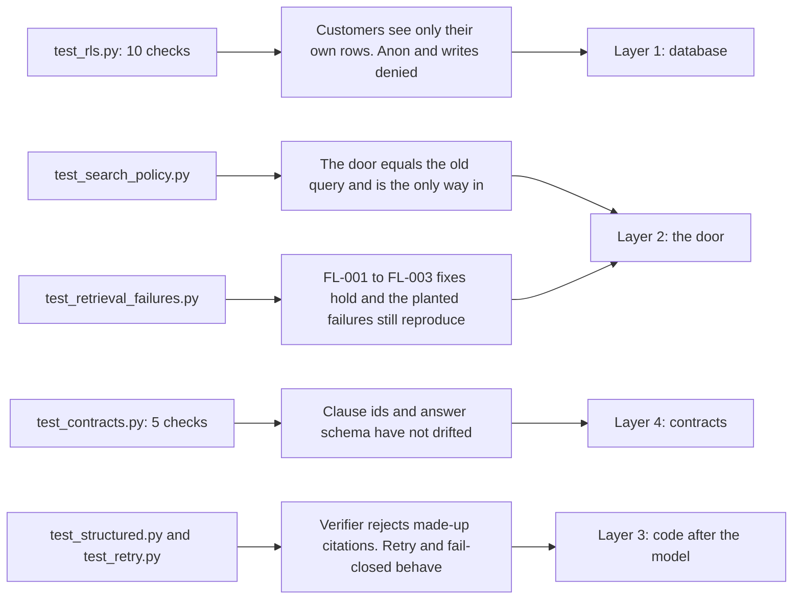

# Day 7 notes (18 Nov): access control, the guarded door, frozen contracts

Nov 20, 2026 · @saurabh

## 1. Concepts learnt

On 18 Nov the project stopped being only a question-answering pipeline and got the controls an agent desk needs before it can be trusted: who is asking, what they may see, and which shapes may never change. Eleven concepts, each in plain words with an example from AOP. The first idea matters most: **access control belongs below the model, in the database, not in the prompt.**

**1.1 Authentication versus authorization.** Authentication answers "who are you?"; authorization answers "what may you do?". Supabase Auth handles the first: a user logs in and gets a signed token. Example: the two test logins `cust001@example.com` and `cust002@example.com` prove identity. They say nothing yet about which rows each may read.

**1.2 Row-level security (RLS).** A rule attached to a table that decides, row by row, who can see or change each row. Example: the `invoices` table holds every customer's invoices, but a customer who runs `select * from invoices` gets back only their own, because the policy hides the rest.

**1.3 Policy and `auth.uid()`.** A policy is a small condition that Postgres adds to every query. `auth.uid()` returns the id of the logged-in user from the signed token. Example: `customer_id = current_customer_id()` means "show me the row only if it belongs to the customer linked to this login".

**1.4 Deny by default.** Start closed, then open only what is needed. Turning RLS on with no policy means nobody sees anything. Example: migration 004 enabled RLS on the new tables with no policies; migration 006 then added three read-only policies. Until then the tables were invisible to the API.

**1.5 The roles, and who bypasses RLS.** Supabase has four to keep apart. `anon` is not logged in. `authenticated` is a logged-in user. `service_role` is a server key that bypasses RLS. The database owner (`postgres`) also bypasses RLS. Example: our Python code connects as the owner, so it is not blocked by the policies. That is why the policies are tested by pretending to be a customer.

**1.6 Security-definer helper function.** A function that runs with its creator's rights, not the caller's. Example: `current_customer_id()` must read the `customers` table, but a customer is not allowed to read it directly. The definer rights let it do that one lookup safely and nothing more.

**1.7 The guarded door.** Instead of letting callers query the knowledge tables, give them one function that does the safe thing every time. Example: `search_policy()` always filters to approved clauses and orders by distance, then authority. It has no parameter to turn the filter off, and direct access to the tables is closed. Anyone who wants policy text must come through that door.

**1.8 Least privilege with grants.** Give each role only what it needs. Example: `anon` has no table rights; `authenticated` gets `select` on three tables and cannot insert, update or delete; only `authenticated` and `service_role` may run `search_policy()`.

**1.9 Testing security by simulating a login.** A security rule is not proven until it is attacked. Example: `test_rls.py` switches to the `authenticated` role inside a transaction (`set local role`) and sets the token claims (`request.jwt.claims`), so Postgres behaves as if cust\_001 were logged in, then tries to read cust\_002's invoice and to change one.

**1.10 A frozen reference test.** When you replace a piece of code, keep a copy of the old behaviour inside the test so you can prove nothing changed. Example: `vector_search` now calls `search_policy()`. If the test compared the two through `vector_search`, it would compare the function with itself. So the old SQL query is copied into `test_search_policy.py` and both are run on all 40 golden questions.

**1.11 Contracts and versioning.** A contract is a shape other parts depend on, so it may change only on purpose. Example: the `(doc_id, clause_id)` pairs and the answer schema are saved as `clause_ids_v1.csv` and `answer_schema_v1.json`. The latest version is the contract, and `test_contracts.py` fails if either drifts. A test that has never failed proves little, so it also breaks a copy of the data to show it can fail.

## 2. Why we need these concepts

A support desk that answers questions about orders and invoices must never show one customer another's data, whatever the question says. A prompt cannot guarantee that; the database can. Each concept below closes one specific way that guarantee could fail.

| Concept | Why it is needed | What goes wrong without it |
| --- | --- | --- |
| Authentication and authorization | The system must know who is asking before it can decide what they see | With no identity, no policy can work; with identity but no rules, every logged-in user sees everything |
| Row-level security and policies | The rule must hold for every query, from every caller, including ones nobody wrote yet | Filtering in application code is one forgotten `where` away from a leak. Q30 (cust\_001 asks for cust\_002's invoice) is the planted case |
| Deny by default | A table added later should be closed until someone decides to open it | A forgotten table is readable. We checked the knowledge tables and found no default rights, but we locked them explicitly anyway, because a default is not a rule |
| Knowing which roles bypass RLS | A test run as the wrong role can pass for the wrong reason | Our Python connects as the owner, which skips the policies, so the policies could look green while untested. Hence the simulated-login tests |
| Security-definer helper | The policy needs one fact (which customer is this login) from a table the customer cannot read | Either the customers table is opened to everyone, or the policy cannot work |
| The guarded door | The status filter and the authority tiebreak must run every time | When the filter lives in each caller, one caller can skip it and unapproved text reaches the model |
| Least privilege | A smaller reach limits the damage when something is wrong | An agent with broad rights can do broad harm. This matters when Phase 3 agents arrive |
| Simulated-login tests | A rule that was never attacked is only an assumption | A policy with a typo passes review and leaks in production. The 10 checks include writes and deletes being denied |
| Frozen reference test | A refactor must be proved not to change behaviour | A test comparing the new code to itself always passes and proves nothing |
| Contracts and a drift test | Other parts (verifier, golden set, MCP server, agents) depend on the ids and the schema | A silent rename breaks every citation of that clause or every consumer of the answer |

The common thread: each control is enforced by something that cannot be talked out of it (the database, a test, a versioned file), not by a request in a prompt.

## 3. How I implemented it in AOP

The work ran in four parts, each pushed as its own commit and each proved by a test before the next began. Migrations are applied with `rag/scripts/apply_sql.py`, run from the `rag` folder where `.env` lives.

| Step | What was built | Files | Commit | Proof |
| --- | --- | --- | --- | --- |
| 1. Shared customer tables | `customers` (plan, billing, currency, status, `auth_user_id` linked to `auth.users`), `orders`, `invoices`, with `customer_id` repeated on every row so one policy shape fits all three. Two synthetic customers: cust\_001 (Pro, monthly, EUR) and cust\_002 (Team, annual, USD). RLS on, no policies | `004_customer_tables.sql` | `783f766` | Row counts after applying |
| 2. Logins linked to customers | Two Supabase Auth users created, linked by email to the two customers | `005_link_auth_users.sql` | `54bdac1` | Link check: both customers have a login |
| 3. Row-level security | `current_customer_id()` (security definer), anon revoked, `select` granted to `authenticated`, three `for select` policies on `customer_id = current_customer_id()` | `006_rls_policies.sql`, `test_rls.py` | `54bdac1` | `test_rls.py`: 10 checks pass |
| 4. The guarded door | `search_policy(query_embedding, match_count)`: approved clauses only, ordered by distance then authority rank, limit capped at 50, security definer; direct access to `documents`, `chunks`, `clause_registry`, `plans_fees` revoked from `anon` and `authenticated` | `007_search_policy.sql`, `test_search_policy.py` | `9878e58` | Same rows as the old query on all 40 golden questions at k=8, plus the door checks |
| 5. Retrieval switched to the door | `vector_search()` calls `search_policy()` when `approved_only`; the unfiltered direct query remains for evaluation only | `retrieval.py` | `e44c35a` | Offline tests pass; scorer subset re-run saved as `after_door_*` |
| 6. Frozen contracts | 80 `(doc_id, clause_id)` pairs and the answer schema saved as version 1; the freeze script refuses to overwrite | `contracts/`, `scripts/freeze_contracts.py`, `test_contracts.py` | `38825de`, `dc468ac` | `test_contracts.py`: 5 checks pass, including two that prove the test can fail |
| 7. Decisions and log | ADR-032 (door and lockdown) and ADR-033 (contracts); 18 Nov build log section closes G1 | `decisions.md`, `phase-2-answering.md` | `d6b51d0`, `116d131` | Gate G1 met on 20 Nov |

What the `test_rls.py` checks cover: each customer sees only their own invoices, orders and customer row; Q30 gets nothing, both by asking for the other customer's invoice and by asking for it by id; a login with no matching customer sees nothing; `anon` is denied outright; a customer cannot change an invoice or delete an order.

What the `test_search_policy.py` checks cover: the function equals a frozen copy of the old query on every golden question; a logged-in customer can call it; it returns only approved clauses even with a huge `match_count`; the count is capped at 50; a customer and `anon` cannot read any of the four knowledge tables directly; `anon` cannot call the function.

What did not change, on purpose: `expand_references` still reads clauses directly as the database owner, and our Python still connects as the owner. Both are recorded as known limits in ADR-032 and handled in Phase 3.

Things that went wrong and what they taught:

- A query run from the repo root failed with `KeyError: 'DATABASE_URL'`, because `.env` lives in `rag/`. Database scripts run from `rag`.
- I had assumed Supabase's API roles had default read rights on the knowledge tables. Checking showed none. The lockdown was kept explicit anyway, since a default is not a rule.
- A test comparing the new function through `vector_search` would have become a comparison with itself after the switch, so the reference query was frozen inside the test.
- The contracts README was first committed as `contracts/contracts_README.md`; GitHub only shows a folder's description when the file is called `README.md`, so it was renamed with `git mv`.

## 4. Architecture of the day

The database now has two zones with different rules: customer data protected by row-level security, and knowledge data closed behind one function. Three kinds of caller reach them differently, and two frozen files sit beside the code as contracts.

Solid lines are the intended paths. Dashed lines are either denials or the owner shortcuts that are known limits, which Phase 3 closes with a restricted agent role.

## 5. The architect's view

The design principle of the day: **the model is outside the trust boundary.** It can be wrong, confused or pushed by a user's wording, so nothing that protects data may depend on what it says. Protection sits in layers that the model cannot reach, and the prompt is the weakest of them.

| Layer | Control | Can the model or the user's wording change it? |
| --- | --- | --- |
| 1. Database | Row-level security on customer tables; knowledge tables closed | No |
| 2. The door | `search_policy()` always filters to approved clauses | No: there is no parameter to turn the filter off |
| 3. Code after the model | Verifier: citation given, approved, in registry; fail closed | No: it is plain code |
| 4. Contracts and tests | Frozen ids and schema; drift test | No: a file and a test |
| 5. Prompt | Strict `refused` rules, cite only the sources given | Yes: it is a request, not a guarantee |

The decisions behind it, with what each one costs:

| Decision | Alternative rejected | What we gave up | Revisit when |
| --- | --- | --- | --- |
| RLS on `customer_id`, repeated on every table (ADR-032) | Filter by customer in application code | One more column to keep consistent | Customer tables need joins that one column cannot express |
| One door function for the knowledge base (ADR-032) | Let callers query the tables and trust them to filter | Callers cannot run ad-hoc queries on those tables | A new access pattern needs a second function |
| Security definer on the two functions | Open the underlying tables to the role | The function itself must be reviewed carefully, because it runs with more rights than the caller | Any change to either function |
| Freeze `(doc_id, clause_id)` only, not `section_ref` or `topic` (ADR-033) | Freeze the whole registry | Labels can change without a version | A label becomes something consumers depend on |
| Versioned files with a drift test (ADR-033) | Convention and review | Any change needs a new version and an ADR | The answer needs a new field, such as attempts or claim coverage |

Known limits, stated plainly. These are the honest part of the design:

- **Owner bypass.** Our Python connects as the database owner, which skips RLS. The guarantee holds for the API roles, not yet for our own code. A bug in our code could read any row. Fix: a restricted database role for agents (Phase 3).
- **Direct reads in `expand_references`.** It reads clauses without the door. It needs a clause-lookup function with the same guarantees.
- **Filter after the index.** The approved filter runs after the HNSW index finds neighbours, so on a very large table a strict filter could return fewer than 8 rows (an ADR-019 cost). At our size it does not bite; it is a scale limit.
- **Provenance, not coverage.** The verifier proves where a citation came from, not that every sentence has one.
- **Select-only policies.** Writes are denied because no write policy exists. Phase 3 actions, such as a refund, will need deliberately designed write paths.
- **Not tested.** Behaviour under heavy load.

What this means for Phase 3. Agents act on behalf of one customer, so every tool they call, including the MCP server, must reach data through the same doors and run under a restricted role that cannot bypass RLS. The next design question is no longer retrieval quality but the agent's authority: what it may read, what it may change, and when it must stop and hand over to a person.

The governance view, for your AI-governance direction:

| A reviewer asks | AOP evidence today | Gap |
| --- | --- | --- |
| Can a user reach data that is not theirs? | RLS plus 10 simulated-login checks; Q30 blocked at the database | Owner bypass in our own code |
| Can unapproved content reach an answer? | Filter inside the door, 40-question equivalence test | `expand_references` reads directly |
| Does the system fail safely? | Verifier, bounded retry, refusal with `verification_failed` | Claim coverage unchecked |
| Can a change be traced and controlled? | ADR-032, ADR-033, frozen v1 files, drift test, commits | None known at this size |
| Is there evidence it works? | Golden set v1.1, immutable baseline, 0 error rows | Q29 and Q30 not scoreable in the scorer; no live monitoring |

## 6. Supporting diagrams

### 6.1 What happens to a query on a customer table

The bypass branch is why every policy test must switch to the `authenticated` role first. Run as the owner, a broken policy would still look correct.

### 6.2 How the test pretends to be a customer

The positive checks matter as much as the negative ones: cust\_001 must still see their own invoices, or the policy is broken in the other direction.

### 6.3 Before and after the door

The retrieval result did not change: the equivalence test compares the function with a frozen copy of the old query on all 40 golden questions at k=8. What changed is where the rule lives and who can skip it. The unfiltered path used by `rag_off` stays, owner-only, for evaluation.

### 6.4 How a contract changes on purpose

What may change without a new version: adding clauses or documents (the test only reports new ids), `section_ref` and `topic` labels, the prompt, the model, retrieval and the retry loop, as long as the schema is the same.

### 6.5 Which test proves which control

None of these tests call the model, so they run in seconds and can run before every commit.
